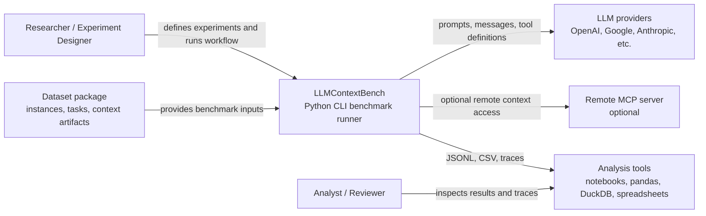

# C4 — System Context

> Transition note: this page describes the existing implementation. The accepted
> [v1 target architecture and contracts](v1-contracts.md) describe the refactor;
> [slice tracking](../../specs/009-llmctxbench-v1/tasks.md) identifies what is implemented.

## Diagram

## Explanation

LLMContextBench is a local/CI-executed research tool that orchestrates benchmark experiments over dataset packages and LLM providers.

It can optionally interact with remote MCP servers when evaluating protocol-based context provisioning.
