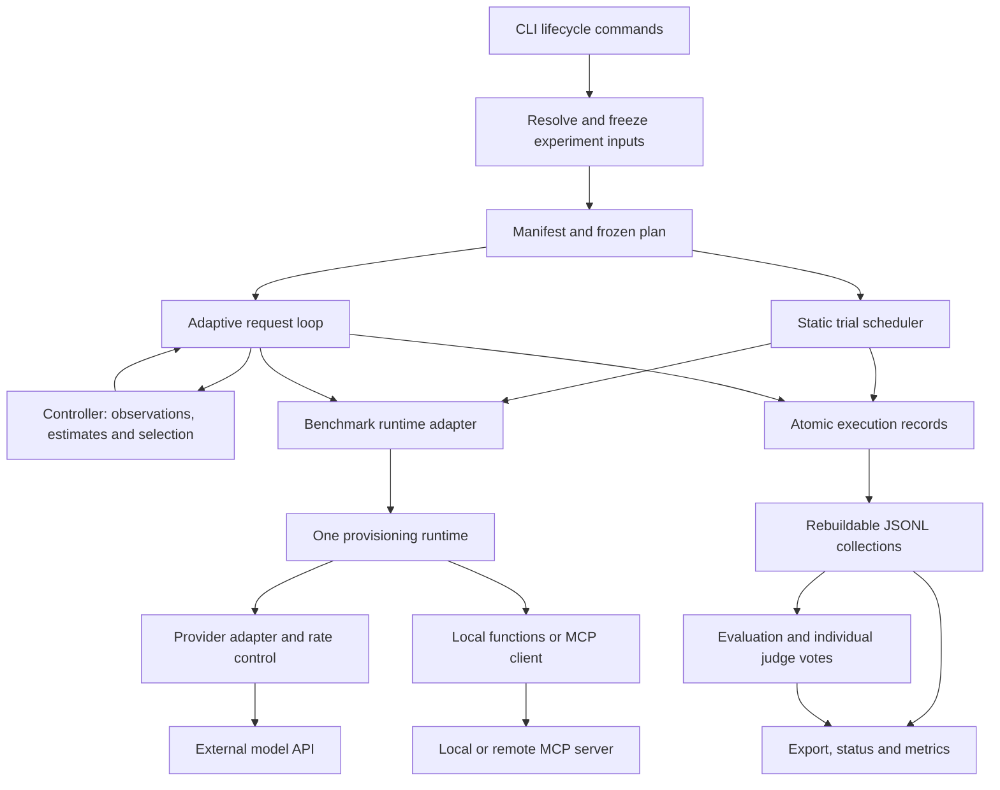

# LLMCtxBench v1 target architecture and contracts

Status: accepted target, not a claim that all changes are implemented. See the
[slice checklist](../../specs/009-llmctxbench-v1/tasks.md) for implementation status.
This document supersedes the journal-based design discussed in the historical review.

## Components and boundaries



`benchmark` owns trial identity and artifact translation. `runtime` accepts operational requests and
capabilities, never benchmark models or a concrete dataset adapter. `ai` owns provider integration
and tool execution. `dataset` defines generic capabilities; concrete adapters supply context, tools,
features and validators. `adaptation` owns request ordering, feedback and candidate selection.
Internal registries suffice; no third-party plugin discovery or mandatory MAPE-K class hierarchy.

Generation settings use `modelParams`; task substitutions use `taskParams`. Runtime limits and MCP
connection settings are execution/provisioning configuration. An adaptation candidate is a model and
configuration pair. Remote MCP execution mode is explicit and remains a reporting stratum.

## Authority and layout

| Artifact | Authority and owner |
|---|---|
| manifest and resolved inputs | Canonical; plan |
| benchmark trials.jsonl | Canonical; plan |
| adaptive trial specifications | Canonical; execute, before dispatch |
| per-trial execution records | Canonical; execute; includes response/error, status, usage and timing |
| per-request adaptive records | Canonical; execute; saved decisions, attempt references, delivery disposition |
| responses.jsonl | Derived collection; execute/rebuild, includes failures |
| adaptive trials.jsonl, observations, decisions, outcomes | Derived collections; execute/rebuild |
| evals.jsonl and judge_votes.jsonl | Canonical; eval |
| execution traces | Diagnostic evidence; optional detail cannot be necessary for recovery |
| exports, metrics and reports | Derived; artifact-only analysis |

Trial execution records must be self-contained enough to rebuild response collections without traces
or a provider. Request completion can be reconstructed from saved attempt results and the frozen
fallback/sensor policy. Do not maintain independently writable duplicate authorities.

Readers and writers migrate together under an explicit new artifact version. Historical artifacts
are rejected with a pointer to the old code tag, not upgraded in place. Current contracts remain
valid for code not yet migrated. Export and status do not fetch or resolve datasets.

## Recovery

One run writer holds a filesystem lock. Canonical records use a temporary file, flush/fsync,
atomic replacement and directory sync. The execution state machine is:

```text
trial persisted → started persisted → external execution → succeeded/failed persisted
                                            │
                                      process interruption
                                            ↓
                          started remains: uncertain outcome
```

Resume skips completed attempts. It stops at uncertain attempts unless --retry-uncertain is given.
An explicit retry creates a new ID and retains the earlier uncertain expenditure. It is separate
from the automatic fallback allowance. Replay saved decisions and observations to restore controller
state. Corrupt canonical records are errors. Rebuild collections without external calls.

No append-only journal, compaction, general event sourcing or per-tool-call recovery checkpointing.
A crash may lose intermediate usage; unknown expenditure is reported honestly. Interrupted time is
not measured provider time. Quota restoration, when implemented, uses saved usage timestamps and
accounts explicitly for downtime.

## Requests and delivery

A rejected request has zero attempts. A delivered request references the first accepted response.
Execution success and answer acceptance are different: an explicitly configured online sensor may
reject a response. Rejected responses are never delivered as a fallback after later failures.
Automatic fallback tries the configured candidate order once each, fresh context, default limit two.
A request otherwise ends failed; all attempts and expenditure remain visible.

An online sensor needing ground truth makes the run privileged and excludes it from default ordinary
comparisons. Controllers cannot receive offline evaluator evidence. Knowledge and evaluation roles
are checked across experiments, including a declared lineage group for related dataset variants.

## Measurement and goals

Measure attempt and request latency directly using monotonic spans. Model/tool spans remain
inclusive diagnostics, not additive terms used to invent an overhead metric. Track known active
execution separately from interruption gaps.

Each metric value uses reported, measured, derived, estimated or unavailable. Completeness and
coverage are separate. Unknown totals are null/unavailable with a known subtotal; they are never zero.
Arithmetic sums of observations are derived. Admission estimates remain distinct from observations.
Account for all attempts, online feature/sensor costs, retries and failures; evaluation cost is separate.

Goals declare upper/lower bounds. Targets report violations. Admission rejects infeasible work
unless best effort is explicit. Time/request windows are explicit; warm-up reports sample count.
Released requests form delivery denominators; evaluations report coverage separately. Pair complete
runs by scenario, seed and repeat and report differences and pairing coverage.

## Deployment and reproducibility

Client MCP means the benchmark owns the tool loop and observes client-side calls. Provider-hosted
MCP is not used by the v1 execution path. OpenAI, Anthropic, and Google integrations expose explicit
provider identifiers and client function-calling capabilities; unknown providers fail instead of
falling back to a mock. `remote_mcp` uses the same client-side tool loop as local MCP and connects to
the configured remote server from the benchmark process. Surface operation allow-lists filter
advertised tools and reject disallowed calls. Provider-reported token semantics remain provider
specific. Cache isolation requires provider evidence.

Frozen inputs plus relevant source/dependency/data digests define the execution fingerprint.
Resume and cross-directory analysis reject mismatches for the same identity. Adaptive runs are
serial with seeded ordering. Simulation initially resamples calibration observations; it is estimated,
requires coverage and is not described as exact counterfactual replay.

Derived datasets are ordinary materialized directories with recipes and lineage. Do not introduce a
content-addressed store. Historical reproduction is delegated to tags and Zenodo; see the
[accepted plan](../development/llmctxbench-v1-refactor-plan.md).

## Implemented increment: definitions (S02)

Version-3 benchmark definitions support taskParams, modelParams, candidate pairs, execution.options
and single-parent extends; schema: `schemas/experiment-v1.schema.json`. Input paths in versioned
files resolve against their declaring file. The shared planner still uses its old internal parameter
names during migration; this is a boundary translation, not a second runtime. Existing unversioned
study definitions remain until their callers migrate in S12. Artifact names/authority below the
planning boundary have not yet changed.

## Implemented increment: frozen planning (S03)

Schema-version-3 plans freeze resolved.json, trials, dataset and implementation/dependency inputs.
The current provisioning artifact version is 4 (execution-record contract 1). Execute verifies the
frozen inputs before model work. Reporting verifies frozen artifacts without resolving datasets.
Identical experiment IDs with conflicting fingerprints cannot be combined. Existing version-2/3
artifact support is transitional until S12; unknown versions are rejected.

## Implemented increment: runtime and dataset boundaries (S04)

All provisioning strategies now enter through one domain-neutral runtime. Local function and
client MCP share the client-side tool loop; dataset packages declare their capabilities, and
evaluation dispatches through validator registrations. Lattes environment configuration lives
with its adapter. The runtime no longer imports benchmark orchestration. This boundary supports the
usage and timing contract implemented in S05 below.

## Implemented increment: usage and timing (S05)

Each model attempt records measured elapsed time and whether it failed. `modelAttemptDurationMs`
is the sum of those direct spans; `totalDurationMs` is measured around the full provisioning request,
including context preparation and waits. Neither is inferred by subtracting model or tool spans.
Token totals include `totalTokensProvenance` and `usageCompleteness`. When all calls and attempts
have known totals, `totalTokens` is available; otherwise it is null and `knownTotalTokens` retains
the known subtotal. Failed calls with no provider usage remain unknown, not zero. Cached and
reasoning tokens remain separate provider-reported details.

## Implemented increment: durable execution (S06)

Version-4 manifests declare `executionRecordVersion: 1`. Each attempt has an atomic canonical record
under `execution-records/`, first in `started` state and then `succeeded` or `failed` with its complete
response result. `responses.jsonl` is rebuilt in plan order from the latest terminal attempt; a latest
`started` record is shown as started and does not produce a response. If the writer exits before a
terminal record is saved, that attempt is uncertain. A completed success or failure is skipped on resume.
`--force` explicitly creates another attempt; `--retry-uncertain` creates a new
attempt while retaining the uncertain record. A writer lock prevents overlapping executions, and
corrupt or fingerprint-mismatched records stop recovery. Eval, status, export and metrics rebuild the
derived response collection without provider or dataset access. Version-2/3 artifacts remain on the
transitional lifecycle path until S12.

## Implemented increment: providers and client-hosted MCP (S07)

Provider resolution accepts the explicit identifiers `openai`/`gpt`, `anthropic`/`claude`,
`google`/`gemini`, `mock`, and `echo`. Unknown names are errors. Providers that do not support
tool-calling cannot run local function, local MCP, or remote MCP strategies. `remote_mcp` now opens
its configured MCP endpoint from the client and runs each tool call through the shared tool loop;
the provider receives declared functions and no endpoint credentials. The execution surface's
operation list limits tools visible and callable by the model. Judge request parameters continue to
be merged with structured-output defaults, with configured values taking precedence.

## Implemented increment: minimal adaptive lifecycle (S08) and request outcomes (S09)

An adaptive v1 definition declares a static, threshold, or cascade policy, an explicit ordered workload, and
optional contiguous phases with per-tool-call delay. Planning writes `adaptive-plan.json`; threshold
planning also freezes `knowledge.json` derived from a separate completed static run with evaluation
disabled. Calibration and adaptive workload task/instance pairs cannot overlap. Calibration estimates
are derived means grouped by candidate and size bin, with their source manifest and response digests.

Execution processes requests serially. Each request record in `adaptive-records/` is canonical for its
decision and references every durable execution attempt; `requests.jsonl` is derived.
Threshold selection prefers the lowest-token calibrated candidate meeting the latency target, then
falls back to the fastest candidate if the target is missed. Successful observations update in-memory
knowledge and are snapshotted in each request record for deterministic resume. Missing eligible or
calibrated candidates produce an explicit rejected request without a trial attempt. The ordinary
response collection contains selected trial attempts, so eval/export/metrics remain on the standard
lifecycle. Phase delay wraps tool calls for local function, local MCP, and remote MCP strategies.

Cascade policies try the configured primary and each fallback at most once, using fresh trial context.
Execution failures and responses rejected by the optional minimum-response-length sensor trigger the
next candidate. The first accepted response is the delivery; an exhausted cascade is a failed request.
Request records retain every attempt, cumulative known and complete token usage, measured request and
sensor durations, and sensor token usage. The built-in sensor is local and deterministic, so its model
token usage is zero. The ordinary response collection contains each candidate's durable trial result;
delivery outcomes remain authoritative in the request records. Adaptive definitions support one
scheduled execution per request (`repeats=1`); operator recovery attempts remain separate from
automatic fallback attempts.

## Implemented increment: adaptive controllers and disturbances (S10)

The v1 lifecycle also supports utility selection using the configured weighted sum of calibrated
latency and token estimates, a rolling failure-window circuit breaker with one configured fallback,
total-token budget admission, and seeded exploration with utility exploitation. Utility, budget,
exploration, and strict quota policies require a separate static calibration run. Unknown observations
remain unavailable: utility selection skips candidates missing a weighted metric; budget admission
rejects unknown prior spend unless `bestEffort` is enabled. Budget decisions count every known attempt,
including failed calls and fallback attempts, and retain the estimate separately from observed usage.

An optional `tokenQuota` enforces a rolling token window using calibrated estimates before dispatch.
Completed request attempt records persist observed usage timestamps, allowing the quota window to be
restored on resume. Unknown usage blocks strict quota admission; `bestEffort` explicitly permits it.
The quota wait and total request duration are recorded separately from provider attempt duration.
Phases can add deterministic tool-call failures using `toolFailureRate` and `failureSeed`, alongside
the existing tool delay. Fault draws use a stable per-request seed/call stream and are provider-free.
