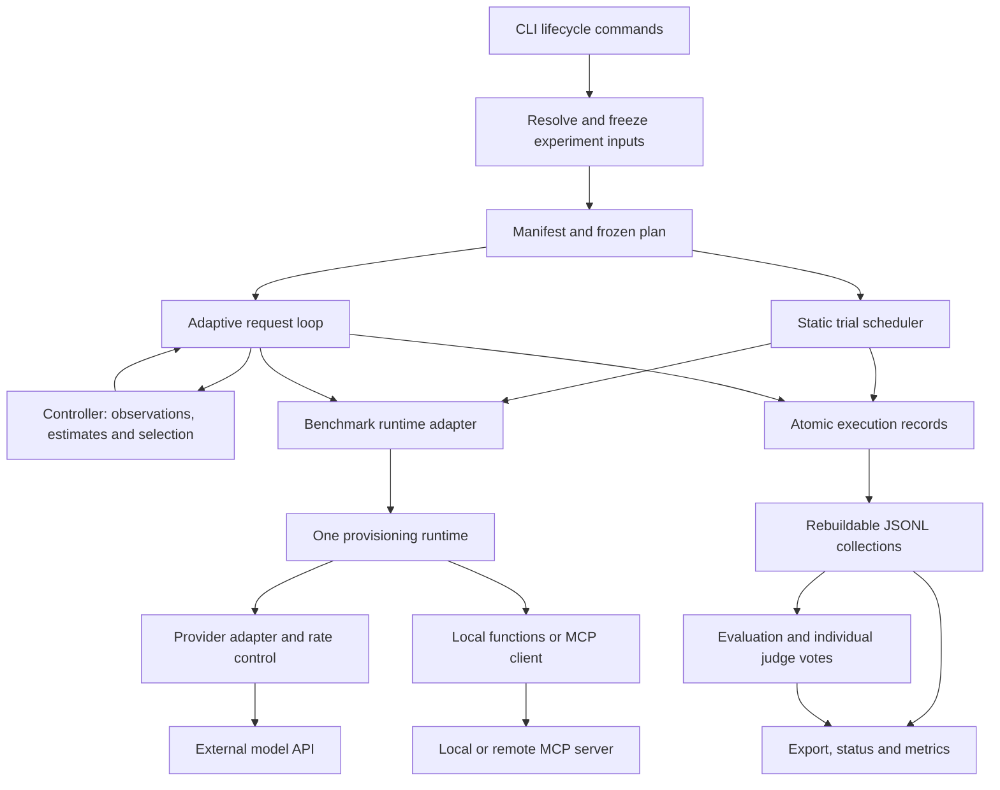

# LLMCtxBench v1 target architecture and contracts

Status: accepted target, not a claim that all changes are implemented. See the
[slice checklist](../../specs/009-llmctxbench-v1/tasks.md) for implementation status.
This document supersedes the journal-based design discussed in the historical review.

## Components and boundaries



`benchmark` owns trial identity and artifact translation. `runtime` accepts operational requests and
capabilities, never benchmark models or a concrete dataset adapter. `ai` owns provider integration
and tool execution. `dataset` defines generic capabilities; concrete adapters supply context, tools,
features and validators. `adaptation` owns request ordering, feedback and candidate selection.
Internal registries suffice; no third-party plugin discovery or mandatory MAPE-K class hierarchy.

Generation settings use `modelParams`; task substitutions use `taskParams`. Runtime limits and MCP
connection settings are execution/provisioning configuration. An adaptation candidate is a model and
configuration pair. Remote MCP execution mode is explicit and remains a reporting stratum.

## Authority and layout

| Artifact | Authority and owner |
|---|---|
| manifest and resolved inputs | Canonical; plan |
| benchmark trials.jsonl | Canonical; plan |
| adaptive trial specifications | Canonical; execute, before dispatch |
| per-trial execution records | Canonical; execute; includes response/error, status, usage and timing |
| per-request adaptive records | Canonical; execute; saved decisions, attempt references, delivery disposition |
| responses.jsonl | Derived collection; execute/rebuild, includes failures |
| adaptive trials.jsonl, observations, decisions, outcomes | Derived collections; execute/rebuild |
| evals.jsonl and judge_votes.jsonl | Canonical; eval |
| execution traces | Diagnostic evidence; optional detail cannot be necessary for recovery |
| exports, metrics and reports | Derived; artifact-only analysis |

Trial execution records must be self-contained enough to rebuild response collections without traces
or a provider. Request completion can be reconstructed from saved attempt results and the frozen
fallback/sensor policy. Do not maintain independently writable duplicate authorities.

Readers and writers migrate together under an explicit new artifact version. Historical artifacts
are rejected with a pointer to the old code tag, not upgraded in place. Current contracts remain
valid for code not yet migrated. Export and status do not fetch or resolve datasets.

## Recovery

One run writer holds a filesystem lock. Canonical records use a temporary file, flush/fsync,
atomic replacement and directory sync. The execution state machine is:

```text
trial persisted → started persisted → external execution → succeeded/failed persisted
                                            │
                                      process interruption
                                            ↓
                          started remains: uncertain outcome
```

Resume skips completed attempts. It stops at uncertain attempts unless --retry-uncertain is given.
An explicit retry creates a new ID and retains the earlier uncertain expenditure. It is separate
from the automatic fallback allowance. Replay saved decisions and observations to restore controller
state. Corrupt canonical records are errors. Rebuild collections without external calls.

No append-only journal, compaction, general event sourcing or per-tool-call recovery checkpointing.
A crash may lose intermediate usage; unknown expenditure is reported honestly. Interrupted time is
not measured provider time. Quota restoration, when implemented, uses saved usage timestamps and
accounts explicitly for downtime.

## Requests and delivery

A rejected request has zero attempts. A delivered request references the first accepted response.
Execution success and answer acceptance are different: an explicitly configured online sensor may
reject a response. Rejected responses are never delivered as a fallback after later failures.
Automatic fallback tries the configured candidate order once each, fresh context, default limit two.
A request otherwise ends failed; all attempts and expenditure remain visible.

An online sensor needing ground truth makes the run privileged and excludes it from default ordinary
comparisons. Controllers cannot receive offline evaluator evidence. Knowledge and evaluation roles
are checked across experiments, including a declared lineage group for related dataset variants.

## Measurement and goals

Measure attempt and request latency directly using monotonic spans. Model/tool spans remain
inclusive diagnostics, not additive terms used to invent an overhead metric. Track known active
execution separately from interruption gaps.

Each metric value uses reported, measured, derived, estimated or unavailable. Completeness and
coverage are separate. Unknown totals are null/unavailable with a known subtotal; they are never zero.
Arithmetic sums of observations are derived. Admission estimates remain distinct from observations.
Account for all attempts, online feature/sensor costs, retries and failures; evaluation cost is separate.

Goals declare upper/lower bounds. Targets report violations. Admission rejects infeasible work
unless best effort is explicit. Time/request windows are explicit; warm-up reports sample count.
Released requests form delivery denominators; evaluations report coverage separately. Pair complete
runs by scenario, seed and repeat and report differences and pairing coverage.

## Deployment and reproducibility

Client MCP means the benchmark owns the tool loop and observes client-side calls. Provider-hosted
MCP keeps native connectors and their observability limits. Provider capability validation rejects
unsupported modes and operation restrictions. Cache isolation requires provider evidence.

Frozen inputs plus relevant source/dependency/data digests define the execution fingerprint.
Resume and cross-directory analysis reject mismatches for the same identity. Adaptive runs are
serial with seeded ordering. Simulation initially resamples calibration observations; it is estimated,
requires coverage and is not described as exact counterfactual replay.

Derived datasets are ordinary materialized directories with recipes and lineage. Do not introduce a
content-addressed store. Historical reproduction is delegated to tags and Zenodo; see the
[accepted plan](../development/llmctxbench-v1-refactor-plan.md).
