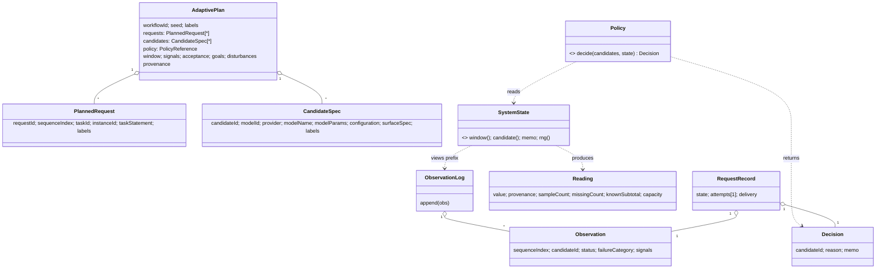

# Adaptive workflow

The adaptive workflow processes an ordered workload of requests. For each request a policy
selects one candidate (a model plus a provisioning configuration) from a fixed catalogue, using
only observations of earlier requests. The workflow then executes that candidate once and
records the outcome as an observation for later decisions. The loop follows MAPE-K: Monitor
(signal extraction), Analyze (delivery check), Plan (the policy), Execute (one attempt),
Knowledge (observation log and policy memo).

Code: `ctxbench/adaptive/` (`workflow.py`, `definition.py`, `plan.py`, `policy.py`,
`policies/`, `state.py`, `signals.py`, `sensors.py`, `goals.py`, `invocation.py`,
`projections.py`, `artifacts.py`, `testing.py`).

## Domain model



The policy has no association with `PlannedRequest`: that absence is request blindness
([ADR 0001](../decisions/0001-request-blind-policies.md)). The full domain vocabulary is in
the [domain model](../domain-model.md).

## Planning

`AdaptiveWorkflow.plan`:

1. parses the definition into `AdaptiveExperiment` (a file and a code-built experiment converge
   on one normalised mapping; [ADR 0005](../decisions/0005-two-entry-paths-one-definition-form.md));
2. resolves the dataset and checks that it serves every candidate's strategy (tool provider
   for `local_function`, MCP server for `local_mcp`, MCP settings for `remote_mcp`); this is a
   catalogue-level check, not a per-request filter;
3. expands the workload (explicit list, or the seeded generator in `ctxbench/workload/`) and
   renders task statements;
4. resolves each candidate once into a `CandidateSpec`; candidates must share one model unless
   `allowMixedModels` is true;
5. resolves the policy reference, instantiates it to validate parameters, checks every candidate
   ID the policy names (`candidate_targets()`) and every `(signal, statistic)` pair it reads
   (`signal_readings()`) with the same rule `state.window()` applies at run time;
6. resolves declared online assessors, validates goals, acceptance and disturbances against the
   catalogue and the workload;
7. writes `resolved.json`, `adaptive-plan.json` and `manifest.json`
   ([plan contract](../contracts/adaptive-plan.md)).

Planning makes no provider call and requires an empty or missing output directory. Invalid
input raises `DefinitionError` naming the offending field.

## The loop

```mermaid
sequenceDiagram
    participant WF as adaptive.workflow
    participant ST as SystemState
    participant PO as Policy
    participant RC as Request record
    participant EX as TrialExecutionService
    participant RT as ProvisioningRuntime
    participant LOG as ObservationLog

    loop for each request in frozen order
        WF->>RC: create record (state=started)
        WF->>ST: build view over the log prefix
        WF->>PO: decide(candidates, state)
        PO-->>WF: Decision
        WF->>WF: validate decision
        WF->>RC: persist decision, readings, memo (before execution)
        WF->>EX: execute(ExecutionRequest)
        EX->>RT: invoke (disturbance interceptors)
        RT-->>EX: result
        EX->>EX: extract signals, run assessors, length check (stored with the attempt)
        EX-->>WF: outcome
        WF->>RC: observation; state=delivered or failed
        WF->>LOG: append observation
    end
    WF->>WF: rebuild responses.jsonl, append lifecycle session
```

- **Execution identity.** `executionId = correlationId = requestId`, `candidateId` = the
  selected candidate, `trialId = null`. `adaptive/invocation.py` builds the execution request
  from `PlannedRequest` and `CandidateSpec` at decision time.
- **One decision and at most one attempt per request**
  ([ADR 0002](../decisions/0002-one-decision-one-attempt.md)). There is no workflow-level retry,
  fallback list or reject action. Provider-level retries configured through a model's
  `rate_limit` parameters stay inside the one attempt and its latency.
- **Delivery.** A request is `delivered` when the attempt succeeds and the response has at
  least `acceptance.minimumResponseLength` characters (default `0`); otherwise it is `failed`
  with `terminalReason` `attempt_failed` or `response_too_short`. Goals are not enforced.
- **Request duration.** `requestDurationMs` is measured with a monotonic clock from before the
  decision to the terminal state; it includes decision time, execution and assessors.

## Signals

A signal value is `SignalValue(value, provenance, unit)`; `value` is `None` exactly when the
provenance is `unavailable`. `adaptive/signals.py::extract_signals` reads the attempt result:

| Signal | Unit | Source | Provenance |
|---|---|---|---|
| `latency_ms` | ms | `timing.durationMs`, else `metricsSummary.totalDurationMs` | `measured` |
| `total_tokens` | tokens | `metricsSummary.totalTokens` | as recorded; `unavailable` when incomplete, with the known partial total in `knownSubtotals` |
| `input_tokens`, `output_tokens` | tokens | `usage.inputTokens`, `usage.outputTokens` | `reported` (or `estimated` when the total is estimated) |
| `cached_input_tokens`, `reasoning_tokens` | tokens | `metricsSummary` | `reported`, `unavailable` when not reported (never zero) |
| `model_calls`, `tool_calls` | count | `metricsSummary` | `measured` |
| `failed` | bool | `status != "success"` | `derived` |
| `accepted` | bool | success and minimum length | `derived` |
| `failed.<category>` | bool | the observation's `failureCategory`; computed when read, never stored | `derived` |
| `quality.<metric>` | assessor scale | a declared online assessor | the assessor's declared provenance |

A failed attempt keeps what was observed: duration is measured, and token usage is recorded if
the provider reported it and `unavailable` otherwise.

**Failure categories** (`FAILURE_CATEGORIES`): `context_overflow`, `rate_limited`,
`provider_error`, `tool_error`, `step_limit`, `empty_response`, `capability_unavailable`,
`unknown`. The layer that knows the cause assigns the category and writes it to the trace error
metadata: each model adapter recognises its provider's context-length errors
(`context_overflow_markers`; the OpenAI, Claude and Gemini adapters are tested against synthetic
errors only), a tool runtime error is `tool_error`, an untagged exception is `unknown`. In
provider error classification an HTTP 429 is authoritative, a recognised context overflow is
never retried, and only then is the message searched for rate-limit wording. The category is
never inferred from error text by the adaptive workflow.

## Online assessors (quality signals)

Declared as `"signals": [{"id": "quality.<metric>", "assessor": "<ref>", "sources": [...]}]`.
The reference names a `SignalCapability.signal_id` of the dataset (resolved through
`DatasetPackage.online_assessor`) or an external `module:Class`.

- The assessor receives `AssessmentInput(request_id, task_id, instance_id, candidate_id,
  response)` and runs inside the attempt, so its result is stored atomically with the
  execution and resume never assesses twice. The assessor sees the request; the policy sees
  only the resulting value.
- Only successful attempts are assessed. For a failed attempt the quality value is
  `unavailable` and the cost record is a known zero with `skipped: "attempt_not_successful"`.
- An exception or invalid observation yields an unavailable value with measured duration.
- Assessor usage and duration are recorded per attempt under `assessorCost` and reported in
  separate metric columns; they are neither generation nor evaluation usage. The attempt's
  `durationMs` includes assessment; `latency_ms` does not.
- An assessor that uses reference data makes the run `privileged`.
- Assessor source digests and declared capabilities are frozen in the plan and checked at
  `execute`.

## Observation log, windows and readings

`ObservationLog` (`adaptive/state.py`) is an in-memory, append-only list of observations of
terminal requests, in sequence order. It is never persisted on its own; it is rebuilt from
request records.

| Window | Selection for a decision |
|---|---|
| `{"requests": N}` (sliding) | Observations of the last `N` terminal requests before the current one. |
| `{"requests": N, "mode": "fixed"}` | Observations of earlier requests in the current block; request at 1-based position `i` belongs to block `ceil(i / N)`. Empty at the first request of a block. |
| `{"all": true}` | Every earlier observation. |

Windows are counted in requests. For goals, the selection includes the request being
evaluated. Scope `system` selects all observations; `candidate:<id>` only that candidate's.
A candidate not selected inside the window has an empty selection, so its knowledge expires.

A `Reading` is one signal aggregated over one window and scope with one statistic:

| Statistic | Rule |
|---|---|
| `sum` | Sum of values. With any missing value: unavailable, `knownSubtotal` = sum of available values. Over an empty selection: `0`, `derived`. |
| `mean`, `median`, `min`, `max`, `last` | Over available values; `missingCount` reported. |
| `p<q>` | Linear-interpolation percentile (`metrics/aggregate.py::percentile`), `0 < q < 100`; unavailable with fewer than two values. |
| `rate` | Mean of a 0/1 signal (a built-in bool or a declared binary-scale signal). |
| `count` | Observations in the window; always available. |

An empty selection is unavailable for every statistic except `sum` and `count`. A computed
value is `estimated` if any input is estimated, otherwise `derived`. With a `capacity`,
`remaining = capacity - value` (not clamped; negative is an overshoot) and
`utilisation = value / capacity`.

## System state

`SystemState` is the read-only view a policy receives:

```python
class SystemState(Protocol):
    decision_index: int           # 1-based
    completed_requests: int       # terminal requests so far
    default_window: WindowSpec
    def window(self, signal, statistic, *, scope="system", window=None, capacity=None) -> Reading
    def candidate(self, candidate_id) -> CandidateState   # observation_count, selections, last_status
    memo: Mapping | None          # the memo returned with the previous decision
    def rng(self) -> random.Random
```

- **Blindness.** No member exposes a request ID, task, instance, label, context size or dataset
  value. A test walks every reachable attribute to enforce it.
- **Causality.** For the request with `sequenceIndex = n` the state holds exactly the
  observations of requests with sequence `< n` and the previous memo. Offline evaluation, goal
  statuses and later records are unreachable.
- **Unknown signals.** `window()` raises `PolicyContractError` for a signal that is neither built
  in nor declared, including `failed.<category>` with an unknown category, and for `rate` on a
  non-binary signal.
- **Audit.** Every `window()` call is stored in the decision's `readings`.
- **Determinism.** `rng()` is `random.Random(int(sha256(f"{seed}:{decisionId}")[:16], 16))`.
  Policies must not use other randomness, the clock, files, network or global state.
- **Memory.** A policy that needs memory returns a JSON `memo` with its decision; it comes back
  as `state.memo`. After a resume a new policy instance is created, so instance attributes must
  not carry state between decisions.

## Policy contract

```python
class Policy(Protocol):
    id: ClassVar[str]
    version: ClassVar[str]
    def __init__(self, **params) -> None: ...
    def decide(self, candidates: Sequence[CandidateRef], state: SystemState) -> Decision: ...
    # optional, for checks at plan time:
    def candidate_targets(self) -> tuple[str, ...]: ...
    def signal_readings(self) -> tuple[tuple[str, str], ...]: ...

CandidateRef(candidate_id, labels)        # the full catalogue in declared order
Decision(candidate_id, reason, memo=None)
```

The workflow validates each decision: a catalogue candidate, a non-empty reason, and a
JSON-serialisable memo of at most 16 KiB. A violation or an exception in `decide` raises
`PolicyContractError` and stops the run; nothing is recorded for that decision.

| Built-in | Parameters | Rule |
|---|---|---|
| `static` | `candidate` | Always that candidate. |
| `random` | `candidates` (optional subset) | Uniform choice with `state.rng()`. |
| `round_robin` | `candidates` (optional order) | Next in order; position kept in the memo. |
| `window_threshold` | `signal`, `statistic`, `tiers`, `otherwise`, `when_unavailable`, `scope`, `window`, `capacity`, `min_samples` | Measure = `utilisation` with a capacity, else `value`. Select the first tier whose `upTo` ≥ measure, else `otherwise`. An unavailable reading, or fewer than `min_samples` values (not applied to `sum` and `count`), selects `when_unavailable`. |
| `min_signal` | `signal`, `statistic`, `window`, `objective` (`min`/`max`), `min_samples` | First, any candidate with fewer than `min_samples` observations in the window (declared order). Otherwise the best available per-candidate reading, ties by declared order; unavailable readings rank last; all unavailable → fewest observations. |

## Plug-in resolution and fingerprint

A policy is referenced as `{"ref": ..., "params": {...}, "sources": [...]}`: a name without a
colon is a built-in, `package.module:ClassName` is an external class. `plan` records `id`,
`version` and `sourceDigest` over the class's source file and the files in `sources`, for
built-in and external policies alike. Online assessors use the same scheme. `execute`
re-resolves every plug-in and refuses a changed digest
([ADR 0003](../decisions/0003-plugins-by-reference-with-fingerprinted-source.md)). Modules must
be importable at `execute`; `--plugin-path` (API: `plugin_paths`) adds directories to the import
path for one call.

The execution fingerprint is the hash of `adaptive-plan.json`
([ADR 0004](../decisions/0004-plan-as-fingerprint.md)).

## Disturbances

Declared per experiment: `name`, `version`, `component` (`local_function`, `local_mcp`,
`remote_mcp`, `model`), `kind` (`delay`, `failure`, `delay_and_failure`), `delayMs`,
`failureRate`, `firstSequence`, `lastSequence`, `seed`, `candidates`.

- Effects are per call of the component: `delayMs` is added to each call, and each call fails
  with probability `failureRate`. The draw is a hash of the disturbance name, seed, sequence
  index, call index and operation, so equal definitions inject identical effects.
- `plan` refuses duplicate names, unknown candidates, a tool component that the named
  candidates do not use, and a `firstSequence` after the last request.
- Several disturbances on one component stack in declared order, the first innermost. The
  `model` component wraps the model adapter outside provider rate control, so an injected model
  failure is never retried.
- An injected failure gets the category of a real failure of its component (`tool_error` or
  `provider_error`), so no signal reveals it. Each attempt records
  `{name, version, appliedDelayMs (derived), injectedFailures (measured)}`; the injected delay
  is inside measured latency and reported separately.

## Goals

A goal is a bound (`upper` or `lower`) on a reading: `id`, `signal`, `statistic`, `scope`,
`window`. Goals are frozen in the plan but not evaluated by the loop. `metrics` rebuilds the
observation log from the request records and calls `adaptive/goals.py::evaluate` for each
terminal request, writing `adaptive_goal_metrics.csv` with status `met`, `violated` or
`unknown`. A policy that wants to act on a bound reads the same reading through `state.window()`.

## Resume and replay

`execute` on an existing run:

1. validates the manifest and the fingerprint, the dataset digest and plug-in sources;
2. for each request in order, loads its record and validates it against the plan and the
   execution records;
3. for a terminal request, appends its observation to the log and restores the memo — no
   policy call;
4. for a started request with a persisted decision, hands the execution to
   `TrialExecutionService`, which replays a completed attempt or refuses an uncertain one
   without `--retry-uncertain`; if the execution completed but the record has no observation
   yet, the observation is taken from the execution's `_adaptiveSignals`;
5. for a started request without a decision, asks the policy.

Recorded decisions are never recomputed. One writer at a time is guarded by `.adaptive.lock`.

`ctxbench.adaptive.testing.verify_replay(root)` rebuilds the state for every recorded decision,
calls the policy and returns the decisions that differ. It makes no provider call and writes
nothing; it is a test helper, not an API or CLI operation.
