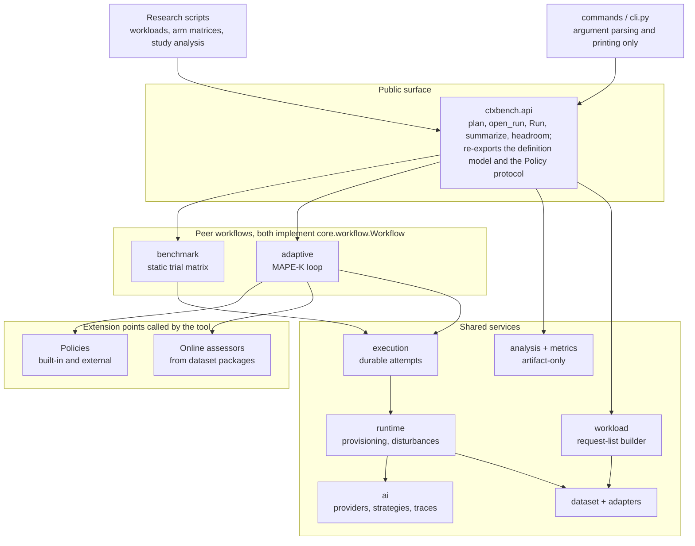
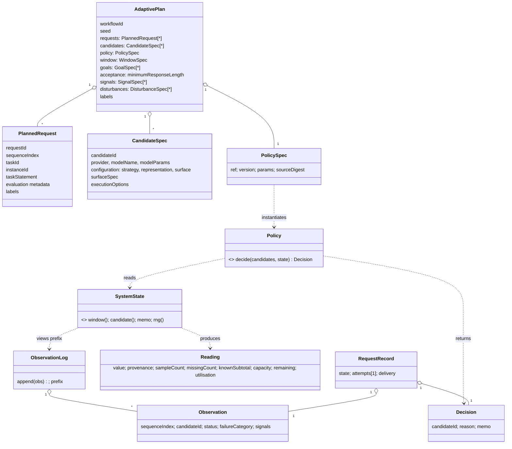
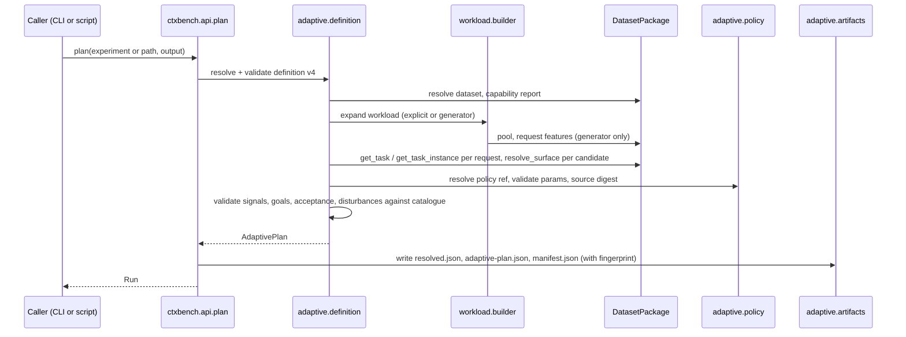
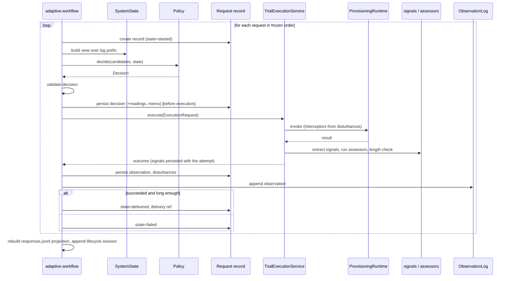
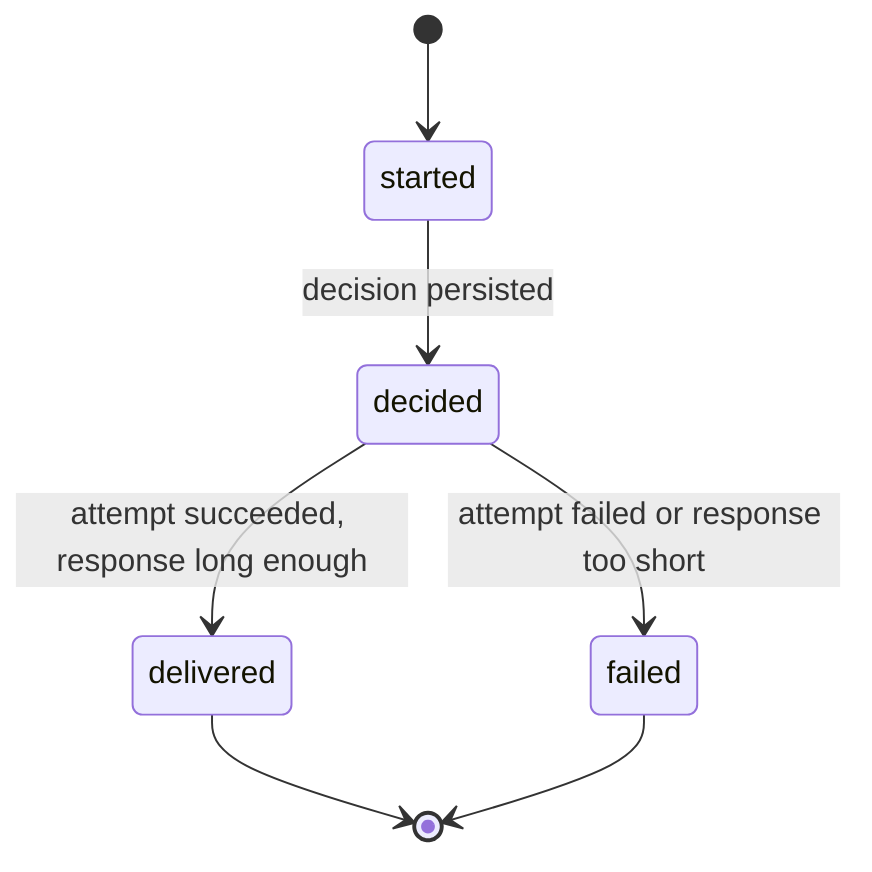
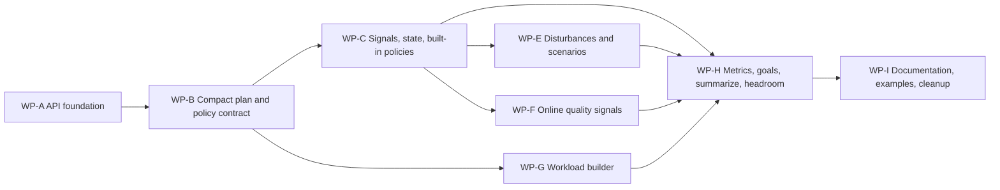

# Self-adaptive provisioning and framework API — design

**Status:** implementation design. WP-A, WP-B, WP-C and WP-E have implementation commits; see
[`wp-e-acceptance.md`](wp-e-acceptance.md). Each work package
in [section 11](#11-work-packages) needs its own approval before implementation starts.

**Audience:** an agent or team implementing the refactor without access to the design discussion.

**Relation to other documents:**

- [`architecture-assessment-and-plan.md`](architecture-assessment-and-plan.md) (the *plan*) is the
  baseline. Its WP0–WP8 are done and remain valid. This document replaces the post-WP8 packages
  WP9–WP15 with the packages in section 11 and states every divergence in
  [section 12](#12-divergences-from-the-plan).
- [`usecases.md`](usecases.md) stays the use-case reference.
- `docs/architecture/adaptive-plan-v3.md` and `workflow-contracts.md` describe the *current*
  artifacts; they are rewritten in the last work package.

All file paths are relative to the repository root. "Today" means the tree at commit `3e0f797`,
the baseline **before WP-A**. Section 4 and the "today" remarks elsewhere describe that baseline;
changes that WP-A and WP-B already made (policy contract, compact plan, one execution per
request, removal of the estimator and of the fallback loop) are in the tree and are not repeated
as pending work. Each work package in section 11 states what it adds to the tree as it stands
when the package starts.

---

## 1. Purpose

Evolve LLMContextBench so that a researcher can test whether self-adaptive context provisioning is
worth studying:

1. Define a **workload**: an ordered list of requests.
2. Let the tool choose, for each request, which **provisioning configuration** to use.
3. Base that choice on a **policy** and on the **current system state** only.
4. Compare policies under identical conditions.

The tool must be usable in two ways over one implementation:

- as a **CLI** (`llmctxbench plan | execute | eval | export | metrics | status`), unchanged;
- as a **framework**: an in-process Python API that research scripts call, plus extension points
  the tool calls back.

---

## 2. Requirements

Each requirement has an identifier that the work packages and tests refer to.

### 2.1 Functional

| ID | Requirement |
|---|---|
| R1 | A workload is a finite, ordered list of requests. A request is one occurrence of a dataset task for a dataset instance, identified by a unique `requestId`. The same task/instance pair may occur many times. |
| R2 | For each request the tool selects one candidate (a model plus a provisioning configuration) at run time through a policy. |
| R3 | **Request-blind policies.** A policy receives the candidate catalogue and the system state. It receives nothing about the request: no task, instance, context size, feature, label or identifier. |
| R4 | **Strict blindness.** The tool never filters or ranks candidates using information about the request. An infeasible choice (for example, context larger than the model limit) is executed, fails, and the failure becomes a signal in the system state. This does not restrict decisions based on system state: a policy may prefer or avoid a candidate because of what the state shows (for example, few tokens left in the current window). |
| R5 | The system state exposes windowed aggregates of **signals**: token usage, latency, failures, and any quality signal, system-wide and per candidate. |
| R6 | Policies are interchangeable. Built in: always the same candidate, seeded random, tiers on a windowed signal (optionally against a capacity), lowest windowed signal per candidate. External policies use the same contract. |
| R7 | A **scenario** is a workload plus zero or more seeded **disturbances** (delay or failure injected into a runtime component for a range of the sequence). |
| R8 | **One decision, one attempt.** Each request gets one policy decision, which always selects a candidate. The candidate is executed once; if the attempt fails, the request fails. A policy cannot reject a request: when the system cannot handle a request, the attempt itself reports it. The workflow never retries a request and has no fallback list (both deferred, section 13). Provider-level retries, when an experiment configures them through `rate_limit`, happen inside that one attempt and are off by default (section 6.2). |
| R9 | **Goals** (bounds on windowed signals) are reported as met, violated or unknown. They are computed by `metrics` from the request records after execution. They are not evaluated in the loop and not enforced by the tool. |
| R10 | Runs are comparable: for equal workload and seed, every policy sees the identical frozen request order. A run-summary table gives one row per run with its labels, workload digest and delivered and failed counts, so that scripts can pair runs. |
| R11 | A **headroom** analysis over a benchmark matrix compares the best single candidate with the per-request oracle for any signal. |

### 2.2 Framework and API

| ID | Requirement |
|---|---|
| R12 | Every lifecycle step is callable in-process and returns typed results. No API function prints or exits the process. |
| R13 | Adaptive experiments can be built as Python objects. These objects are the parsed form of the definition: the same classes the tool obtains when it loads a definition file. There is one definition model per workflow and no parallel set of API-only classes. |
| R14 | `plan(...)` returns a **run handle** bound to an output directory. `open_run(path)` returns an equivalent handle. Scripts never build artifact paths or parse artifact files. |
| R15 | **The tool owns the loop.** The workflow iterates requests, calls the policy, executes, observes and records. A script never selects a candidate or invokes one request. |
| R16 | Plug-ins (policies, online assessors) are referenced **by name and parameters** in the definition. No live Python object is part of an experiment. Plug-in source is fingerprinted. |
| R17 | Research scripts (workload shapes, policy/seed matrices, study-specific analysis) live outside the tool core. |
| R24 | **One workflow contract.** Benchmark and adaptive implement the same `Workflow` interface (load, plan, execute, status, responses, metric tables) and are selected through a registry. Commands and the API contain no per-kind branching. The interface carries no shared behaviour; shared behaviour stays in services. |

### 2.3 Cross-cutting (inherited from the plan and `CLAUDE.md`)

| ID | Requirement |
|---|---|
| R18 | **Generic.** No dataset, study or domain concept in generic code. No built-in feature, task or metric names beyond signals every execution yields. |
| R19 | **Durable and resumable.** Decision persisted before execution; terminal outcome persisted before the next decision; resume never re-decides a completed attempt. |
| R20 | **Prefix-causal.** A decision uses only observations committed before it. |
| R21 | **Provenance.** Every value is `reported`, `measured`, `derived`, `estimated` or `unavailable`. Unavailable is never zero. |
| R22 | **Phase separation.** Generation usage, online-assessor usage and offline evaluation (judge) usage are recorded separately. Offline evaluation never feeds the loop. |
| R23 | Files remain the single durable record. The API hides them; it does not replace them. |

### 2.4 Non-goals

- Concurrent or time-scheduled workloads (plan WP13).
- Online learning, bandit or model-based controllers as built-ins (they can be external policies).
- Offline policy simulation over recorded matrices (see [section 13](#13-deferred-work)).
- A stable, broad public API. Only `ctxbench.api` is public; everything else is internal.
- A storage abstraction or in-memory artifact backend.
- Any compatibility reader for adaptive plan v3 or earlier artifacts.

---

## 3. Vocabulary

Terms from the plan's "Normative terminology" keep their meaning. Additions and refinements:

| Term | Definition |
|---|---|
| **Request** | One workload item before a candidate is chosen: `requestId`, sequence index, task, instance, opaque labels. |
| **Candidate** | A model plus a provisioning configuration, with a stable `candidateId`. One catalogue per experiment, identical for every request. |
| **Attempt** | One durable execution of one candidate for one request. A request has exactly one attempt. |
| **Signal** | A named quantity observed per attempt, with unit and provenance. Built-in signals come from every execution; quality signals come from online assessors. |
| **Observation** | The set of signal values, status and failure category of one attempt. |
| **Window** | A selection of observations counted in requests: the last `N` requests (sliding), the current block of `N` requests (fixed), or the whole run. |
| **Reading** | The result of aggregating one signal over one window and scope with one statistic. Carries value, provenance and sample counts. |
| **System state** | Read-only view over the causal prefix of observations and decisions. The only input to a policy besides the catalogue. |
| **Policy** | A named, versioned decision rule: `(candidates, state) → decision`. |
| **Decision** | The selection of one candidate for one request. Always carries a reason. |
| **Goal** | A bound (upper or lower) on a reading. Reported by `metrics`, not enforced. |
| **Disturbance** | A seeded delay or failure injected into a runtime component for a range of the sequence. |
| **Scenario** | A workload plus disturbances. |
| **Run** | One planned experiment in one output directory. In the API this is the handle returned by `plan`. The plan's rule against using "run" for trial, attempt or request still holds. |
| **Arm** | Study vocabulary only: one experimental condition (a policy with parameters, possibly other settings). Not a tool concept; the tool only stores `labels`. |

Words the tool must not introduce: study, episode, probe, cascade, size bin, burst.

---

## 4. Current state relevant to this design

This table is the pre-WP-A baseline (commit `3e0f797`). The rows on the adaptive definition,
selection, request knowledge, knowledge, retry, fingerprint, programmatic use and version
constants were resolved by WP-A and WP-B.

| Area | Today | Consequence |
|---|---|---|
| Execution core | `ProvisioningRuntime` (`runtime/runtime.py`), `TrialExecutionService` (`execution/service.py`), `Engine` and strategies (`ai/`). | Reused unchanged except for disturbance and error-kind hooks. |
| Adaptive definition | Hand-expanded: each request embeds, per candidate, a full `ExecutionRequest` with `runtimeRequest` and `resultMetadata` payloads (`examples/adaptive/minimal.json`). | Replaced by a compact definition (R13). |
| Selection | Hard-coded in `adaptive/workflow.py::_plan_next_candidate`: `selection_metric` ∈ `declared_order`, `latency`, `tokens`, plus whole-run token-budget admission. | Replaced by the policy contract (R2, R6). |
| Request knowledge in the loop | `RequestFeatures`, `featureSchema`, `FeaturePartitionKey`, per-request candidate map, `ContextFit` / `Candidate.eligible` filtering. | Removed from the decision path (R3, R4). |
| Knowledge | `RollingWindowEstimator`: rolling mean of latency and total tokens per candidate and feature partition. | Replaced by a generic observation log and windowed readings (R5). |
| Retry | `candidateOrder` is both preference and fallback list; any unmet SLO triggers the next candidate until the catalogue is exhausted. | Removed: one attempt per request (R8); SLOs become reported goals (R9). |
| Disturbances | `runtime/disturbances.py` defines `DisturbanceSpec` and `ToolRuntimeDisturbance`; `ProvisioningRuntime` accepts interceptors; no command wires them. | Wired through the definition (R7). |
| Online quality | `OnlineQualityAssessor`, `QualityObservation`, `SignalCapability` exist; `commands/execute.py` passes no assessor. | Wired through dataset capabilities (R5). |
| Fingerprint | Benchmark plans compute and verify `executionFingerprint` (`benchmark/fingerprint.py`). Adaptive plans take the fingerprint from the definition and `execute` does not verify implementation or dataset. | Adaptive plans compute and verify it, including plug-in sources (R16, R19). |
| Programmatic use | `commands/*.py` expose keyword-argument functions that print and return exit codes. `run_adaptive_workflow` accepts injected `estimator`, `quality_assessor`, `invoke`. | A public `ctxbench.api` with typed results (R12–R14). |
| Version constants | `ADAPTIVE_PLAN_VERSION = 3`, `ADAPTIVE_RECORD_VERSION = 2`, `ADAPTIVE_ARTIFACT_VERSION = 2`, adaptive manifest `schemaVersion = 2`, `RESPONSE_SCHEMA_VERSION = 2`. | Bumped once (section 8.6). |

---

## 5. Structural view

### 5.1 Layers



Inversion of control (R15): arrows into `Ext` originate in the adaptive workflow only. Scripts
supply plug-in *references*; they are never on the call path of a request.

### 5.2 Target package layout

Only the changed or new parts are listed. Nothing else moves.

```text
src/ctxbench/
├── api/                          NEW  public surface (the only import scripts may use)
│   ├── __init__.py               re-exports everything public, including the adaptive definition
│   │                             model (api defines no experiment classes of its own)
│   ├── run.py                    plan(), open_run(), Run; dispatch through the workflow registry
│   ├── workflows.py              builds the registry from benchmark.workflow and
│   │                             adaptive.workflow
│   └── errors.py                 CtxbenchError hierarchy
├── core/workflow.py              NEW  Workflow protocol, WorkflowRegistry, result and option
│                                      types (section 5.4)
├── phases/                       NEW  evaluation.py, export.py: shared phases moved out of
│                                      commands/
├── util/status_tables.py         NEW  response, evaluation and judge tallies for status reports
├── core/definitions.py           NEW  `extends` resolver (moved), shared definition parts:
│                                      Model, Configuration
├── benchmark/workflow.py         CHANGED  adds BenchmarkWorkflow (the Workflow implementation)
│                                      next to the existing execute_benchmark_trials
├── workload/                     NEW  generic request-list construction
│   └── builder.py                Workload, Segment, RequestSpec
├── adaptive/
│   ├── definition.py             NEW  definition model (AdaptiveExperiment, WorkloadRequest;
│   │                                  sections are schema-validated mappings), schema v4,
│   │                                  parse/serialise, validation, expansion to a plan
│   ├── plan.py                   NEW  AdaptivePlan v4, CandidateSpec, PlannedRequest (frozen model)
│   ├── artifacts.py              CHANGED  plan/manifest/record I/O, fingerprint
│   ├── policy.py                 NEW  Policy protocol, Decision, registry, external loader
│   ├── policies/                 NEW  static.py, random.py, round_robin.py,
│   │                                  window_threshold.py, min_signal.py
│   ├── signals.py                NEW  SignalValue, built-in signal extraction, failure categories
│   ├── state.py                  NEW  ObservationLog, SystemState, Reading, statistics
│   ├── goals.py                  NEW  pure goal evaluation over an observation log; called by
│   │                                  metrics, not by the loop
│   ├── sensors.py                CHANGED  online assessor contract and resolution; keeps the
│   │                                  minimum-response-length check
│   ├── invocation.py             RENAMED from runtime_adapter.py; builds the runtime request
│   │                                  at decision time
│   ├── workflow.py               CHANGED  AdaptiveWorkflow (the Workflow implementation) and
│   │                                  the per-request loop; plan classes move to plan.py
│   ├── projections.py            CHANGED  record v3
│   ├── estimator.py              REMOVED  (replaced by state.py)
│   ├── calibration_contract.py   REMOVED  (deferred, section 13)
│   └── types.py                  REMOVED  (Provenance moves to core/provenance.py)
├── core/provenance.py            NEW  Provenance enum shared by adaptive, metrics, analysis
├── runtime/disturbances.py       CHANGED  adds the model component; reports applied effects
├── ai/engine.py                  CHANGED  optional model interceptor
├── ai/rate_control.py            CHANGED  normalised error kinds
├── analysis/                     NEW  artifact-only analyses
│   ├── summarize.py              one summary row per run, for scripts to pair and compare
│   └── headroom.py               best-static versus oracle over a benchmark matrix
├── metrics/adaptive.py           CHANGED  record v3, signals, goals, failure categories
└── commands/*.py                 CHANGED  thin wrappers over ctxbench.api
```

### 5.3 Dependency rules

These extend the plan's "Allowed dependency direction" table. Enforce them in
`tests/test_import_boundaries.py`.

| Package | May import | Must not import |
|---|---|---|
| `ctxbench.api` | workflows, services, analysis | `commands`, `cli` |
| `core.workflow`, `core.definitions` | `util`, other `core` modules | workflows, `api`, services |
| `commands`, `cli` | `ctxbench.api`, `util.logging` | workflow internals, `adaptive.*`, `benchmark.*` (except through `api`) |
| `adaptive` | `execution`, `runtime`, `core`, `dataset` protocols, `workload` | `benchmark`, `commands`, `api`, concrete adapters |
| `adaptive.policies`, external policies | `adaptive.policy`, `adaptive.state` (read-only types) | `execution`, `runtime`, `ai`, `dataset`, artifact I/O |
| `workload` | `dataset` protocols | workflows, `commands` |
| `analysis`, `metrics` | `util`, `core`, and the pure modules `adaptive.state` and `adaptive.goals` (windows, statistics, goal evaluation; no I/O) | `ai`, `runtime`, `execution` (they read artifacts only) |
| `runtime`, `ai`, `execution` | unchanged | workflows, `api` |

One existing violation must be removed: `adaptive/runtime_adapter.py` imports
`ctxbench.benchmark.models` (`DatasetProvenance`, `ExperimentDataset`). Move `DatasetProvenance`
to `ctxbench/dataset/provenance.py` and re-export it from `benchmark.models` so benchmark
artifacts and imports do not change.

### 5.4 Workflow interface

**Today** there is no workflow abstraction. `workflowKind` is a value in the adaptive definition
and manifest, and each command branches on it by hand (`commands/plan.py`, `execute.py`,
`eval.py`, `export.py`, `metrics.py`, `status.py`). The two paths share services but no
contract.

**Target.** Both workflows implement one protocol, and callers obtain the implementation from
a registry.

```python
# core/workflow.py
class Workflow(Protocol):
    kind: ClassVar[str]                                   # "benchmark" | "adaptive"

    def load_definition(self, source: str | Path | Mapping[str, JSON], *, logger=None) -> Any: ...
        # parse, resolve `extends`, validate; returns the workflow's definition model
    def plan(self, definition: Any, *, output: Path | None, cache_dir: Path | None,
             plugin_paths: Sequence[Path] = (), logger=None, progress=False) -> PlanOutcome: ...
    def status(self, root: Path, *, by: str | None = None) -> RunStatus: ...
        # counts plus the rendered report lines; the command only prints them
    def execute(self, root: Path, *, options: ExecuteOptions, logger=None) -> ExecuteOutcome: ...
    def prepare_responses(self, root: Path) -> Mapping[str, Any]: ...
        # validate the run and refresh responses.jsonl; called by the shared eval and export phases
    def responses(self, root: Path) -> Iterator[Mapping[str, JSON]]: ...
        # one per trial (benchmark), the delivered response per request (adaptive)
    def metric_tables(self, root: Path) -> Mapping[str, Sequence[Mapping[str, JSON]]]: ...
    def write_metrics(self, roots: Sequence[str], *, options: MetricsOptions,
                      logger=None) -> MetricsOutcome: ...

class WorkflowRegistry:
    def for_definition(self, header: Mapping[str, JSON]) -> Workflow: ...
    def for_run(self, root: Path) -> Workflow: ...
    def for_inputs(self, roots: Sequence[Path]) -> Workflow: ...   # metrics; several inputs → default
```

Result types (`PlanOutcome`, `RunStatus`, `ExecuteOutcome`, `MetricsOutcome`) carry counts and
a one-line `summary`; workflows never print, and the commands print the summary. The protocol
above is the one implemented in WP-A; `prepare_responses`, `write_metrics`, `for_inputs` and
the `by` argument were added during implementation because `eval`, `export`, `metrics` and
`status` each had a per-kind branch.

| Operation | `BenchmarkWorkflow` | `AdaptiveWorkflow` |
|---|---|---|
| `load_definition` | benchmark schema, resolved definition dict | adaptive schema, `AdaptiveExperiment` |
| `plan` | expand the trial matrix | freeze requests, candidates and policy |
| `execute` | run the selected trials | run the decision loop |
| `status` | trial counts | request states |
| `responses` | one per trial | delivered response per request |
| `metric_tables` | trial rows, aggregates | request, attempt and goal rows |

Rules:

- **Interface, not base class.** The protocol has no method bodies and no shared state. A
  benchmark knows every execution at plan time; the adaptive loop decides at run time, and
  "trial" and "request" stay different units. Behaviour common to both is already in services
  (`execution`, `runtime`, `ai`) and is used by composition. No `Study`-like parent is
  introduced.
- **Kind resolution in one place.** Only `WorkflowRegistry` reads the kind. A definition is
  adaptive when `workflowKind == "adaptive"`, otherwise benchmark (`kind == "benchmark"`); a
  run is adaptive when its manifest says so, otherwise benchmark. No file format changes.
- **No branching elsewhere.** `commands/*.py` and `api/run.py` contain no comparison on the
  workflow kind. A test greps for it.
- **Shared phases stay shared.** `eval` and `export` are single implementations in
  `ctxbench/phases/` (`evaluation.py`, `export.py`). They receive the workflow's
  `prepare_responses` as a callable and an `emit` callable for user-facing lines, so they
  import neither a workflow nor the API. Phase separation (R22) is unchanged.
- **Unsupported options.** `ExecuteOptions` carries `retry_uncertain`, `force` and `selector`.
  A workflow rejects what it does not support with `ExecutionStateError` (adaptive rejects
  `force` and `selector`, as today).
- **Kind-specific operations** are not in the protocol. `AdaptiveWorkflow` adds
  `requests(root)` and `attempts(root)`; `BenchmarkWorkflow` adds
  `trials(root)`. `Run` forwards them and raises `ExecutionStateError` on the wrong kind.
- **One file per kind.** Each implementation lives in its package's existing `workflow.py`,
  next to the execute-phase code it calls (`execute_benchmark_trials`, `run_adaptive_workflow`).
  No file is renamed. The class is a thin adapter: methods other than `execute` delegate to the
  modules that already do the work. If the adaptive loop grows large, it can later be extracted
  to its own module without changing the protocol.
- **Registration.** `api/workflows.py` imports both implementations and builds the registry,
  so `core` never imports a workflow and `adaptive` never imports `benchmark`.
- A third workflow kind is one new implementation plus one registry entry.

*Verified in WP-A:* the per-kind branches in `eval` and `export` only chose how to validate
the run and rebuild `responses.jsonl`; `prepare_responses` covers both.

---

## 6. Logical view

### 6.1 Domain model



The policy has no association with `PlannedRequest`. That absence is the structural form of R3.

### 6.2 Signals

A **signal value** is `SignalValue(value: float | None, provenance: Provenance, unit: str)` with
`value is None` iff `provenance == unavailable`.

Built-in signals, extracted from every attempt result by `adaptive/signals.py`:

| Signal ID | Unit | Source in the attempt result | Provenance |
|---|---|---|---|
| `latency_ms` | ms | `timing.durationMs`, else `metricsSummary.totalDurationMs` | `measured`, else `unavailable` |
| `total_tokens` | tokens | `metricsSummary.totalTokens` with `metricsSummary.totalTokensProvenance` | as recorded; `unavailable` when incomplete |
| `input_tokens`, `output_tokens` | tokens | `usage.inputTokens`, `usage.outputTokens` | `reported`, else `unavailable` |
| `cached_input_tokens`, `reasoning_tokens` | tokens | `metricsSummary.cachedInputTokens`, `metricsSummary.reasoningTokens` | `reported`, else `unavailable` (never zero when the provider does not report them) |
| `model_calls`, `tool_calls` | count | `metricsSummary.modelCalls`, `metricsSummary.toolCalls` | `measured` |
| `failed` | bool (0 or 1) | `status != "success"` | `derived` |
| `failed.<category>` | bool (0 or 1) | the observation's `failureCategory` (see below); computed when read, not stored | `derived` |
| `accepted` | bool (0 or 1) | success and minimum response length (section 6.8) | `derived` |

Rules:

- A failed attempt keeps whatever was observed. Duration is normally measured. Token usage is
  recorded if the provider reported it and is `unavailable` otherwise; it is never set to zero by
  assumption.
- `total_tokens` uses the existing completeness logic (`ai/models/usage.py::account_tokens`).
  A known partial total is stored separately as `knownSubtotal` and is not a signal value.
- Quality signals are named `quality.<metric_id>` and come from online assessors (section 6.9).
  They follow the same value rules and add assessor cost (duration, tokens) recorded under
  separate keys, never added to generation signals.
- New built-in signals require a document change. Datasets and plug-ins extend the set only
  through declared assessors.

**Failure category** (string, recorded per failed attempt; not passed to policies as request
information, but available through one binary windowed signal per category, named
`failed.<category>`):

`context_overflow`, `rate_limited`, `provider_error`, `tool_error`, `step_limit`,
`empty_response`, `capability_unavailable`, `unknown`.

There is no category for injected failures: an injected failure takes the category of a real
failure of its component (section 6.12), so no signal tells a policy that a failure was injected.

For a terminal observation, `failed.<category>` is `1` when the observation has that failure
category and `0` otherwise, including successful attempts. It has `derived` provenance. The
category string itself remains on the observation for audit; policies receive only these signal
values through `state.window(...)`.

These signals are **not stored**. The observation stores only `failureCategory`; the state
computes `failed.<category>` from it when a reading asks for it. `observation.signals` therefore
never contains a `failed.<category>` key, and recomputing a reading from the request records
needs nothing beyond `failureCategory`. A category outside the list above is an unknown signal
(section 6.5).

Classification belongs to the layer that knows the cause. `ai/rate_control.py::
classify_provider_error` today returns kinds `rate_limit`, `transient`, `fatal`. Extend
`ProviderErrorInfo` with a normalised `category`, let each model adapter recognise its
provider's context-length error, and record the category in the trace error metadata that
`Engine.execute` already writes. The call site that knows the cause tags the exception
(`ai/failures.py`): a model adapter call is tagged with its provider category, a tool runtime
call with `tool_error`, an unsupported capability with `capability_unavailable`; the step limit
writes `step_limit` on its own trace error. An exception nobody tagged is `unknown`, never
`provider_error`. The adaptive invocation copies the category into the attempt result as
`failureCategory`, so it survives when the trace is not kept.
`adaptive/signals.py::classify_failure(result)` reads that field (or the trace error metadata)
plus `CapabilityUnavailableError` and the empty answer. It does not infer a category from
error text.

In `classify_provider_error`, an HTTP 429 status is authoritative, a recognised context
overflow comes next and is never retried, and only then is the message searched for rate-limit
wording; "429" must stand alone, because token counts in overflow messages can contain it.

- **Context-overflow detection is best effort.** It is implemented per model adapter: each
  adapter declares `context_overflow_markers` (fragments of its provider's error wording and
  error codes) and `ModelAdapter.failure_category(exc)` matches them.
  `classify_provider_error(provider_name, exc, adapter=...)` asks the adapter that made the
  call; there is no table keyed by provider name. An adapter without markers reports
  `provider_error`; the raw provider message stays in the trace.
  WP-C implements it for all four adapters in the tree: `ai/models/mock.py`, `openai.py`,
  `claude.py` and `gemini.py`. Only the mock path is exercised end to end; the three provider
  paths are tested against synthetic error objects and are unverified against live providers
  until the first live run (section 15). An adapter added later reports `provider_error` until
  it gains its own detection.
- **The category is also written to benchmark traces.** The trace error metadata is written by
  `Engine.execute` for every workflow, so failed benchmark trials gain the same `category`
  field. This is an accepted, additive change to trace content: no existing field changes, no
  benchmark schema version changes, and no benchmark metric reads the field.
- **Provider rate control is unchanged and off by default.** `ai/rate_control.py` reads an
  optional `rate_limit` block from the model parameters. Without it there is no client-side
  throttling and no retry (`max_attempts` defaults to 1), so a provider rate-limit error fails
  the attempt as `rate_limited`. With it, throttling waits (`tpm`, `rpm`, `min_interval_ms`)
  and retries (`max_attempts > 1`) happen inside one attempt and are part of its
  `latency_ms`; the attempt fails only when the retries are exhausted. The `rate_limit` block
  is part of the model parameters, so it is frozen in the plan and fingerprinted. Adaptive
  experiments may set it. Runs with different settings observe rate limiting differently and
  are not comparable; `summarize` reports the setting per run (section 9.4).

### 6.3 Observation log and windows

`ObservationLog` is an append-only, in-memory list of `Observation`, ordered by
`sequenceIndex` (at most one observation per request). It is rebuilt from request records on resume and is never
persisted on its own.

A window selects observations from the log prefix:

| Window spec | Selection |
|---|---|
| `{"requests": N}` | Observations of the last `N` terminal requests before the current one. |
| `{"requests": N, "mode": "fixed"}` | Observations of the terminal requests in the **current block** before the current one. Blocks partition the sequence by position: the request at 1-based position `i` belongs to block `ceil(i / N)`. The window resets at each block boundary. |
| `{"all": true}` | Every observation in the scope. |

All windows are counted in requests; time-based and observation-count windows are deferred
(section 13). `N` is a positive integer. `mode` is `"sliding"` (default) or `"fixed"`. The
experiment-level `window` is required and is the default for every reading and goal.

- A sliding window answers "how much was used over the last `N` requests".
- A fixed window answers "how much was used since the window last reset", which is the form
  needed for a budget of `capacity` per `N` requests. For the first request of a block the
  selection is empty.
- For goals (section 6.10), computed for each terminal request, the selection includes that
  request: the last `N` requests ending with it (sliding) or its block up to and including it
  (fixed).

**Scope:**

- `system`: all observations.
- `candidate:<candidateId>`: observations of that candidate only.
- `candidate` (in policy parameters): "evaluate per candidate"; a policy expands it over the
  catalogue.

With a candidate scope, the selection is the candidate's observations that fall inside the
window. A candidate that was not selected inside the window has an empty selection, so its
readings are unavailable; that is how its knowledge expires.

### 6.4 Readings and statistics

```python
@dataclass(frozen=True, slots=True)
class Reading:
    signal: str
    statistic: str
    scope: str
    window: WindowSpec
    value: float | None
    provenance: Provenance          # derived | estimated | unavailable
    sample_count: int               # observations with an available value
    missing_count: int              # observations in the window with an unavailable value
    known_subtotal: float | None    # for "sum" when missing_count > 0
    capacity: float | None = None   # optional, supplied by the caller of state.window()

    @property
    def remaining(self) -> float | None: ...     # capacity - value; None if either is None
    @property
    def utilisation(self) -> float | None: ...   # value / capacity; None if either is None
```

`capacity` turns a reading into a budget view: "`remaining` tokens are left in the current
window". It is a positive number in the signal's unit, declared by whoever asks for the reading
(policy parameters, section 6.6). `remaining` is not clamped: a negative value is an overshoot.
`remaining` and `utilisation` are `derived` from `value` and inherit its provenance; they are
`None` when `value` is unavailable. `known_subtotal` is reported for information; no built-in
policy decides on it.

| Statistic | Definition | When values are missing |
|---|---|---|
| `sum` | Sum of values. | `value = None`, `provenance = unavailable`, `known_subtotal` = sum of available values. |
| `mean`, `median`, `min`, `max`, `last` | Over available values. | Computed over available values; `missing_count` reported. |
| `p<q>` (for example `p95`) | Linear-interpolation percentile over available values, `0 < q < 100`, as computed by `metrics/aggregate.py::percentile`. Needs at least two available values; with fewer the reading is unavailable. | Same as `mean`. |
| `rate` | Mean of a 0/1 signal. | Same as `mean`. |
| `count` | Number of observations in the window (available or not). | Always available. |

- An empty selection gives `value = None`, `provenance = unavailable`, `sample_count = 0` for
  every statistic except `count` and `sum`. `sum` of an empty selection is `0` with provenance
  `derived`: nothing was observed in the window, so nothing was consumed. This is an observed
  zero, not a substitute for a missing value, and it is what makes a fixed window start each
  block with its full capacity.
- Provenance of a computed value is `estimated` if any source value is `estimated`, otherwise
  `derived`.
- Reuse `metrics/aggregate.py::percentile`, `mean` so that online readings and offline metrics
  agree. The percentile is the existing linear-interpolation one, which returns no value for
  fewer than two inputs. A `p<q>` reading over a single available value is therefore
  unavailable whatever `min_samples` says, so a `window_threshold` policy on a percentile
  selects `when_unavailable` until the window holds two values.

### 6.5 System state

`SystemState` is a read-only view constructed by the workflow for one decision. It holds a
reference to the log prefix and nothing about the current request.

```python
class SystemState(Protocol):
    @property
    def decision_index(self) -> int: ...          # 1-based count of decisions in this run
    @property
    def completed_requests(self) -> int: ...      # terminal requests so far
    @property
    def default_window(self) -> WindowSpec: ...   # experiment-level window

    def window(self, signal: str, statistic: str, *, scope: str = "system",
               window: WindowSpec | None = None,
               capacity: float | None = None) -> Reading: ...

    def candidate(self, candidate_id: str) -> CandidateState: ...
    @property
    def memo(self) -> Mapping[str, JSON]: ...     # the policy's own memo from its last decision
    def rng(self) -> random.Random: ...           # deterministic per decision

@dataclass(frozen=True, slots=True)
class CandidateState:
    candidate_id: str
    observation_count: int
    selections: int
    last_status: str | None
```

Rules:

- **Blindness (R3).** No attribute or method of `SystemState` or `CandidateState` exposes
  `requestId`, task, instance, labels, context size or any dataset value.
- **Unknown signals.** `window()` raises `PolicyContractError` for a signal that is neither
  built in nor declared in the experiment's `signals`.
- **Audit.** Every `window()` call is logged in the decision record (signal, statistic, scope,
  window, capacity, resulting reading). This is the recorded answer to "why was this candidate chosen".
- **Determinism.** `rng()` returns `random.Random(int(sha256(f"{seed}:{decisionId}")[:16], 16))`.
  Policies must not use any other randomness, the wall clock, files, network or global state.
- **Policy memory.** A policy that needs memory (hysteresis, cooldown, round-robin position)
  returns a JSON-serialisable `memo` with its decision. The workflow stores it in the decision
  record and passes it back as `state.memo` on the next decision. Policy instances must not rely
  on instance attributes that change between decisions; after a resume a new instance is created.

### 6.6 Policy contract

```python
class Policy(Protocol):
    id: ClassVar[str]
    version: ClassVar[str]

    def __init__(self, **params: JSON) -> None: ...
    def decide(self, candidates: Sequence[CandidateRef], state: SystemState) -> Decision: ...

@dataclass(frozen=True, slots=True)
class CandidateRef:
    candidate_id: str
    labels: Mapping[str, str]        # static, experiment-declared labels of the candidate

@dataclass(frozen=True, slots=True)
class Decision:
    candidate_id: str
    reason: str
    memo: Mapping[str, JSON] | None = None
```

- `candidates` is the full catalogue in declared order, the same sequence for every decision.
- The workflow validates the decision: `candidate_id` must be in the catalogue;
  `reason` must be non-empty; `memo` must be JSON-serialisable and at most 16 KiB.
- A contract violation or an exception inside `decide` raises `PolicyContractError` and stops the
  run. It is a defect in the policy, not a request failure, and nothing is recorded for that
  decision. Because plug-in source is fingerprinted, fixing the policy requires a fresh plan.
- A decision always selects a candidate. There is no reject action: every request is
  attempted, and a request the system cannot handle ends as a failed attempt reported by the
  model or runtime (R8).
- A policy cannot write artifacts, call providers or see later records. It has no access
  to the execution service.

**Built-in policies** (`adaptive/policies/`):

| ID | Parameters | Rule |
|---|---|---|
| `static` | `candidate` | Always select `candidate`. |
| `random` | `candidates` (optional subset) | Uniform choice using `state.rng()`. |
| `round_robin` | `candidates` (optional order) | Next in order; position kept in `memo`. |
| `window_threshold` | `signal`, `statistic`, `tiers`, `otherwise`, `scope` (default `system`), `window` (optional), `capacity` (optional), `min_samples` (default 1), `when_unavailable` (required) | Take the measure: the reading's `utilisation` if `capacity` is given, else its `value`. Select the target of the first tier whose `upTo` is greater than or equal to the measure; if none, select `otherwise`. If the reading is unavailable or has too few samples, select `when_unavailable`. See below. |
| `min_signal` | `signal`, `statistic`, `window` (optional), `objective` (`min` default or `max`), `min_samples` (default 1) | Per candidate over the window. First select any candidate with fewer than `min_samples` **observations** in the window, in declared order. Otherwise select the best available reading; ties break by declared order. A candidate whose reading is unavailable is ranked last. If every reading is unavailable, select the candidate with the fewest observations in the window (declared order on ties). A percentile statistic requires `min_samples >= 2`. |

A blind policy learns about a candidate only by selecting it. `min_signal` therefore re-selects
any candidate whose observations have left the window. Exploration counts observations, not
available values: a candidate that was tried but whose signal is unavailable (for example one
that always fails without reporting token usage) is not explored again until its observations
leave the window, so the policy cannot lock onto it. The window size sets the exploration
rate: with `C` candidates, about `C × min_samples` of every `N` requests go to exploration, so
`N` should be clearly larger than that.

**`window_threshold` details.**

- `tiers` is a non-empty list of `{"upTo": <number>, "select": <target>}` with strictly
  ascending `upTo`. A target (`select`, `otherwise`, `when_unavailable`) is a candidate ID.
  One tier plus `otherwise` is the plain two-level threshold.
- With `capacity`, `upTo` values are fractions of the capacity (`0.9` = 90 % used, that is,
  10 % left). Without it they are in the signal's unit.
- **Unavailable reading.** `when_unavailable` is a required, fixed target with no default: the
  experiment states what to do when the usage in the window is not fully known (for example the
  cheaper candidate). The policy does not guess from partial sums.
- **Warm-up.** For every statistic except `sum` and `count`, a reading with fewer than
  `min_samples` available values is treated as unavailable, so `when_unavailable` is selected.
  The default of 1 means "decide from the first observation". `sum` and `count` are exempt:
  few observations mean little was used, which is true information, and `sum` over an empty
  selection is a derived zero (section 6.4).
- The decision `reason` records the measure, the capacity and the tier, for example
  `total_tokens.sum=9120 capacity=10000 utilisation=0.912 tier=2`.

**Windowed budget (worked case).** "Use A while the window has room, move to the cheaper B
when few tokens are left, and to the cheapest C once the capacity is exceeded" is:

```json
"policy": {"ref": "window_threshold",
           "params": {"signal": "total_tokens", "statistic": "sum",
                      "window": {"requests": 20, "mode": "fixed"},
                      "capacity": 10000,
                      "tiers": [{"upTo": 0.7, "select": "A"}, {"upTo": 1.0, "select": "B"}],
                      "otherwise": "C", "when_unavailable": "B"}}
```

The decision uses only system state. The policy does not know what the next request will cost,
so the window can still be overshot; a goal on the same reading (section 6.10) reports it. A
policy that wants to anticipate cost may read each candidate's historical cost (for example
`mean` of `total_tokens` in `candidate:<id>` scope), which is also system state.

### 6.7 Plug-in resolution and fingerprint

A policy reference in a definition is `{"ref": <string>, "params": {...}}`.

- If `ref` has no colon, it names a built-in policy in the registry `adaptive/policy.py::BUILTIN`.
- If `ref` is `"package.module:ClassName"`, `plan` imports the module with `importlib`, checks
  the class against the protocol (`id`, `version`, callable `decide`), and records:
  - `policy.id`, `policy.version` (from the class),
  - `policy.sourceDigest`: SHA-256 over the module's source file and over any extra files listed
    in the optional reference field `"sources": [paths]` (resolved relative to the definition).
- `params` must be JSON. `plan` instantiates the policy once to validate parameters early, and
  checks that every candidate ID named in built-in policy parameters exists.
- `execute` re-imports, recomputes `sourceDigest` and refuses to run on a mismatch.
- The module must be importable at `execute` time (on `sys.path` or installed). The API accepts
  `plugin_paths: list[Path]` on `plan` and `Run.execute`, and the CLI accepts `--plugin-path`,
  to add directories to the import path for that call only.

The same reference scheme applies to online assessors that are not provided by a dataset
package (section 6.9).

### 6.8 Delivery and failure

A request has one decision and one attempt (R8).

| Outcome | Request state | `terminalReason` |
|---|---|---|
| Attempt succeeds and the response has at least `minimumResponseLength` characters | `delivered` | `delivered` |
| Attempt succeeds but the response is shorter | `failed` | `response_too_short` |
| Attempt fails | `failed` | `attempt_failed` |

```json
"acceptance": {"minimumResponseLength": 0}
```

- `minimumResponseLength` defaults to `0`, so every successful attempt is delivered. It is
  implemented by the existing `MinimumResponseLengthSensor`; its cost stays recorded as sensor
  cost.
- There is no signal-based acceptance. A bound on a quality signal is a goal (section 6.10)
  and is reported, not enforced.
- There is no workflow-level retry, no ordered fallback list and no per-request candidate
  filtering. Provider-level retries configured through `rate_limit` stay inside the one attempt
  (section 6.2). A failed
  attempt is an observation: it raises the `failed` readings that the next decision sees.

### 6.9 Online assessors (quality signals)

Declared in the experiment:

```json
"signals": [{"id": "quality.<metric_id>", "assessor": "<signal_id>"}]
```

- `assessor` names a `SignalCapability.signal_id` from the dataset's
  `DatasetCapabilityReport.semantic_quality_assessors`, or is a `"module:Class"` reference.
- Add to the `DatasetPackage` protocol:
  `def online_assessor(self, signal_id: str) -> OnlineQualityAssessor | None` (default `None`).
- Change the assessor call so it can do real work. Today it receives only
  `(request_id, candidate_id, response)`:

```python
@dataclass(frozen=True, slots=True)
class AssessmentInput:
    request_id: str
    task_id: str
    instance_id: str
    candidate_id: str
    response: str

class OnlineQualityAssessor(Protocol):
    @property
    def capability(self) -> SignalCapability: ...
    def assess(self, item: AssessmentInput) -> QualityObservation: ...
```

- The assessor sees the request; the **policy does not**. Only the resulting signal value enters
  the state.
- The assessor runs after the attempt and before the observation is committed. An exception or
  an invalid observation yields an unavailable value with the measured assessor duration (this
  is today's behaviour in `_monitor`; keep it).
- **Privileged runs.** If any enabled assessor declares `uses_reference_data = True`, `plan`
  writes `"privileged": true` in the manifest, and metrics and comparison reports carry the
  flag. A privileged run cannot be presented as deployable behaviour.
- Assessor cost is recorded per attempt under `assessorCost` and reported in its own metric
  columns (R22).

### 6.10 Goals

```json
"goals": [
  {"id": "latency", "signal": "latency_ms", "statistic": "p95", "upper": 5000,
   "scope": "system", "window": {"requests": 10}}
]
```

- Exactly one of `upper`, `lower`. `window` defaults to the experiment window and may be
  sliding or fixed. A budget of `X` per `N` requests is the goal
  `{"statistic": "sum", "upper": X, "window": {"requests": N, "mode": "fixed"}}`.
- Goals are declared in the definition and frozen in the plan, but the loop does not evaluate
  them. `metrics` rebuilds the observation log from the request records and calls
  `adaptive/goals.py::evaluate` (a pure function) for each terminal request, over the log
  including that request. Status: `met`, `violated`, or `unknown` (reading unavailable).
- Output: `adaptive_goal_metrics.csv`, one row per request and goal, with status, value and
  sample counts.
- Goals are not part of `SystemState`. A policy that wants to act on a bound asks for the same
  reading with `state.window(...)` and decides.

### 6.11 Workload

The frozen plan always holds an explicit ordered request list. Two ways to supply it:

**Explicit** (definition or API):

```json
"workload": {"requests": [
  {"requestId": "r-0001", "taskId": "<task>", "instanceId": "<instance>", "labels": {}}
]}
```

**Generated** by `ctxbench.workload.builder` (definition or API; one code path):

```json
"workload": {"generator": {
  "seed": 1,
  "tasks": ["<task>"], "instances": [],
  "sampling": "with_replacement",
  "segments": [
    {"size": 10},
    {"size": 10, "where": {"<feature-id>": "<value>"}}
  ],
  "labelFeatures": ["<feature-id>"]
}}
```

- The pool is the cross product of scoped tasks and instances that the dataset serves.
- A segment draws `size` requests from the pool, filtered by `where` over the dataset's declared
  request features (`DatasetPackage.request_features`, `RequestFeatureSchema`). Categorical
  equality and numeric `{"min":..,"max":..}` ranges are supported; anything richer is a script
  concern (build an explicit list).
- `sampling`: `with_replacement` (default) or `without_replacement` (fails if a segment needs
  more than the filtered pool holds).
- Draw order is determined only by `seed`, the segment index and the sorted pool. Request IDs
  are `r-0001…` in sequence order.
- `labelFeatures` copies the named feature values into each request's `labels`.
- The plan records the generator specification and the digest of the sorted pool beside the
  expanded list.

**Where features are allowed.** Dataset features are used in exactly two places: building a
workload, and stratifying analysis through request `labels`. They never reach `SystemState`,
`CandidateRef` or a policy. A test asserts this (section 14).

### 6.12 Disturbances

Definition:

```json
"disturbances": [
  {"name": "<name>", "version": "1", "component": "remote_mcp", "kind": "delay",
   "delayMs": 2000, "firstSequence": 11, "lastSequence": 20, "seed": 1,
   "candidates": ["B"]}
]
```

- Maps to the existing `DisturbanceSpec`. `component` ∈ `local_function`, `local_mcp`,
  `remote_mcp`, and new `model`. `candidates` empty means every candidate using that component.
- `kind` ∈ `delay` (requires `delayMs`, an integer number of milliseconds), `failure` (requires
  `failureRate`) and `delay_and_failure` (at least one of the two).
- **Effects are per call, not per request.** `delayMs` is added to every model call or tool call
  of the component, and `failureRate` is the probability that each such call fails. A request
  that makes five tool calls at `failureRate: 0.2` fails with probability `1 - 0.8^5 ≈ 0.67`.
- **Seeded draws.** The failure draw of a call is a hash of the disturbance name, its `seed`,
  the request's sequence index, the call index within the attempt and the operation name, each
  as a separate field. Disturbances therefore draw independently of one another, and equal
  definitions give equal draws in every run.
- **Refused at `plan`:** two disturbances with the same name; an unknown candidate; a tool
  component that a named candidate does not use, or that no candidate uses when `candidates` is
  empty; a `firstSequence` after the last request. A disturbance that could never take effect
  is an error, so a scenario cannot run undisturbed without notice.
- Several disturbances on one component are stacked in declared order, the first innermost.
- `model` disturbances are needed because `inline` has no tool runtime. Implementation: `Engine`
  gains an optional per-call `model_interceptor`; `ProvisioningRuntime` accepts it under the
  interceptor key `model`; `ModelRuntimeDisturbance` wraps `ModelAdapter.generate` with the same
  seeded delay and failure logic as `ToolRuntimeDisturbance`.
- At each attempt the workflow asks every spec for a decorator for
  `(component, sequenceIndex, candidateId)` and passes the non-empty ones as
  `runtime_interceptors`.
- Each disturbance wrapper counts what it applied. The attempt record stores
  `disturbances: [{name, version, appliedDelayMs, injectedFailures}]`, one entry per disturbance
  whose component the attempt instantiated; an attempt outside every disturbance's scope stores
  an empty list. `appliedDelayMs` is `derived`: the configured delay times the number of
  affected calls, not a measured sleep. `injectedFailures` is `measured` (a count). Injected delay
  is inside measured latency by design and is also reported separately.
- **Injected failures look real to policies.** An injected failure takes the category a real
  failure of the same component gets: `tool_error` for a tool component, `provider_error` for
  `model`. A policy therefore cannot tell an injected failure from a real one through
  `failed.<category>`. The injection stays auditable in the attempt's `disturbances` entry and in
  the trace error message (`Injected disturbance <name> on <component>`), which policies never
  read.
- The model interceptor wraps the adapter outside provider rate control. An injected model
  failure is therefore never retried by a configured `rate_limit` retry and records no model
  call.
- Disturbances are part of the plan and the fingerprint. They are not visible to policies.

### 6.13 Candidates

The adaptive definition reuses the benchmark vocabulary (`models`, `surfaces`,
`configurations`) and names each pair:

```json
"models": {"m1": {"provider": "<provider>", "name": "<model>", "modelParams": {}}},
"surfaces": {"s1": {"type": "<surface-type>"}},
"configurations": {"c1": {"strategy": "<strategy>", "representation": "<repr>", "surface": "s1"}},
"candidates": {
  "A": {"model": "m1", "configuration": "c1", "labels": {}},
  "B": {"model": "m1", "configuration": "c2", "labels": {}}
}
```

`plan` resolves each candidate once into a `CandidateSpec` (provider, model name, merged model
parameters, `ProvisioningConfiguration`, `surfaceSpec` from `DatasetPackage.resolve_surface`,
execution options). The benchmark definition schema is not changed.

**The model is part of the candidate, but is not selected by default.** A candidate references
a model declared in `models`; the pair is the unit that executes, is fingerprinted and owns its
signals. A policy returns only a `candidateId`, so it selects a model only when candidates
reference different models.

- **Single-model default.** `plan` raises `DefinitionError` when the candidates reference more
  than one model key, unless the definition sets `"allowMixedModels": true` (API:
  `allow_mixed_models=True` on the experiment). With one model the policy chooses among
  provisioning configurations only, which is the research question; studies are repeated per
  model in separate experiments.
- **Mixed catalogues are opt-in.** With the flag set, nothing else in the workflow changes.
  `plan` writes `"mixedModels": true` in the manifest, and metrics and comparison reports carry
  the flag and add the model as a grouping column.
- **Known limits of a mixed catalogue**, to be stated in any report that uses one:
  - Token counts from different models use different tokenizers and prices, so a system-scope
    `sum` of `total_tokens` adds unlike units. A cost signal is deferred (section 13).
  - Usage reporting differs by provider, so provenance is uneven across candidates and sums
    are unavailable more often.
  - Differences between candidates mix the effect of the model with the effect of the
    configuration; a result cannot be attributed to provisioning alone.

---

## 7. Behavioural view

### 7.1 Planning



Planning rules:

- The output directory must not exist or must be empty.
- Planning makes no provider call.
- Validation failures raise `DefinitionError` with the JSON path of the offending field.
- Capability checks: every candidate's strategy must be supported by the dataset (tool provider
  for `local_function`, MCP server for `local_mcp`, MCP settings for `remote_mcp`). This is a
  catalogue-level check, not a per-request filter, so it does not conflict with R4.
- Model check: all candidates must reference the same model unless `allowMixedModels` is true
  (section 6.13).
- Task statements are rendered at plan time with the existing template renderer
  (`benchmark/runspec_generator.py::render_task_template`; move it to
  `ctxbench/dataset/tasks.py` so `adaptive` does not import `benchmark`).

### 7.2 The loop



Step details:

1. **Monitor.** Signals are extracted inside the invocation wrapper passed to
   `TrialExecutionService.execute`, so they are stored atomically with the attempt result under
   the existing `_adaptiveSignals` key. This is today's mechanism; keep it, change the payload
   to the signal map plus `failureCategory`, `accepted`, `assessorCost`, `disturbances`.
2. **Analyze.** Success and the length check decide delivery. Goals are not evaluated here
   (section 6.10).
3. **Plan (MAPE-K).** `Policy.decide`.
4. **Execute.** One `ExecutionRequest` per request, built at decision time by
   `adaptive/invocation.py` from `PlannedRequest` + `CandidateSpec`.
5. **Knowledge.** The observation log and the memo. Both reconstructible from request records.

**Execution identity.** `executionId = requestId`, `correlationId = requestId`, `candidateId` =
selected candidate, `trialId = None`. Today one execution ID exists per request × candidate pair
in the plan; the new scheme removes that pre-expansion.

**Request duration.** Measured by the workflow with a monotonic clock from just before the
decision to the terminal state, and stored as `requestDurationMs` (`measured`). It includes
decision time, execution and assessors. On a resumed request only the active time of each
session is summed and `interrupted: true` is recorded.

### 7.3 Request state machine



Persisted `state` values are `started`, `delivered`, `failed`. Today's `rejected` value is no
longer produced.
`decided` is a position inside `started`, recoverable from the record.

`terminalReason` values: `delivered`, `attempt_failed`, `response_too_short`.

### 7.4 Causality

For the decision of the request with `sequenceIndex = n` the state contains exactly:

- every observation of requests with sequence `< n`;
- the memo returned by the previous decision.

Nothing else. Offline evaluation results, goal statuses, later request records and plan contents
about requests are unreachable from `SystemState`. Runs are serial; there is one writer, guarded
by the existing `.adaptive.lock`.

### 7.5 Resume and replay

`execute` on an existing run:

1. Validate manifest, plan digest and fingerprint (implementation, dataset, plug-in sources).
2. For each request in order, load its record if present and validate it against the plan and
   the execution records (today's `_validate_saved_record`, adapted).
3. **Terminal request:** append its observation to the log and restore the memo. No policy
   call.
4. **Started request:**
   - decision persisted but no terminal attempt → hand to `TrialExecutionService`, which
     either replays a completed execution or refuses an uncertain `started` attempt unless
     `retry_uncertain=True` (unchanged semantics);
   - no decision persisted → ask the policy.
5. Decisions already recorded are **never recomputed** during resume.

**Replay check (test helper).** `adaptive/testing.py::verify_replay(root)` rebuilds the state
for every recorded decision, calls the policy, and returns the decisions that differ from the
record. It makes no provider call and writes nothing. It is the main determinism test. It is
not part of the public API or the CLI.

`force` remains rejected for adaptive runs; selectors remain rejected.

### 7.6 Post-execution lifecycle

Unchanged in shape:

- `responses.jsonl` is a projection: exactly one row per delivered request
  (`adaptive/projections.py`).
- `eval` judges delivered responses; judge usage stays in evaluation artifacts.
- `metrics` writes request-level and attempt-level rows and the goal table (section 9.3).
- `export` is unchanged apart from reading record v3.

---

## 8. Data contracts

### 8.1 Adaptive definition (schemaVersion 4)

```json
{
  "workflowKind": "adaptive",
  "schemaVersion": 4,
  "id": "<experiment-id>",
  "output": "outputs",
  "seed": 1,
  "labels": {"<key>": "<value>"},
  "dataset": {"id": "<dataset-id>", "version": "<version>", "root": "<path>"},
  "models": {"m1": {"provider": "mock", "name": "mock", "modelParams": {}}},
  "surfaces": {"s1": {"type": "<surface-type>"}},
  "configurations": {
    "c1": {"strategy": "<strategy>", "representation": "<repr>", "surface": "s1"},
    "c2": {"strategy": "<strategy>", "representation": "<repr>", "surface": "s1"}
  },
  "candidates": {
    "A": {"model": "m1", "configuration": "c1"},
    "B": {"model": "m1", "configuration": "c2"}
  },
  "taskParams": {},
  "execution": {"options": {}},
  "workload": {"requests": [
    {"requestId": "r-0001", "taskId": "<task>", "instanceId": "<instance>"}
  ]},
  "policy": {"ref": "window_threshold",
             "params": {"signal": "total_tokens", "statistic": "sum",
                        "tiers": [{"upTo": 10000, "select": "A"}], "otherwise": "B",
                        "when_unavailable": "B"}},
  "window": {"requests": 10},
  "signals": [],
  "acceptance": {"minimumResponseLength": 0},
  "goals": [],
  "disturbances": [],
  "evaluation": {"enabled": false},
  "trace": {"enabled": false, "writeFiles": false}
}
```

- Required: `workflowKind`, `schemaVersion`, `id`, `dataset`, `models`, `surfaces`,
  `configurations`, `candidates`, `workload`, `policy`, `window`.
- `allowMixedModels` is optional, default `false` (section 6.13).
- `extends` is supported with the same single-parent semantics as benchmark definitions; reuse
  `benchmark/definitions.py::resolve_definition` (move the resolver to
  `ctxbench/core/definitions.py`, keep a re-export).
- `dataset` accepts the same forms as the benchmark definition and is resolved through
  `DatasetResolver`.
- WP-B accepts an explicit `workload.requests` list only. The generator form is added in WP-G.
- `additionalProperties: false` at every level. The schema lives in Python
  (`adaptive/definition.py::adaptive_definition_schema`) like the benchmark schema.
- Numbers in examples are placeholders; the tool ships no defaults for thresholds.

### 8.2 Frozen plan (`adaptive-plan.json`, adaptivePlanVersion 4)

```json
{
  "adaptivePlanVersion": 4,
  "workflowId": "<experiment-id>",
  "seed": 1,
  "labels": {},
  "candidates": [
    {"candidateId": "A", "labels": {}, "modelId": "m1", "provider": "mock", "modelName": "mock",
     "modelParams": {}, "configurationId": "c1",
     "configuration": {"strategy": "…", "representation": "…", "surface": "s1"},
     "surfaceSpec": {}, "executionOptions": {}}
  ],
  "requests": [
    {"requestId": "r-0001", "sequenceIndex": 1, "taskId": "…", "instanceId": "…",
     "taskStatement": "…", "taskTemplate": "…", "parameters": {}, "taskTags": [],
     "validationType": null, "validationConfig": {}, "contextBlocks": [], "labels": {}}
  ],
  "workloadSource": {"kind": "generator", "spec": {}, "poolDigest": "<sha256>"},
  "policy": {"ref": "window_threshold", "id": "window_threshold", "version": "1",
             "params": {}, "sourceDigest": "<sha256>"},
  "window": {"requests": 10},
  "signals": [], "acceptance": {},
  "goals": [], "disturbances": []
}
```

Size is `O(requests + candidates)`; no per-request candidate map and no embedded execution
payloads.

### 8.3 Manifest (`manifest.json`, adaptive schemaVersion 3)

Existing keys stay. Changes:

- `schemaVersion: 3`, `adaptiveArtifactVersion: 3`, `adaptivePlanVersion: 4`.
- `executionFingerprint` is **computed**, with
  `fingerprintInputs = {"artifacts": {"resolved.json": …, "adaptive-plan.json": …},
  "implementation": …, "dataset": …, "plugins": [{"ref": …, "sourceDigest": …}]}`
  using `benchmark/fingerprint.py` (move to `ctxbench/core/fingerprint.py`, keep a re-export;
  `verify_snapshot` already lists `adaptive-plan.json` as an allowed frozen artifact).
- New: `labels`, `privileged` (boolean), `seed`.

### 8.4 Request record (`adaptive-records/<requestId>.json`, schemaVersion 3)

```json
{
  "schemaVersion": 3,
  "requestId": "r-0007", "sequenceIndex": 7,
  "executionFingerprint": "<sha256>",
  "taskId": "…", "instanceId": "…", "labels": {},
  "state": "delivered", "terminalReason": "delivered",
  "requestDurationMs": 1234, "requestDurationProvenance": "measured", "interrupted": false,
  "attempts": [{
    "ordinal": 1,
    "decision": {
      "decisionId": "r-0007:d1", "decisionIndex": 7,
      "policy": {"id": "window_threshold", "version": "1"},
      "candidateId": "B", "reason": "total_tokens.sum=10432",
      "memo": null,
      "readings": [{"signal": "total_tokens", "statistic": "sum", "scope": "system",
                    "window": {"requests": 10}, "capacity": null,
                    "value": 10432, "provenance": "derived",
                    "sampleCount": 10, "missingCount": 0, "knownSubtotal": null}],
      "createdAt": "<utc>"
    },
    "executionId": "r-0007",
    "execution": {"attemptId": "…", "status": "success", "resumed": false},
    "observation": {
      "status": "success", "failureCategory": null,
      "signals": {"latency_ms": {"value": 812, "provenance": "measured", "unit": "ms"},
                  "total_tokens": {"value": 950, "provenance": "reported", "unit": "tokens"},
                  "failed": {"value": 0, "provenance": "derived", "unit": "bool"}},
      "knownSubtotals": {}
    },
    "accepted": true,
    "assessorCost": [],
    "disturbances": [],
    "monitored": true
  }],
  "delivery": {"candidateId": "B", "executionId": "r-0007", "attemptId": "…"}
}
```

`attempts` keeps the list shape of record v2 and holds exactly one element once the request is
terminal. The
record stores no state snapshot and no goal status: the observation log is rebuilt from the
records, and goals are computed by `metrics`.

### 8.5 Execution record

`execution-records/…/attempt-NNNNNN.json` keeps `executionRecordVersion: 1` and its fields. Only
the `executionId` values and the content of `result._adaptiveSignals` change.

### 8.6 Version changes

| Constant | Today | New | Location |
|---|---|---|---|
| adaptive definition `schemaVersion` | 3 | 4 | `adaptive/definition.py` |
| `ADAPTIVE_PLAN_VERSION` | 3 | 4 | `adaptive/plan.py` |
| `ADAPTIVE_RECORD_VERSION` | 2 | 3 | `adaptive/workflow.py` |
| `ADAPTIVE_ARTIFACT_VERSION` | 2 | 3 | `adaptive/artifacts.py` |
| adaptive manifest `schemaVersion` | 2 | 3 | `adaptive/artifacts.py` |
| `RESPONSE_SCHEMA_VERSION` (adaptive) | 2 | 3 | `adaptive/projections.py` |
| metrics summary `schemaVersion` | `3.0-adaptive` | `4.0-adaptive` | `commands/metrics.py` → `api` |
| benchmark versions | — | unchanged | — |

Bump once, in the work package that first changes the artifact (WP-B), and add fields in later
packages before the branch is released. Earlier adaptive artifacts fail with the existing
"create a fresh adaptive plan" message. No migration.

---

## 9. Public API (`ctxbench.api`)

### 9.1 Surface

```python
# Adaptive definition model: one frozen dataclass DEFINED in adaptive/definition.py and
# re-exported here. It is what the tool parses a definition file into. Its sections are plain
# mappings in the camelCase shape of section 8.1, validated by the v4 JSON schema and
# normalised at load; there is no typed class per section (see "Typed envelope, plain parts").
AdaptiveExperiment(id, dataset, models, surfaces, configurations, candidates, workload, policy,
                   window, seed=0, output="outputs", labels={}, task_params={},
                   execution_options={}, acceptance={}, signals=(), goals=(), disturbances=(),
                   evaluation={}, trace={}, allow_mixed_models=False)
WorkloadRequest(task_id, instance_id, request_id=None, labels={})   # items of `workload`
# Benchmark experiments have no typed object in this release: pass a path or a definition dict.

# Datasets and workloads
load_dataset(ref, *, cache_dir=None) -> DatasetHandle      # .feature_schema, .task_ids, .instance_ids
Workload.explicit(requests) -> Workload
Workload.generate(dataset, segments, *, seed, tasks=(), instances=(),
                  sampling="with_replacement", label_features=()) -> Workload
Segment(size, where={})

# Lifecycle
load_experiment(path) -> AdaptiveExperiment | Mapping   # Mapping = resolved benchmark definition
plan(experiment | definition_dict | path, *, output, cache_dir=None, plugin_paths=()) -> Run
open_run(path, *, plugin_paths=()) -> Run

class Run:
    root: Path; kind: Literal["benchmark", "adaptive"]; manifest: Mapping; labels: Mapping
    def status(self) -> RunStatus
    def execute(self, *, retry_uncertain=False, force=False, selector=None,
                logger=None, progress=None) -> ExecuteOutcome
    def evaluate(self, **options) -> EvaluateOutcome
    def export(self, **options) -> ExportOutcome
    def metrics(self, *, write=True, **options) -> MetricsView
    def requests(self) -> Iterator[RequestRecord]        # adaptive
    def attempts(self) -> Iterator[AttemptRecord]
    def trials(self) -> Iterator[Mapping]                # benchmark
    def responses(self) -> Iterator[Mapping]

# Analysis (artifact-only)
summarize(runs, *, signals) -> list[Mapping]            # one row per run (section 9.4)
headroom(run, *, signal, objective="min", by=None) -> HeadroomReport

# Extension contracts (re-exported from adaptive.policy / adaptive.state)
Policy, Decision, CandidateRef, SystemState, Reading, CandidateState

# Errors
CtxbenchError
├── DefinitionError        # invalid experiment or definition
├── ArtifactError          # missing, corrupt or unsupported artifacts; fingerprint mismatch
├── CapabilityError        # dataset or provider cannot support a declared requirement
├── PolicyContractError    # policy raised or returned an invalid decision
└── ExecutionStateError    # locked run, uncertain attempt without retry_uncertain, …
```

**Typed envelope, plain parts.** The definition document is the source of truth: the plan
stores its normalised form and the fingerprint is computed from it, so `plan(path)` and
`plan(dict)` take the same input and studies need only definition files. Sections such as
candidates, policy, window, goals and disturbances therefore stay plain mappings in the public
API; a second, typed form would have to be kept in step with the schema. Code that acts on a
section converts it at the boundary to an internal type (for example
`runtime/disturbances.py::DisturbanceSpec`, the policy objects). If typed construction is wanted
later, it is added as builders that emit the canonical mappings (`...to_definition()`), not as
replacements for them. A scenario is not a type either: the WP-G `Scenario` helper returns the
`workload` and `disturbances` sections to put in a definition.

### 9.2 Behavioural rules of the API

- **No printing, no `sys.exit`.** Functions return result objects or raise `CtxbenchError`
  subclasses. Progress and logs go to an injected `PhaseLogger` (default: silent).
- **One code path.** `commands/*.py` become: parse arguments → call `ctxbench.api` → print the
  result → map exceptions to exit codes. CLI output text and artifact names do not change.
- **One definition model.** `plan(path)` parses the file into `AdaptiveExperiment` and then
  follows the same code as `plan(obj)`; there is no second representation to keep in sync.
  `to_definition()` of a loaded experiment equals the resolved definition, and `plan` writes it
  as `resolved.json`. A test asserts `plan(obj)` and `plan(path)` produce byte-identical
  `adaptive-plan.json` for equal inputs.
- **Dispatch.** `plan` asks the registry for the workflow of the definition; `open_run` asks it
  for the workflow of the run directory. `Run` holds that `Workflow` and forwards to it
  (section 5.4). `Run.kind` is informational.
- **Benchmark input.** A benchmark is planned from a path or a definition dict in the existing
  schema. Its internal `benchmark.models.Experiment` is not exposed, and no typed benchmark
  object is added until a script needs one (`headroom` studies build the dict).
- **Frozen after planning.** `Run` reads only artifacts. The `Experiment` object passed to
  `plan` is not retained.
- **`execute` is the cost boundary.** `plan` never calls a provider. `Run.execute()` is the only
  lifecycle call that runs answer generation; `Run.evaluate()` is the only one that runs judges.
- **Lazy results.** Iterators stream from artifacts; `MetricsView` exposes row lists
  (`.requests`, `.attempts`, `.trials`, `.aggregate`) built by the existing metrics code. No new
  dependency (no pandas).
- **Outcome types** carry counts and paths, for example
  `ExecuteOutcome(delivered, failed, provider_invocations, replayed_executions)` for
  adaptive and `ExecuteOutcome(succeeded, failed, skipped)` for benchmark.

### 9.3 Metrics changes

`metrics/adaptive.py` request rows gain: `labels.*` (one column per label key),
`failureCategory`, `policyId`, `policyVersion`, `privileged`,
`assessorTotalTokens`, `assessorDurationMs`. Attempt rows gain one column per
built-in signal with a `<signal>Provenance` column, `failureCategory`, `accepted`,
`injectedDelayMs`, `injectedFailures`. Existing columns keep their names and meanings; the
fallback columns (`fallbackCount`, `attemptsNotAccepted`) are removed, because a request has at
most one attempt.

A new file `adaptive_goal_metrics.csv` has one row per request and goal: status, value, sample
counts. It is computed here, from the request records, with the window and statistics code of
`adaptive/state.py` and `adaptive/goals.py` (section 6.10).

### 9.4 `summarize`

Input: runs. Output: one row per run, ready for a script to join, pair or plot.

- Identity: run path, `labels.*`, policy ID and version, seed, `privileged`, `mixedModels`,
  the `rate_limit` setting of each model (or `none`), and the **workload digest** (SHA-256 over the ordered request list of the plan).
- Counts: requests, `delivered`, `failed`, failures per category.
- Per requested signal: sum and mean over **all attempts** (what the run cost) and over
  **delivered requests** (what the delivered service cost), each with its provenance and
  missing count.
- Goals: violation count per goal.

The tool does no pairing, baseline selection or stratification; those are study analysis and
belong to scripts (R17). Two runs are comparable request by request only when their workload
digests are equal; the digest is in every row so a script can check it.

### 9.5 `headroom`

Input: a **benchmark** run whose trials cover the same requests under several candidates.

- A **candidate** here is a distinct (model, configuration) pair of the benchmark trials,
  identified by the trial's model and configuration keys. To relate it to an adaptive
  catalogue, use the same keys in both definitions.
- Cell value: mean of the signal over repeats of (task, instance, candidate), successful trials
  only.
- `best_static`: the candidate with the best total over cells where every candidate has a value.
- `oracle`: per (task, instance), the best cell.
- Output: both totals, `oracle_gain_over_best_static` (relative), per-candidate share of oracle
  wins, and coverage (cells missing or failed per candidate). `by` repeats the computation per
  value of a dataset feature.
- All outputs are `derived` from recorded values.

Interpretation limits, to be stated in the report text: the oracle knows each request, so it is
an upper bound that request-blind policies cannot reach; and a stationary matrix says nothing
about disturbances.

---

## 10. Implementation notes by file

| File | Change |
|---|---|
| `adaptive/workflow.py` | Add `AdaptiveWorkflow`, implementing the protocol of section 5.4: `execute` calls `run_adaptive_workflow`; the other methods delegate to `definition.py`, `artifacts.py`, `projections.py` and `metrics/adaptive.py`. Keep `run_adaptive_workflow`, locking, lifecycle sessions, `_restore_delivery`. Replace `_plan_next_candidate` with a policy call; replace `_monitor` and `_analyze` with `signals.extract`, assessors and the length check; replace estimator updates with `ObservationLog.append`; delete `_knowledge_snapshot` and the fallback loop over candidates. Remove `QualitySLO`, `AdaptiveWorkflowPolicy`, `AdaptiveCandidateInvocation`, admission logic. New signature: `run_adaptive_workflow(plan, *, root, service, session, dataset, policy, assessors, retry_uncertain=False, logger=None) -> AdaptiveWorkflowOutcome`. |
| `adaptive/invocation.py` | From `runtime_adapter.py`. `build_execution_request(plan, request, candidate)` and `invoke(execution_request, session, *, dataset, interceptors, trace_options)`. Builds `RuntimeRequest` from `PlannedRequest` + `CandidateSpec`; result dict shape unchanged. |
| `adaptive/artifacts.py` | Plan v4 and manifest v3 serialisation, computed fingerprint, `validate_workflow_manifest` updated; delete payload parsing for per-request candidates. |
| `adaptive/projections.py` | Read record v3; set `responseSchemaVersion: 3`. Add `sequenceIndex` to each response row (today the sort key reads a field the row does not carry). |
| `runtime/runtime.py` | Accept interceptor key `model`; pass through to the engine copy. |
| `runtime/disturbances.py` | Add `RuntimeComponent.MODEL`, `ModelRuntimeDisturbance`, applied-effect counters on both wrappers. |
| `ai/engine.py` | `execute(..., model_interceptor=None)` and `execute_model_input(..., model_interceptor=None)`; wrap the resolved model adapter when present, after the capability check, so the check sees the adapter. |
| `ai/rate_control.py`, `ai/models/*.py` | `ProviderErrorInfo.category`; provider-specific context-length detection inside each adapter; category written to trace error metadata. |
| `dataset/package.py` | Add `online_assessor(signal_id)` with default `None`. |
| `commands/plan.py`, `execute.py`, `eval.py`, `export.py`, `metrics.py`, `status.py` | Move the per-kind bodies into `BenchmarkWorkflow` (`benchmark/workflow.py`) and `AdaptiveWorkflow` (`adaptive/workflow.py`) behind the `Workflow` protocol; `api/run.py` dispatches through the registry; commands keep argument handling and printing and lose every `workflowKind` branch. |
| `benchmark/definitions.py`, `benchmark/fingerprint.py`, `benchmark/runspec_generator.py::render_task_template`, `benchmark/models.py::DatasetProvenance` | Move to `core/definitions.py`, `core/fingerprint.py`, `dataset/tasks.py`, `dataset/provenance.py`; leave re-exports. No behaviour change. |
| `examples/adaptive/` | Replace `minimal.json` with a v4 definition using the fake dataset and mock provider; add one example per built-in policy and one with a disturbance. |
| `tests/` | See section 14. |

Out of scope for every package: renaming benchmark artifacts, changing benchmark schemas,
changing CLI flags other than the one addition named here (`--plugin-path`).

---

## 11. Work packages

Ordered. Each package ends with: focused tests green, `pytest -q` green, documentation for the
changed contract updated, a short acceptance report, and approval before the next package.
All default tests are provider-free.



### WP-A — API foundation (no behaviour change)

- **Scope:** R12, R14, R24 for the workflows as they exist today.
- **Tasks:** `core/workflow.py` (protocol, registry, shared result types); `BenchmarkWorkflow`
  and `AdaptiveWorkflow` wrapping the existing code paths; create `ctxbench/api` with
  `plan(path | dict)`, `open_run`, `Run` (status, execute, evaluate, export, metrics,
  iterators) and the error hierarchy, all dispatching through the registry; make
  `commands/*.py` thin and remove their per-kind branches; add the import-boundary tests of
  section 5.3 that are already satisfiable. The move of shared helpers to `core/` and
  `dataset/` is deferred to the first step of WP-B, because WP-B rewrites their consumers.
- **Gate:** CLI output and all artifacts are byte-identical to before for the existing examples
  and fixtures; every lifecycle step is exercised through `ctxbench.api` in tests; no API
  function prints; no workflow-kind comparison exists outside `WorkflowRegistry`.

### WP-B — Compact adaptive plan and policy contract

- **Scope:** R1–R4, R8, R13, R15, R16, R19, R20; version bumps.
- **Tasks:** first, as a separate step with no behaviour change (CLI output and artifacts
  identical, as in the WP-A gate): move the shared helpers (`benchmark/definitions.py`
  resolver, `benchmark/fingerprint.py`, `render_task_template`, `DatasetProvenance`) to `core/`
  and `dataset/` with re-exports, and add the boundary test that `adaptive` does not import
  `benchmark`. Then: definition schema v4 with explicit workload only; the definition model
  (`AdaptiveExperiment`, with sections as schema-validated mappings) as the parsed form,
  re-exported by `ctxbench.api`,
  `plan(experiment)`; `AdaptivePlan` v4,
  `CandidateSpec`, `PlannedRequest`; single-model check with `allowMixedModels`; decision-time invocation and
  one execution ID per request; one decision and at most one attempt per request (the fallback
  loop is removed);
  computed and verified fingerprint including plug-in sources; `Policy`, `Decision`,
  `CandidateRef`, a minimal `SystemState` (`decision_index`, `completed_requests`, `memo`,
  `rng`, `candidate`); built-in `static`, `random`, `round_robin`; external policy loading;
  request record v3 with the decision; resume; the `verify_replay` test helper. Remove `RequestFeatures`,
  `ContextFit`, `Candidate.eligible`, feature schema and partitions, per-request candidates,
  estimator, calibration contract, `selection_metric`, token-budget admission, quality SLO
  enforcement. Delivery = success plus the existing minimum-length check.
- **Gate:** a v4 definition with the fake dataset and mock provider plans and executes through
  CLI and API; an external policy file is loaded, fingerprinted, and a modified file is refused
  at `execute`; interrupt-and-resume tests reproduce identical records; `verify_replay` reports
  no differences; a test proves no request attribute is reachable from the policy inputs; v3
  plans are rejected with the fresh-plan message.

### WP-C — Signals, state, built-in policies

- **Scope:** R4 (failure as signal), R5, R6, R21.
- **Tasks, in dependency order:**
  1. Add `adaptive/signals.py` to extract the built-in signal map, units, provenance, known
     partial token subtotal, and failure category from one terminal execution result. Keep
     generation usage separate from assessor and offline evaluation usage. A missing provider
     value remains unavailable; it is not replaced by zero.
  2. Extend provider and runtime error metadata with the normalized failure categories in §6.2.
     Keep classification at the layer that knows the cause, retain raw messages in traces, and
     implement context-overflow recognition for the four adapters named in §6.2 (`mock`, `openai`, `claude`, `gemini`).
     Provider-level retries remain inside the single attempt described by R8.
  3. Run extraction inside the invocation wrapper passed to `TrialExecutionService.execute`
     (§7.2 step 1), so the signal map, `knownSubtotals` and `failureCategory` are stored
     atomically with the attempt result under the existing `_adaptiveSignals` key of the
     execution record. The workflow then copies that payload into the `observation` of the
     existing request record before advancing to the next request. On resume, rebuild the
     in-memory `ObservationLog` from the request records. For a request whose execution
     completed but whose record has no observation yet (interrupted between the two writes),
     take the observation from the replayed execution's `_adaptiveSignals`; never re-run
     extraction for a completed attempt. `failed.<category>` signals are not stored (§6.2).
     Preserve the existing adaptive record version (`3`); §8.6 allows these fields to be added
     before release without another version bump.
  4. Add `adaptive/state.py` with the append-only prefix log, system and candidate scopes,
     sliding/fixed/all request windows, `Reading`, capacity-derived values, statistics, and
     reading audit. Use the statistic and missing-value rules in §§6.3–6.5. A decision's audit
     is persisted in its existing `readings` field and can be recomputed from prior records.
     Move the `SystemState` protocol, `CandidateState` and `PrefixSystemState` from
     `adaptive/policy.py` to `adaptive/state.py`; `policy.py` imports them and keeps
     re-exporting the two contract types, so existing imports and `ctxbench.api` do not change.
     `state.py` does not import `policy.py`.
  5. Extend the read-only `SystemState` contract with `default_window` and `window(...)`; keep
     request IDs, tasks, instances, labels, response text, and dataset values outside the policy
     view. Add `window_threshold` and `min_signal` policies with early parameter validation.
     At `plan`, every candidate ID a built-in policy names is checked against the catalogue:
     for `window_threshold` that is each `tiers[].select`, `otherwise` and `when_unavailable`.
     Each built-in policy reports the candidate IDs its parameters name, replacing the
     per-policy-name branches in `adaptive/workflow.py::_validate_policy_targets`.
     In the same way a policy reports the `(signal, statistic)` pairs it reads through
     `signal_readings()`, and `plan` checks each pair with
     `adaptive/state.py::validate_reading_request`, the function `state.window()` itself uses.
     Planning and run time therefore apply one rule: known signal, known statistic, and `rate`
     only on a 0/1 signal. An external policy may implement both methods to get the same
     early checks; one that does not is checked at its first `window()` call.
     Policies receive no goal statuses; goals remain a WP-H reporting concern.
  6. Integrate signal extraction, observation reconstruction, state creation, and policy reads
     into the workflow while preserving durable decision-before-execution ordering, resume
     behavior, and one decision/one attempt per request.
- **Gate:**
  - Unit tests cover every statistic, empty windows, missing values, `sum` with unknown subtotal,
    provenance propagation, capacity-derived values, and system/candidate scopes. A percentile
    over fewer than two available values is unavailable.
  - `state.window()` raises `PolicyContractError` for a signal that is neither built in nor
    declared, including `failed.<category>` with a category outside §6.2.
  - The blindness test walks the new state members (`default_window`, `window(...)` and the
    returned `Reading`) and still finds no request data.
  - A `window_threshold` target (`tiers[].select`, `otherwise`, `when_unavailable`) that is not
    in the catalogue is refused at `plan`.
  - Scripted-signal workflow tests cover each `window_threshold` boundary, inclusive tier
    selection, fixed-window reset, `otherwise` after capacity is spent, and
    `when_unavailable` for unavailable sums or insufficient samples. `sum` and `count` are
    exempt from `min_samples`: with an empty window `sum` is a derived zero and a tier is
    selected, not `when_unavailable`.
  - `min_signal` tests cover declared-order ties and re-selecting a candidate after its prior
    observations leave the window.
  - A mock context-overflow failure is persisted as `context_overflow`, contributes to
    `failed.context_overflow`, keeps measured duration, leaves unreported tokens unavailable,
    and creates no second decision or attempt. `observation.signals` holds no
    `failed.<category>` key.
  - Context-overflow recognition in the `openai`, `claude` and `gemini` adapters is tested with
    synthetic provider errors; an unrecognised error is categorised `provider_error`.
  - A failed benchmark trial's trace carries the error `category`, and existing benchmark trace
    fields are unchanged.
  - Resume rebuilds identical readings without re-executing terminal requests; decision reading
    audits match independent recomputation from the request records.
  - An interruption after the execution completed and before the request record received its
    observation resumes with the observation taken from `_adaptiveSignals`: no second
    execution, no re-extraction, and the same readings as an uninterrupted run.
  - Run the focused adaptive, error-classification, and provider-adapter tests, then `pytest -q`.
    All tests use fixtures or mocks; no real-provider execution or evaluation is part of the gate.

### WP-E — Disturbances and scenarios

- **Scope:** R7.
- **Tasks:** definition `disturbances`; wiring into `invocation.py`; `model` component and
  engine interceptor; applied-effect recording; fingerprint coverage.
- **Gate:** with an injected sleeper and seed, tests show the disturbance applies exactly to the
  declared sequence range and candidates, for tool components and for the model component;
  injected failures get the category of a real failure of their component, and no signal
  distinguishes them; two runs with equal seed inject identical effects;
  measured latency includes the injected delay and the record reports it separately.

### WP-F — Online quality signals

- **Scope:** R5 (quality), R22. Corresponds to plan WP9.
- **Tasks:** `signals` declaration; `DatasetPackage.online_assessor`; `AssessmentInput`;
  assessor cost recording; privileged flag; a provider-free assessor in the fake dataset
  fixture.
- **Gate:** a quality signal is readable through `state.window("quality.<id>", …)` and usable by
  `window_threshold` and by a goal; assessor failure yields unavailable, never satisfied; resume does not
  assess twice; assessor cost is absent from generation signals; a reference-data assessor
  marks the run privileged; tests prove offline evaluation artifacts cannot influence decisions.

### WP-G — Workload builder

- **Scope:** R1, R17, R18.
- **Tasks:** `workload/builder.py`; `generator` in the definition; `load_dataset`; the
  `Scenario` helper, which returns `workload` and `disturbances` sections, not a stored type.
- **Gate:** equal seed and specification produce identical request lists across processes;
  a generated workload and its explicit expansion give byte-identical plans; segments filter by declared
  features only and fail clearly on unknown features or insufficient pools; feature values
  appear only in request `labels`.

### WP-H — Metrics, goals, summarize, headroom

- **Scope:** R9, R10, R11.
- **Tasks:** metrics extensions of section 9.3; `adaptive/goals.py` and the goal table;
  `analysis/summarize.py`; `analysis/headroom.py`; API functions.
- **Gate:** metrics keep execution, assessor and evaluation usage in separate columns; goal
  statuses are reproducible from the request records alone and match hand-computed values for
  sliding and fixed windows; `summarize` reports the workload digest and keeps all-attempt and
  delivered-request views separate; `headroom` reproduces hand-computed values on a small fixture and reports missing
  cells.

### WP-I — Documentation, examples, cleanup

- **Tasks:** rewrite `docs/architecture/adaptive-plan-v3.md` as the v4 contract;
  update `workflow-contracts.md`, `artifact-contracts.md`, `README.md`,
  `docs/development/validation-guide.md`, `examples/adaptive/README.md`; add a generic example
  script under `examples/adaptive/` that exercises the API with the fake dataset and mock
  provider; add a pointer from the plan to this document; remove re-exports that have no
  remaining caller.
- **Gate:** every documented command and example runs provider-free as written.

---

## 12. Divergences from the plan

| Plan statement | This design | Reason |
|---|---|---|
| Request features "provide context to the controller when declared"; `FeatureSchema` with estimator partition keys; `Decision` records features. | Features are excluded from every policy input and from Knowledge. They remain a dataset capability for workload construction and analysis labels. | R3. |
| Candidate eligibility: "Plan may select another *eligible* candidate"; candidates validated per request; `ContextFit`. | One catalogue for all requests; no per-request eligibility; infeasible attempts fail. | R4. |
| `WorkloadRequest` declares "eligible candidates". | `PlannedRequest` has no candidate information. | R3, R4. |
| `AdaptiveController.decide(request, knowledge)` and `observe(...)`. | `Policy.decide(candidates, state)`; no `observe` — the workflow owns the log. | R3, R15, simpler replay. |
| Analyze decides acceptance from SLOs; unmet SLO leads to another candidate until the catalogue is exhausted. | One decision and at most one attempt per request; delivery = success plus minimum length; goals are reported by `metrics` only; no retry. | R8, R9; matches v1 decision 8 ("targets only report violations"). |
| Knowledge = calibration, per-candidate estimates, estimator with update policy. | Knowledge = observation log + policy memo + goal statuses; readings computed on demand. | R5; generic over any signal and statistic. |
| Two peer workflow types with no common contract; commands dispatch on `workflowKind`. | Still peers over shared services, but both implement one `Workflow` protocol behind a registry (section 5.4). No shared base class. | R24: removes per-kind branching from commands and the API. |
| WP9 (quality signals). | Kept as WP-F, generalised into the signal model. | — |
| WP10 (calibration handoff between runs). | Deferred; the feature-partitioned calibration contract is removed. | Not needed to test the research question; partitions conflict with R3. |
| WP11 (windowed SLOs). | Windows and readings in WP-C; goals computed by `metrics` in WP-H with the same window code. | Same mechanism serves policies and reporting; reporting does not need to run in the loop. |
| WP12 (shared resource accounting, reservations). | Not built. A windowed budget is a fixed window, a reading with a `capacity` (remaining, utilisation), a policy that selects on it, and a goal that reports overshoot. | Serial execution needs no reservation service. |
| WP13 (scheduled and concurrent workloads). | Deferred, unchanged. | Non-goal. |
| WP14 "conditional; only if the product must support algorithms beyond the current built-in selector". | Mandatory and early (WP-B). | Interchangeable policies are the core requirement. |
| WP15: driver as external tooling that "generates adaptive definitions and invokes the CLI". | Split: workload building, the definition model, run handle, the run-summary table and `headroom` are in the tool; pairing, matrices of policies and seeds stay in scripts. | R12–R14, R17. |
| "Avoid a plugin registry, generic workload DSL" (first refactor). | A small policy registry with external references, and a minimal segment-based generator. | R6, R16; scoped so that scripts keep anything richer. |
| "Keep the current CLI" / commands own lifecycle bodies. | CLI unchanged externally; bodies move behind `ctxbench.api`. | R12. |
| Adaptive `executionFingerprint` supplied by the definition. | Computed and verified, including plug-in sources. | R16, R19. |

Everything else in the plan stands, in particular: peer workflows over shared services, the
dependency directions, singular canonical records, serial processing, decision-before-execution
persistence, rejection of `force` and selectors for adaptive runs, provenance rules, phase
separation, no compatibility readers, provider-free default tests, and the ban on restoring a
`Study` abstraction.

---

## 13. Deferred work

| Item | Why deferred | Precondition to start |
|---|---|---|
| Offline policy simulation over a recorded matrix | Results would be `estimated` and assume stationarity; not needed for the first live comparison. | A concrete need, and a decision on how to label and validate estimates. |
| Priors from earlier runs (plan WP10) | Blind policies start cold by design; a prior is a study choice. | A candidate-level (unpartitioned) prior contract. |
| Time-based windows | Not required: windows are counted in requests (research owner, 2026-11-15). Would need a recorded decision timestamp as the window anchor to stay replayable. | Agreement on the anchor and on behaviour across resume gaps. |
| Concurrency and arrival schedules (plan WP13) | Changes the causal model. | Separate design. |
| Cost signal across models | Only needed for mixed-model catalogues, which are opt-in. | Declared prices per model in the definition; signal `cost` = tokens × price, provenance `derived`, `unavailable` when usage is. |
| Policy rejection of a request (load shedding) | Research owner, 2026-11-15: do not reject; let the model report that it cannot handle the request. It would also need a rule for rejected requests in goal denominators. | A study of admission control. |
| Retry after a failed attempt (a second blind decision) | No requirement needs it; it adds an attempt loop, retry state and split metric meanings. | A study that needs it. |
| Signal-based acceptance (a quality bound that blocks delivery) | It is goal enforcement; goals are reported only. | A decision to enforce goals. |
| Goal statuses visible to policies (`state.goals`) | A policy can ask for the same reading. | — |
| Observation-count windows and a staleness parameter | Windows are request-based; a candidate outside the window is re-explored. | Evidence that window-driven re-exploration is too costly. |
| Paired comparison in the tool | Study analysis (R17); the run-summary table is enough input. | — |
| Replay verification as an API or CLI operation | It is a determinism test. | A need to audit runs outside the test suite. |
| Lower-bound reasoning on partly unknown sums | Subtle semantics for a rare case; `when_unavailable` is explicit. | — |
| Context-length pre-checks as *reporting only* | Would add request knowledge to artifacts. | Decide whether a post-hoc "was infeasible" label is wanted for analysis. |

---

## 14. Test plan

Follow the plan's test pyramid. New or changed test areas:

**Unit**

- Statistics and readings: every statistic × {empty, all available, some missing, all missing};
  provenance propagation; `sum` with `known_subtotal`; `sum` of an empty selection is a derived
  zero; `remaining` and `utilisation` with and without capacity.
- Window selection: sliding and fixed request windows (block boundaries,
  goal evaluation including the current request), whole-run windows, scopes.
- Built-in policies: boundaries, unavailable readings, `min_samples`, tie-breaking, re-exploration
  when a candidate leaves the window, memo round trip, deterministic `rng`.
- Goals: bounds, unknown status, computed from records only.
- Candidate catalogue: mixed models rejected by default, accepted with `allowMixedModels`,
  manifest flag written.
- Signal extraction and failure categories from synthetic results.
- Disturbance applicability and seeded effects (tool and model components).
- Workload builder determinism, filters, sampling modes.
- Definition schema: required fields, unknown fields rejected, error paths.

**Contract**

- **Blindness test:** construct the policy inputs for a decision and assert, by walking every
  attribute reachable from `candidates` and `state`, that no value equals any `requestId`,
  `taskId`, `instanceId`, label value or task statement of the plan.
- **Causality test:** a policy that records every reading it can obtain; assert that readings at
  decision `n` are unchanged when later records are altered or removed.
- **Plug-in fingerprint:** modified external policy source is refused at `execute`.
- **API round trip:** `plan(object)` ≡ `plan(path)`; `open_run` ≡ handle from `plan`.
- **Workflow contract:** one parametrised suite runs load → plan → status → execute →
  responses → metric tables against both implementations; registry resolution for definitions
  and run directories; kind-specific operations raise on the wrong kind; a grep test finds no
  workflow-kind comparison outside the registry.
- **Import boundaries** of section 5.3.
- **Dataset contract:** `online_assessor` default; fake, Lattes and RepoQA packages still
  conform.

**Workflow**

- Multi-request runs with scripted mock outcomes for each built-in policy.
- Interrupt after decision, after execution start, after observation; resume; `verify_replay`.
- Infeasible candidate (one attempt, request failed).
- Disturbed scenario end to end.
- Quality-signal run with the fixture assessor; privileged flag.
- CLI smoke tests for plan, execute, status, eval, export,
  metrics on a v4 run.
- `summarize` and `headroom` on small fixtures with hand-computed expectations.

Suggested focused commands: `pytest -k "adaptive"`, `pytest -k "api"`, `pytest -k "cli"`,
`pytest -k "metrics"`, `pytest tests/test_import_boundaries.py`.

---

## 15. Risks and open questions

**Risks**

- **Recovery regressions** when moving from per-candidate execution IDs to one per request. Mitigate
  with the interrupt/resume matrix in WP-B before any other behaviour changes.
- **Hidden policy state.** A policy that keeps instance attributes will pass tests and break on
  resume. `verify_replay` across a forced re-instantiation catches it; document the memo rule
  prominently.
- **Blindness leaks through signals.** Signals are outcomes of requests, so they correlate with
  request properties. That is the intended feedback channel, but an assessor or a custom signal
  that copies a request feature into a value would defeat R3. Only declared assessors can add
  signals; review them as part of experiment design.
- **Failure cost with live providers.** Rejections of over-limit prompts may report usage
  differently per provider. The first live run should inspect a deliberately infeasible attempt.
  No live call is part of any default test.
- **Scope growth of `ctxbench.api`.** Keep the surface to section 9.1; anything else stays
  internal.

**Open questions for the research owner**

None at this revision. Decided on 2026-11-15:

- Mixed-model catalogues are opt-in (section 6.13).
- Replay verification is a test helper, not a CLI operation (section 7.5).
- Pairing of runs is left to scripts (section 9.4).
- `window_threshold` has `min_samples` for warm-up (section 6.6).
- Policies cannot reject requests; the attempt reports what the system cannot handle (R8).
- Adaptive experiments may configure provider rate control; the setting is reported per run
  (section 6.2).
- `sum` over an empty window is a derived zero (section 6.4).
