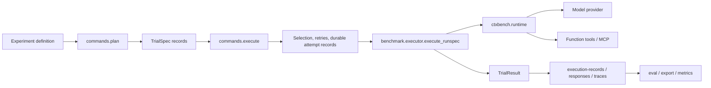
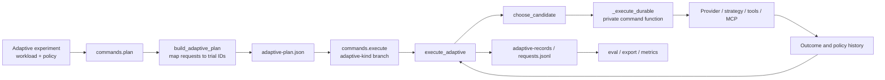
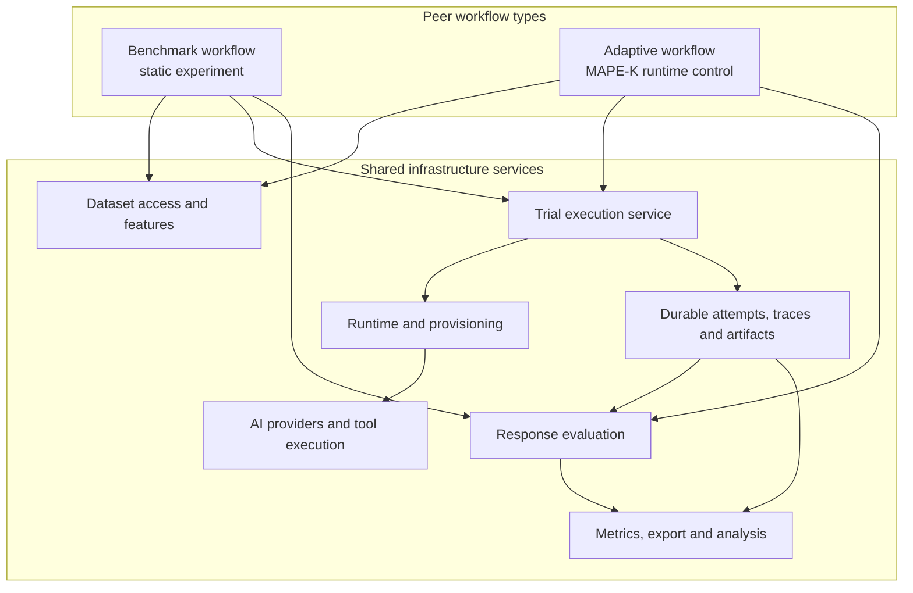
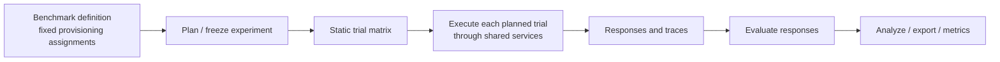
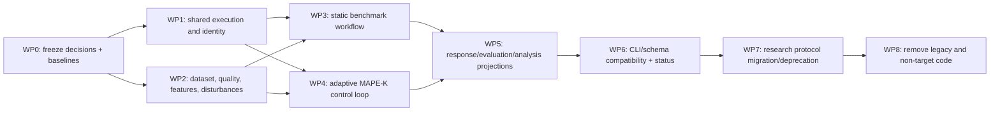

# Benchmark and adaptive workflow architecture

## Purpose and recommendation

The tool should expose two peer workflow types built on shared infrastructure services:

- **Benchmark workflow:** plan a static experiment with provisioning configurations assigned to
  trials before execution; execute trials; evaluate responses; analyze and export results.
- **Adaptive workflow:** process workload requests through a MAPE-K control loop, choosing a
  provisioning configuration at runtime from a declared candidate set; execute it; observe the
  outcome; update controller knowledge and continue.
- **Shared infrastructure services:** provide dataset access, model/provider and tool/MCP runtime,
  durable trial execution, artifact handling, response evaluation, and analysis capabilities to both
  workflows.

This is a better framing than treating benchmark as Level 1 and adaptive as Level 2. The existing
benchmark workflow is a source of reusable services, but its end-to-end static experiment lifecycle
should not itself become the infrastructure layer. Adaptive execution has different control
semantics and should call shared services through stable APIs rather than inherit benchmark
workflow behavior.

## Plan update: WP8 removal of legacy and non-target code

The target product has two workflows: `benchmark` and `adaptive`, built on shared execution,
dataset, runtime, evaluation, and artifact services. Compatibility with old adaptive definitions,
old benchmark artifact versions, and the separate `Study`/RepoQA orchestration is not a requirement.
WP8 removes those paths and abstractions; it does not build compatibility shims or preserve the old
study protocol as a third workflow. Dataset-specific packages, tools, and evaluators remain only
when the benchmark or adaptive workflow consumes them.

The old study protocols include behavior beyond the target workflows, including policy matrices,
replay grids, scenario scheduling, and seeded disturbance campaigns. WP8 retires those capabilities
rather than introducing a generic `Study` layer. Its migration notes must list the capabilities
that stop being supported. Benchmark trial semantics and adaptive request/attempt/delivery metrics
remain the supported scientific units.

Old files on disk remain user-owned, but the application will not load, execute, migrate, or analyze
old adaptive/study records or non-current benchmark artifact versions. Unsupported inputs fail with
a concise fresh-plan message; no compatibility reader or alias is retained solely for old artifacts.

## Current state

At the time of the original assessment, components for both workflows and shared execution existed,
but their boundaries were incomplete. Adaptive execution was wired into benchmark commands, and
durable execution was not yet exposed as a stable service for workflows to compose. WP0-WP7 below
record the subsequent implementation and audit status.

**Implementation status:** WP0-WP7 are complete. WP8 removes retired workflow paths and confirmed
orphan structures; the final disposition and evidence are recorded below.

| Current module | Responsibility today |
| --- | --- |
| `ctxbench.benchmark` | Experiment loading/validation, dataset-to-trial expansion, benchmark models, durable execution records, evaluation, export, and metrics. Some functions are workflow-specific; others are candidates for shared services. |
| `ctxbench.runtime` and `ctxbench.core` | Runtime request/result contracts and provisioning types. |
| `ctxbench.benchmark.runtime_adapter.TrialRuntimeAdapter` | Translate between `TrialSpec`/`TrialResult` and runtime request/result objects. |
| `ctxbench.benchmark.executor.execute_runspec` | Execute one trial through the runtime and return a `TrialResult`. |
| `ctxbench.commands` | CLI entry points for benchmark planning, execution, evaluation, export, and metrics; also study/adaptation commands. |
| `ctxbench.adaptive.v1` | Build a versioned adaptive plan, choose candidates, execute the ordered request loop, and persist request outcomes. |
| `ctxbench.adaptive.runner` and `study_runner` | Episode runners used by other adaptive and study protocols. |
| `ctxbench.studies` and `ctxbench.adapters.repoqa` | Study orchestration and RepoQA-specific preparation, workload generation, and analysis. |

For `kind: "adaptive"`, `plan` branches to build `adaptive-plan.json`; `execute` dispatches to
`execute_adaptive`. That loop calls the private `_execute_durable` function in
`commands.execute`. Adaptive orchestration therefore depends on a command implementation detail
rather than a shared execution service. Separate study and RepoQA episode paths also have their own
preparation and runner logic.

**Research-critical current-state correction:** the adaptive request ledger is not an input to the
current `eval`, `export`, or `metrics` workflows. Those operate on `responses.jsonl`, which includes
attempted candidate results, including cascade fallbacks that were not delivered. `status` does
read adaptive records, but its current state-name checks do not align fully with the states written
by `adaptive.v1`. Adaptive request-level delivery and quality analysis are therefore missing
workflow work, not merely a risk to preserve.

Other findings that constrain the target design:

- `adaptive/types.py` already defines `Candidate`, `RequestFeatures`, `Observation`, `Decision`,
  `PolicyState`, and provenance types; `adaptive/sidecars.py` defines decision sidecars. Extend or
  replace them deliberately rather than create parallel contracts with the same meaning.
- `dataset/capabilities.py` already provides mandatory/optional capability reporting. Extend that
  contract for explicit online-quality support; do not add a second generic capabilities registry.
- The `minimum_response_length` sensor already performs online response acceptance and fallback.
  It is a deterministic response-acceptance heuristic, **not** a semantic accuracy assessor.
- The current adaptive workload rejects repeated task/instance pairs, hard-codes `sizeBin`, and
  expands request/candidate pairs into `TrialSpec`s. Those constraints do not meet the intended
  workload and dataset-agnostic design.
- The repository has durable and non-durable execute paths for different artifact versions. WP0
  must declare the supported execution-version policy; the target should not grow another parallel
  execution engine.
- The fallback tests monkeypatch `commands.execute._execute_durable`. Replace that test seam with
  the public execution-service boundary before extracting the service.
- A focused check of `status` found a state-vocabulary mismatch with the generic adaptive records;
  status must be migrated and contract-tested with the request ledger.

### Review addendum: decisions required before implementation

The WP0 contract decisions are recorded in
[`wp0-decision-record.md`](work-packages/wp0-decision-record.md). That record supersedes the open design
questions below for the staged implementation; the architecture assessment remains the description
of current behavior and implementation risks.

The review at [`architecture-plan-review.md`](architecture-plan-review.md) correctly marks the
previous plan not ready for implementation. The following points are adopted as design constraints,
with two qualifications:

- Reuse or extend existing candidate, feature, observation, decision, policy-state, decision-sidecar,
  and dataset capability contracts. Do not create duplicate types under new names without a
  documented semantic reason.
- Promote `minimum_response_length` to a typed **response acceptance sensor** and preserve its
  fallback behavior. It is not an accuracy/correctness assessor; semantic quality needs a separate
  dataset/evaluator capability and sensor-class provenance.
- Do not use a single one-candidate decision followed by a hidden fixed cascade. Persist a decision
  for every attempt/escalation and let Analyze determine acceptance before another Plan decision.
- Treat runtime disturbances, admission/quota, invocation identity, calibration, feature
  partitioning, estimator update policy, execution session lifetime, and projection cost as explicit
  contracts. None should be accidental behavior inherited from v1 or a study runner.
- Make all controller history strictly prefix-causal: decisions for sequence `n` may use frozen
  calibration plus observations through sequence `< n`, and earlier attempts of request `n` only.
  Records from later requests are never controller input.
- The existing adaptive recovery helper is study-specific and imports a RepoQA digest helper. Do
  not use it as the generic persistence layer. The new workflow uses one shared atomic persistence
  mechanism for execution attempts and workflow records, while retaining distinct canonical
  record types.
- The review did not inspect study runners in depth. Therefore, no `study_runner`, policy, or
  RepoQA research protocol is approved for deletion by this addendum; migration requires a separate
  behavior and artifact audit.

The review's code findings were checked against the current implementation. In particular, the
started-request resume path rewrites a request record before restoring attempts, history can include
records from future sequence positions, and calling `_execute_durable` once per candidate creates a
new `Engine` and rebuilds the full response projection per call. These are defects to correct, not
baseline behavior to preserve.

### Current benchmark workflow and shared execution path



### Current adaptive workflow path



The current `kind: "adaptive"` cascade example has a fixed primary and fallback order. Other
policies can use calibration/history, but the current path is not yet a uniform, explicit MAPE-K
workflow architecture. The existing study runners have richer controller behavior, but remain
separate paths. See the implemented contracts in
[`workflow-contracts.md`](../../architecture/workflows/workflow-contract.md#implemented-increment-minimal-adaptive-lifecycle-s08-and-request-outcomes-s09)
and the MAPE-K discussion in the historical
[`llmctxbench-evolution-plan.md`](../evolution-plan/llmcontextbench-evolution-plan.md).

## Target architecture



Shared infrastructure executes requested work and returns observations. It does not choose the
next route. The benchmark workflow owns static trial assignment and lifecycle. The adaptive
workflow owns dynamic route selection and controller state. Neither workflow should call the
other workflow's CLI or import its private orchestration functions.

The adaptive workflow should choose at runtime from a validated candidate catalog declared before
execution. A policy must not silently invent an undeclared provisioning configuration. The catalog
keeps decisions reproducible and auditable while still allowing the selected route to vary by
request.

### To-be benchmark workflow: static assignment



### To-be adaptive workflow: MAPE-K route selection

```mermaid
flowchart LR
    Definition[Adaptive workflow definition<br/>workload + candidates + objectives + policy] --> Prepare[Validate candidates and prepare episode]
    Prepare --> Request[Next workload request]
    Monitor[Monitor<br/>runtime telemetry + quality signals] --> Analyze[Analyze<br/>objective / degradation state]
    Knowledge[Knowledge<br/>calibration, estimates, history, state] --> Analyze
    Quality[Dataset quality assessor<br/>optional online accuracy/correctness] --> Monitor
    Execute --> Quality
    Analyze --> Plan[Plan<br/>policy selects eligible configuration]
    Knowledge --> Plan
    Request --> Plan
    Plan --> Execute[Execute<br/>shared trial execution service]
    Execute --> Outcome[Attempt outcome]
    Outcome --> Monitor
    Outcome --> Knowledge
    Analyze --> Accepted{Request accepted?}
    Accepted -->|No, candidates remain| Plan
    Accepted -->|Yes| Record[Persist delivered response]
    Accepted -->|No candidates remain| Failed[Persist failed/unserved request]
    Record --> More{More requests?}
    Failed --> More
    More -->|Yes| Request
    More -->|No| Evaluate[Optional offline evaluation of delivered responses]
    Evaluate --> Analysis[Episode analysis / export]
```



In MAPE-K, **Plan** means runtime action selection. It is distinct from experiment/workflow
**planning**, which validates and prepares inputs before the episode starts. The adaptive workflow
may prepare the workload and candidate catalog up front, but chooses an actual route per request at
runtime.

Monitor should collect execution-time evidence such as status, latency, token usage, and tool
failures. Where the dataset exposes a suitable online quality assessor, the loop may also collect
quality signals such as correctness or accuracy. Analyze interprets all declared signals against
objectives or SLOs; a policy can then trade quality against latency, token, or availability goals.

Quality is an optional capability, not a universal numeric field. When no valid online assessor is
available, quality is unavailable, not zero, and a quality SLO cannot be claimed as satisfied.
Record the measure definition, sensor class, evaluator/source, value and range, provenance, and
assessor latency/token cost. A judge or oracle invoked during the loop is part of adaptive
operational cost and has different deployment validity from a runtime signal or heuristic.
Post-run evaluation of the adaptive episode must not feed that same episode's controller. A
separately frozen, disjoint calibration evaluation may seed Knowledge as a declared prior, with its
source and split recorded; this is not same-episode feedback.

## Dataset-agnostic workflow contract

Both workflow types should accept any dataset package that satisfies declared capabilities. Generic
workflow code must not branch on dataset IDs or import RepoQA/Lattes-specific logic. The current
`DatasetPackage` already provides task/context/evidence access, request features, validators, and
optional oracle/tool capabilities. The refactor should make capability support explicit and
validate requirements when planning an experiment or adaptive episode.

The common contract should distinguish required from optional capabilities:

| Capability | Benchmark use | Adaptive use |
| --- | --- | --- |
| Task and instance enumeration; context and task access | Build and execute trials | Build the ordered workload and execute requests |
| Provisioning/tool capability validation | Validate fixed configurations | Validate all declared candidates before runtime selection |
| Request features | Stratify plans and analyses | Provide context to the controller when declared |
| Evidence/oracle/validator | Offline response evaluation | Online quality signal only when an explicit assessor supports it |
| Quality measure contract | Report evaluation result and provenance | Report a runtime quality observation that can be consumed by an SLO policy |

Dataset adapters own the meaning and calculation of quality measures. The generic evaluator and
controller consume typed values and provenance; they should not assume every dataset's `accuracy`
has the same definition. A dataset with only offline evaluation still works in both workflows, but
adaptive policies cannot enforce a per-request quality SLO from that offline-only result.

## Module structure and abstractions

The following is a logical target structure. Introduce service boundaries before moving every
existing module; the package layout can evolve incrementally.

```text
src/ctxbench/
├── services/                         # NEW logical shared-service boundary
│   ├── execution.py                  # Durable, workflow-neutral invocation service
│   ├── execution_records.py          # One canonical attempt store keyed by executionId
│   ├── artifacts.py                  # Atomic writes and derived projection/rebuild services
│   ├── evaluation.py                 # Offline evaluation and optional online assessors
│   └── analysis.py                   # Workflow-aware metrics/export/report services
├── dataset/                          # Existing generic package/capability protocols
├── runtime/                          # Existing shared runtime contracts and engine
├── ai/                               # Existing providers, models and tool-call integration
├── benchmark/                        # Benchmark workflow and benchmark-domain artifacts
│   ├── planner.py                    # NEW/extracted: freeze experiment into static trials
│   ├── workflow.py                   # NEW/extracted: plan -> execute -> evaluate -> analyze
│   ├── trial_adapter.py               # NEW: TrialSpec <-> ExecutionRequest/result mapping
│   ├── runtime_adapter.py            # Existing TrialSpec <-> runtime translation
│   └── ...
├── adaptive/                         # Adaptive workflow and MAPE-K responsibilities
│   ├── workflow.py                   # NEW/extracted: run an adaptive workload episode
│   ├── monitor.py                    # NEW: capture runtime observations
│   ├── analyzer.py                   # NEW: interpret observations against objectives
│   ├── controller.py                 # Reuse/extend existing policy interfaces and policies
│   ├── knowledge.py                  # Reuse/extend PolicyState and calibration contracts
│   ├── types.py                      # Request, candidate, decision, observation contracts
│   └── ...
└── adapters/
    └── repoqa/                       # Dataset-specific package/tools/evaluation as consumed
```

### Allowed dependency direction

| Package | May depend on | Must not depend on |
| --- | --- | --- |
| `ai` | Provider SDKs and neutral AI request contracts | Benchmark/adaptive workflows, CLI, concrete datasets |
| `runtime` / `core` | Core provisioning and AI/runtime contracts; dataset capability protocols | Benchmark/adaptive workflows, CLI, concrete dataset adapters |
| `dataset` / `adapters` | Dataset contracts and domain-specific libraries | Workflow orchestration or CLI internals |
| `services` | Runtime, AI, dataset protocols, neutral execution/artifact contracts | Benchmark/adaptive workflow modules or command modules |
| `benchmark` workflow | Shared services, benchmark models, dataset protocols | Adaptive controller internals |
| `adaptive` workflow | Shared services, adaptive models, dataset protocols | `commands.*`, benchmark workflow, benchmark `TrialSpec` as its execution API |
| `commands` / CLI | Workflow entry points and presentation/logging | Policy decisions or execution implementation details |

The specific import test should reject cross-workflow and CLI-private imports, while allowing
benchmark adapters to translate benchmark models into neutral service contracts.

### Existing and necessary abstractions

| Abstraction | Status / owner | Responsibility |
| --- | --- | --- |
| `TrialSpec` / `TrialResult` | Existing, benchmark domain | Describe a planned benchmark trial and its result. Do not make adaptive request identity depend on benchmark `trialId`. |
| `RuntimeRequest` / `ExecutionResult` | Existing, runtime | Carry operational request and result without importing benchmark experiment/artifact models. |
| `Candidate`, `RequestFeatures`, `Observation`, `Decision`, `PolicyState`, `Provenance` | Existing, `adaptive/types.py` | Reuse/extend where semantics fit; do not create parallel contracts. Replace hard-coded features only through a versioned feature-schema change. |
| `DecisionRecord` and sidecar models | Legacy protocol implementation | Remove with RepoQA/study runners; current adaptive records are canonical. |
| `DatasetCapabilityReport` | Existing, `dataset/capabilities.py` | Extend mandatory/optional capability reporting for quality/features rather than add a parallel capability registry. |
| `TrialRuntimeAdapter` | Existing, benchmark/runtime boundary | Translate trial records to runtime requests and runtime results back to benchmark results. |
| `ExecutionRequest` / `ExecutionOutcome` | New shared infrastructure contracts | Represent one invocation independent of benchmark trial or adaptive request semantics; include workflow correlation IDs and a stable execution ID. |
| `TrialExecutionService` | New shared service | Execute an `ExecutionRequest` durably; return an outcome and execution-attempt reference. Own persistence, retry/recovery, and runtime invocation, not route selection. |
| `BenchmarkWorkflow` | New explicit workflow boundary | Plan a static experiment, execute its frozen trial matrix, evaluate responses, and analyze results. |
| `ProvisioningCandidate` | New/clarified shared/adaptive contract | Identify a validated configuration the adaptive policy may select and the execution service can run. |
| `WorkloadRequest` | New/typed adaptive contract | Represent one ordered request occurrence, its unique request ID, dataset identity/features, and eligible candidates. Repeated task/instance tuples are permitted when request IDs differ. |
| `Monitor` | MAPE-K responsibility | Capture request/attempt observations available during execution. |
| `Analyzer` | MAPE-K responsibility | Interpret observations against objectives, constraints, and degradation rules. |
| `Controller` / MAPE-K Plan | MAPE-K responsibility | Select an eligible candidate and record the decision reason. Runtime Plan is distinct from pre-run experiment planning. |
| `Knowledge` | MAPE-K responsibility | Persist calibration, estimates, observations, controller state, and relevant history for reproducible decisions. |
| `AdaptiveWorkflow` | New explicit workflow boundary | Iterate workload requests; invoke monitor/analyzer/controller and shared execution; handle fallback; persist delivery decisions. |
| `Decision`, `Observation`, `QualityObservation` | Extend existing/new typed contracts | Carry selection, measured runtime outcome, and optional quality signal. Reuse/extend existing adaptive types and sidecars where appropriate. |

MAPE-K names describe responsibilities; they do not require one class per letter. Existing code can
implement multiple responsibilities initially. Avoid a plugin registry, generic workload DSL, or
second artifact store in the first refactor. Adaptive selection belongs to the v2 adaptive workflow.
WP8 removes `adaptive/v1.py`, study policy modules, and their separate persistence structures rather
than consolidating their policy catalogs into another abstraction.

## Normative terminology and units

Use these terms consistently in definitions, code, CLI help, logs, and artifacts:

| Term | Definition |
| --- | --- |
| **Workflow** | End-to-end protocol coordinating preparation, execution, and post-execution work. Supported types are `benchmark` and `adaptive`. |
| **Benchmark experiment** | Static design whose model and provisioning configuration assignments are frozen into trials before execution. |
| **Adaptive workload** | Ordered requests processed in an adaptive episode. Each request declares dataset identity/features and eligible candidates. |
| **Provisioning configuration** | Concrete route/treatment: strategy, representation, surface, runtime parameters, and provider/model selection as applicable. |
| **Provisioning candidate** | Validated provisioning configuration available to the adaptive controller. The candidate set is prepared before an episode; selection happens at runtime. |
| **Trial** | One benchmark-planned execution of a fixed configuration for a dataset task/instance. |
| **Attempt** | One durable invocation of a trial/candidate, including retry or fallback, with one observed result. |
| **Request outcome** | Adaptive disposition for one workload request: delivered, failed, or rejected, with decision and attempt references. |
| **Observation** | Runtime evidence available to MAPE-K: execution status, latency, usage, failures, and optional online quality signals. |
| **Quality signal** | Dataset-defined measure such as correctness/accuracy, with value, scale, source, evaluator, timing, and provenance. It may be unavailable. |
| **Benchmark planning** | Pre-execution resolution and freezing of an experiment into trial specifications. |
| **MAPE-K Plan** | Runtime controller action selection among eligible provisioning candidates. It is not benchmark planning. |

Do not use **run** as an ambiguous synonym for trial, attempt, request, or workflow. Preserve public
artifact terms such as `trials.jsonl`, `responses.jsonl`, `trialId`, `taskId`, and `response`.

## Service and workflow contracts

These are boundary requirements, not final implementation signatures. `ExecutionRequest` deliberately
does not require a benchmark `TrialSpec`; benchmark and adaptive workflows adapt their own
identities into this shared invocation contract. Serialized contracts must be versioned if their
meaning or fields change.

```python
class TrialExecutionService(Protocol):
    def execute(
        self, request: ExecutionRequest, session: ExecutionSession
    ) -> ExecutionOutcome: ...

class DatasetPackage(Protocol):
    def capability_report(self) -> DatasetCapabilityReport: ...
    def request_features(self, instance_id: str, task_id: str) -> RequestFeatures: ...

class OnlineQualityAssessor(Protocol):
    def assess(
        self, request: WorkloadRequest, response: str
    ) -> QualityObservation | Unavailable: ...

class AdaptiveController(Protocol):
    def decide(self, request: WorkloadRequest, knowledge: Knowledge) -> Decision: ...
    def observe(
        self, decision: Decision, observation: Observation, knowledge: Knowledge
    ) -> Knowledge: ...
```

Online quality assessment is an optional capability, kept separate so datasets without labels or
an online evaluator remain valid. Evolve the existing `DatasetCapabilityReport`; do not replace it
with a parallel `DatasetCapabilities` method. Preserve the existing `request_features(instance_id,
task_id)` argument order. Capability checks happen before provider calls. The execution service
receives a neutral `ExecutionRequest`; the controller does not create provider or MCP clients.

### Required data contracts

- `BenchmarkDefinition`: dataset/scope, fixed configuration assignments, repetitions, evaluation
  configuration, output settings, and provenance inputs.
- `AdaptiveWorkflowDefinition`: dataset/scope, ordered workload or workload generator, candidate
  catalog, policy, quality/performance SLOs, evaluation rules, seed, and repeat settings.
- `DatasetCapabilityReport` (extended): supported task/context access, request features, tool
  surfaces, offline evidence, online quality assessment, and workload constraints. Preparation
  rejects unsupported declared requirements before execution; no parallel `DatasetCapabilities`
  protocol is introduced.
- `ExecutionRequest`: unique `executionId`, workflow/run ID, request correlation ID, task/instance,
  model/provider, provisioning configuration, runtime parameters, context/evidence references, and
  trace settings. Benchmark supplies `trialId`; adaptive supplies `requestId` and candidate ID.
- `ExecutionOutcome`: execution/attempt identity; terminal status; response/error; measured
  timing; usage, completeness and provenance; trace references; execution-artifact reference.
  Unknown metrics remain unavailable, not zero.
- `QualityObservation`: metric identifier/definition version, value/scale, evaluator/source,
  sensor class (runtime, heuristic, proxy, judge, oracle), reported/measured/derived/estimated/
  unavailable provenance, assessor duration/token cost, and request/candidate identity.
- `CalibrationArtifact`: source run/artifact fingerprint, dataset/version, disjoint data scope,
  candidate-catalog fingerprint, feature schema/partition keys, estimator/update-policy versions,
  metric definitions, estimates, and provenance. Separate offline evaluation on a disjoint
  calibration set may seed Knowledge; evaluation of the adaptive episode itself may not.
- `FeatureSchema`: declared feature identifiers, types/units, extraction provenance, and allowed
  estimator partition keys. Generic controllers must not assume `small|medium|large` bins.
- `DisturbanceSpec`: scenario ID/version, target component or candidate, request schedule,
  deterministic seed, requested effect, and applied-effect observations. Fingerprint it with the
  prepared workflow.
- `ExecutionSession`: explicit lifecycle for reusable Engine/provider/MCP resources. Report startup
  and warmup separately from attempt and request timing; hold session reuse policy constant within a
  comparison unless it is an experimental factor.
- `Observation`: `ExecutionOutcome` plus optional `QualityObservation` and normalized failure events.
- `Decision`: request identity, decision/attempt ordinal, eligible and previously attempted
  candidates, selected candidate or rejection, policy name/version, reason, relevant
  state/estimate snapshot, and sequence.
- `Knowledge`: calibration references, per-candidate estimates, observed history, controller state,
  and last committed request sequence; reconstructible from frozen inputs and canonical records.

### Workflow state transitions

```mermaid
stateDiagram-v2
    [*] --> Prepared
    Prepared --> Running: start workflow
    Running --> RequestReady: benchmark next trial / adaptive next request
    RequestReady --> DecisionRecorded: adaptive only; persist decision before action
    RequestReady --> AttemptStarted: benchmark fixed assignment
    DecisionRecorded --> AttemptStarted: dispatch selected candidate
    AttemptStarted --> AttemptTerminal: success or failure persisted
    AttemptTerminal --> AnalyzingAttempt: adaptive monitor/analyze
    AnalyzingAttempt --> FeedbackCommitted: observation and Knowledge persisted
    FeedbackCommitted --> DecisionRecorded: same request not accepted; candidate remains
    FeedbackCommitted --> RequestReady: request complete; more workload
    AttemptTerminal --> RequestReady: more benchmark trials
    RequestReady --> Completed: no work remains
    Completed --> Evaluating: evaluation enabled/requested
    Evaluating --> Analyzing: evaluation artifacts complete
    Completed --> Analyzing: evaluation omitted
    Analyzing --> [*]
```



Adaptive routing is a loop **per attempt**, not a single decision followed by one attempt. Analyze
checks execution success and configured response acceptance/quality. If the request is not
accepted, Plan may select another eligible, not-yet-attempted candidate and record a new decision;
the configured cascade/probe/escalation policy controls whether another attempt is allowed. Every
attempt and decision is visible. This represents fallback without hiding it inside a fixed ordered
list that overrides the controller.

Persist each decision before external execution and each terminal outcome before committing
Knowledge for the next attempt/request. A decision may use only observations from the calibration
artifact and the strictly earlier execution prefix; future request records must never influence it.
Resume replays canonical decisions and observations in order; it must not silently choose a new
route for a completed attempt. An uncertain started attempt follows the explicit recovery policy.
`force` must start a clean episode generation/output or be rejected for adaptive workflows; it must
not recompute one request while retaining future records as controller history.

## Implementation plan and dependency diagram

Work packages are ordered. Later work must preserve each earlier package's acceptance gate.



### WP0 — Architecture contracts and behavior baselines

**Scope:** settle design questions that would otherwise be accidentally decided inside WP1/WP2/WP4.
Do not begin those work packages until the decision record and fixtures are approved.

**Likely files:** this document; `docs/architecture/vocabulary.md`;
`docs/architecture/workflow-contracts.md`; definition and dataset contract models.

**Tasks / decisions to record:**

1. **Cascade semantics:** one persisted decision per attempt/escalation; acceptance is analyzed
   between attempts; candidates cannot be retried indefinitely within one request.
2. **Disturbance model:** define a versioned `DisturbanceSpec` with target component/candidate,
   schedule, seed, and applied-effect record. It is part of the execution fingerprint. Use one
   instrumentation hook; remove duplicate delayed-runtime implementations. A disturbance applies
   only where its declared target exists. Do not claim cross-route comparability when (for example)
   inline bypasses the disturbed retrieval service. Record injected wait separately; include actual
   wait in end-to-end latency.
3. **Admission/quota:** move admit/wait/reject/best-effort decision into MAPE-K Plan. Execute may
   perform a planned wait, measured separately. Replay admission using recorded logical sequence
   and usage, not a new wall-clock decision.
4. **Identity and repeats:** allow repeated task/instance tuples through distinct `requestId`s.
   Identify each invocation with an `executionId` correlated to `requestId` or `trialId`; attempts
   are children of an execution, not keyed only by `TrialSpec`. Decide artifact version/migration.
5. **Calibration:** define a versioned `CalibrationArtifact` bound to dataset/version, candidate
   catalog fingerprint, feature schema, estimator version, source artifact and disjointness rules.
   A separate calibration run may have offline quality evaluations and provide a quality prior if
   its samples are disjoint from adaptive evaluation requests. Same-episode post-run evaluation
   must not influence routing.
6. **Quality sensors:** classify evidence as runtime signal, deterministic heuristic, proxy,
   reference judge, or oracle. Record the class and deployment assumptions. The current minimum
   response length is a deterministic acceptance heuristic, not accuracy. Oracle/judge feedback is
   privileged and its costs count when used in-loop.
7. **Features and learning:** replace hard-coded size bins with a declared, versioned feature
   schema and estimate partition key. Specify estimator update behavior (cumulative, rolling,
   decayed, etc.) and version it; do not inherit an unbounded cumulative mean by default.
8. **Import and persistence boundaries:** approve the dependency matrix below. New generic workflow
   records use the shared atomic persistence utilities, not `adaptive/recovery.py`'s study-specific
   envelope/RepoQA digest dependency.
9. **Execution session and measurement:** define session lifetime (one benchmark execution batch
   or adaptive episode), Engine/MCP client reuse, startup/warmup treatment, runtime interceptor hook,
   and separate initialization, attempt, request, assessor, and admission-wait timing.
10. **Projection cost and authority:** update response projections once per batch/checkpoint or
    incrementally, not by rebuilding the full collection per candidate attempt. Define canonical
    execution, decision, delivery, and evaluation records and derived views.
11. **Force/resume/history:** resume restores recorded state; no future-sequence records may enter a
    decision. `force` starts a clean episode generation/output or is rejected for adaptive runs.
    Started request recovery must preserve prior decision/attempt history.
12. **Version support:** choose one durable execution path for supported artifacts. Older
    non-durable artifacts are analysis-only or rejected with explicit replan/migration guidance;
    do not carry two execution engines forward.
13. **Controller inventory:** compare existing generic v1, `adaptive.policy`, and
    `adaptive.study_policy` behavior before introducing or consolidating controllers. SEAMS and
    v1 are evidence to audit, not architecture to copy.
14. **Test seam:** before WP1, replace tests that monkeypatch `_execute_durable` with a fake
    `TrialExecutionService` seam.

Capture baseline behavior for the static benchmark path separately from adaptive defects. Tests
must not freeze known adaptive behaviors listed above.

**Acceptance gate:** a reviewed decision record covers all 14 items; the public schema/artifact
migration plan is recorded; fixtures define intended behavior; import rules and target ownership
are approved. Public schema changes are a separate implementation approval gate under `CLAUDE.md`.

### WP1 — Shared durable trial execution service

**Scope:** public service executes a workflow-neutral `ExecutionRequest` in an explicit
`ExecutionSession` and returns a durable `ExecutionOutcome` linked by `executionId`.

**Likely files:** new `src/ctxbench/services/execution.py` and shared execution-record module,
`src/ctxbench/commands/execute.py`, `src/ctxbench/benchmark/executor.py`,
`src/ctxbench/benchmark/runtime_adapter.py`, and a benchmark-to-execution adapter.

**Tasks:** move durable orchestration out of CLI code; persist by execution identity with workflow
correlation fields; define one lock scope; preserve atomic started/terminal records, retry and
uncertain-attempt rules; use one session-scoped Engine/runtime lifecycle per configured workflow
session; expose a runtime interceptor for declared disturbances; separate initialization and
attempt timing; batch or increment response projection. Add a benchmark adapter from `TrialSpec` to
`ExecutionRequest`. Do not make `TrialSpec` the generic service contract.

**Acceptance gate:** static benchmark outputs retain their intended semantics; service tests prove
resume/retry/recovery, repeated execution identities, session lifecycle, and no provider call for
completed attempts; response rebuild work is linear/batched; no workflow imports
`commands.execute._execute_durable`.

### WP2 — Dataset capabilities and quality observations

**Scope:** both workflows work with any conforming dataset; online quality and custom features are
optional, declared capabilities.

**Likely files:** `src/ctxbench/dataset/package.py`, `capabilities.py`, `validation.py`,
`src/ctxbench/benchmark/evaluation.py`, dataset adapters, adaptive observation models.

**Tasks:** extend the existing capability report rather than introduce another registry; define a
feature schema/partition-key contract; define `ResponseAcceptanceSensor` (starting with the
existing minimum-length rule) separately from semantic `OnlineQualityAssessor`; tag sensor class
(runtime, heuristic, proxy, judge, oracle); adapt fake, Lattes, and RepoQA packages as applicable;
bind calibration to catalog/features/estimator and allow disjoint offline quality priors; include
assessor latency/tokens in-loop; add the shared `DisturbanceSpec` hook and remove duplicate delay
wrappers.

**Acceptance gate:** capability contracts pass for at least two dataset implementations; offline-
only datasets work without quality SLOs; calibration fingerprints and disjointness validate;
feature/estimator versions are frozen; sensor provenance/cost and disturbance scope are recorded;
unavailable quality is never zero or a satisfied SLO.

### WP3 — Explicit benchmark workflow

**Scope:** static benchmark lifecycle is a workflow over shared services.

**Likely files:** `commands/plan.py`, `commands/execute.py`, `commands/eval.py`,
`commands/export.py`, `commands/metrics.py`, plus a focused benchmark workflow module if it reduces
duplication.

**Tasks:** keep benchmark experiment planning as authority for fixed configuration assignment;
adapt planned trials to the shared execution service; sequence plan, execute, response evaluation,
then analysis; keep CLI code as adapters; preserve artifact-only analysis where the current
contract permits it. Decide support for transitional/non-durable artifact versions per WP0.

**Acceptance gate:** fake-dataset lifecycle completes with fixed assignments and preserves current
benchmark response, evaluation, export, metric, and status meanings; unsupported artifact versions
fail clearly under the no-compatibility policy.

### WP4 — Adaptive MAPE-K workflow

**Scope:** sequential Monitor-Analyze-Plan-Execute-Knowledge loop over the shared trial service.

**Likely files:** add typed adaptive plan/controller/workflow/record modules without preserving the
v1 API; add typed observation/quality/knowledge models; update adaptive CLI dispatch. WP8 removes
the old v1 implementation and reader code.

**Tasks:** prepare ordered requests with occurrence-specific IDs and eligible candidate execution
requests; decide one candidate per attempt; monitor runtime/quality observations; analyze acceptance
and all declared SLOs with missing-value semantics; let Plan/admission choose, wait, reject, or
select a next candidate; execute via WP1; update Knowledge using only causal history; persist each
decision, execution, observation, delivery, and Knowledge snapshot; replay records on resume.

**Acceptance gate:** scripted multi-request/repeated-request tests prove quality SLOs can change
routes; cascade attempts are individually decided and recorded; latency/token/error policies still
work; quota/admission is replayable; missing quality has explicit unavailable/infeasible behavior;
future records cannot leak; started-request resume preserves history; assessor cost is reported.

### WP5 — Delivered responses, evaluation, and adaptive analysis

**Scope:** make workflow outputs and analysis reflect what the workflow actually delivered while
retaining per-attempt evidence.

**Target record meaning:** shared execution records are canonical per invocation/attempt. Adaptive
request records are canonical for decisions and delivery. `responses.jsonl` is the derived set of
workflow results: one terminal result per benchmark trial and one delivered response per served
adaptive request. Failed/unserved adaptive requests remain in the request ledger, not the response
view. Non-delivered candidate attempts remain available through execution records and an explicit
attempt-level analysis view, not as additional workflow responses.

**Likely files:** `src/ctxbench/benchmark/execution_records.py`, `commands/eval.py`,
`commands/export.py`, `commands/metrics.py`, new workflow analysis/projection modules, artifact
models and schemas.

**Tasks:** introduce response identity that can reference either `trialId` or `requestId` plus
`executionId`; evaluate delivered adaptive responses by default; allow per-attempt evaluation only
as an explicitly named diagnostic; key evaluation/judge votes to a response identity while keeping
individual judge votes and generation/evaluation costs separate; derive request-level accuracy/SLO
attainment, delivery rate, request latency, all-attempt cost, fallback count, and route transitions
from canonical records; make analysis artifact-only. Version any changed response/evaluation/export
schemas.

**Acceptance gate:** fallback attempts do not count as delivered outputs; adaptive quality/accuracy
metrics correspond to delivered requests; attempt cost still counts every executed candidate;
judge votes remain individually available; request and attempt denominators are reported
separately; analysis can be rebuilt without providers.

### WP6 — Definitions, workflow dispatch, and status

**Scope:** expose benchmark and adaptive as distinct workflow types through the current CLI.

**Likely files:** `benchmark/definitions.py`, `benchmark/models.py`, `commands/*`, `cli.py`,
`commands/status.py`, documentation and fixtures.

**Tasks:** implement typed/discriminated `BenchmarkDefinition` and `AdaptiveWorkflowDefinition`
according to WP0's version decision; dispatch CLI to the workflows; make `status` use the workflow
projections/state vocabulary; add cross-workflow tests using shared services. WP8 removes old
definition and artifact readers; no compatibility loader is part of the target.

**Acceptance gate:** current definitions retain their declared semantics; unsupported definitions
fail clearly; `status` agrees with canonical records at every state; workflows share services
without importing one another's orchestration modules. Public schema changes are versioned.

### WP7 — Research protocol audit

**Scope:** audit the overlapping RepoQA and study runners before making a keep/remove decision.

**Likely files:** `src/ctxbench/studies/*`, `src/ctxbench/adapters/repoqa/workflow.py`,
`src/ctxbench/commands/adaptation.py`, adaptive modules and tests.

**Tasks:** compare workload generation, seeds, controller behavior, disturbance scope, quality/cost
accounting, recovery, source fingerprints, and artifacts. Do not port SEAMS/v1 module structures or
policy implementations as the target architecture.

**Acceptance gate:** protocol contracts, artifact authorities, costs, and scientific outcomes are
documented with provider-free regression evidence. No protocol is implicitly declared supported by
being left in the CLI. WP7 audit is recorded in
`docs/development/adaptive/wp7-study-path-audit.md`; the removal decision is made explicit in WP8.

### WP8 — Remove legacy and non-target code

**Scope:** reduce the supported runtime and public schema to the benchmark and adaptive workflows
plus shared services. Compatibility with old workflow definitions, old artifact versions, and old
CLI entry points is explicitly out of scope. Remove the standalone `Study` and RepoQA study/adaptation
orchestration instead of preserving it as a third workflow or adding a generic study abstraction.

**Disposition decisions:**

1. Remove adaptive v1 planning, policies, execution, and record handling. The current adaptive v3
   plan and workflow are the only supported adaptive path. Remove the old `kind: adaptive` branch from
   benchmark definitions/models and remove legacy adaptive branches from plan, execute, status,
   eval, export, and metrics.
2. Remove `ctxbench.studies`, its `Study`/`Baseline` definitions, the `llmctxbench study` command
   group, replay/counterfactual policies, and `adaptive.study_runner`/`study_policy`.
3. Remove the standalone `llmctxbench adaptation repoqa` protocol, its RepoQA workflow and
   `adaptive.runner` packet orchestration. Keep RepoQA dataset, tool, MCP, and evaluation components
   only where the benchmark or adaptive workflow has direct callers.
4. Remove unregistered `commands.experiment` and `commands.run`, their checkpoint and expand-path
   code, and old artifact-name aliases. Remove deprecated `DatasetProvider` after remaining
   consumers use `LocalDatasetPackage`.
5. Remove benchmark execution/status/evaluation readers for provisioning artifact versions 2/3 and
   manifests without the current execution fingerprint. Support only current benchmark artifacts
   and adaptive v3 plans. Do not delete or rewrite users' artifact files; they cease to be accepted
   by the current commands.
6. Remove tests that only preserve retired behavior. Keep current benchmark/adaptive unit,
   service-contract, and workflow tests; retain rejection tests only to prove unsupported input
   fails clearly. Split tests by directories or pytest markers so fast unit/contract tests run
   separately from the smaller end-to-end layer.
7. Remove or rewrite stale adaptive/study examples and docs. Split mixed definition tests: retain
   current benchmark schema/fingerprint coverage, remove tests asserting old adaptive planning or
   controller behavior. Migration notes enumerate dropped
   study capabilities and state that historical artifacts require the prior application version
   if they still need analysis.
8. Perform a repository-wide orphan inventory before finalizing the deletion list. Inspect Python
   imports and call sites, CLI registration and package entry points, scripts, schemas/configuration
   references, tests, examples, and docs. Separate code used only by the retired workflows from
   code with no current caller or declared entry point. Record each candidate, evidence, disposition,
   and confidence; remove confirmed orphans in WP8, and defer ambiguous candidates rather than
   treating a missing static import as proof of disuse.

**Likely files:** `src/ctxbench/adaptive/v1.py`, `policy.py`, `runner.py`, `study_runner.py`,
`study_policy.py`, `recovery.py`, `sidecars.py`, `calibration.py`, `research.py` (remove only the
legacy implementations; retain WP2/WP4 estimator and calibration contracts); `src/ctxbench/studies/*`;
`src/ctxbench/adapters/repoqa/workflow.py`, `study.py`, `workload.py`, and study-only helpers;
the adaptation, study, experiment, and run command modules; legacy adaptive branches in the plan,
execute, status, eval, export, and metrics commands; benchmark definitions/models,
provisioning/fingerprint/paths/checkpoints/results; `DatasetProvider`; schemas; tests; examples; and
architecture, validation, compatibility, and README documentation.

**Required invariants:** benchmark trial identity and fixed assignments remain stable for current
definitions; adaptive request/attempt/delivery identities and causal history remain stable; execution,
evaluation, and assessor costs remain separate; unavailable metrics keep their provenance; tool/MCP
traces and current judge-vote artifacts remain intact. Dataset-specific logic stays in adapters.

**Acceptance gate:**

- Only current benchmark definitions/artifacts and adaptive v3 plans are accepted. Old formats fail
  without migration or partial interpretation.
- The CLI exposes only benchmark/adaptive lifecycle paths plus dataset management; no Study, RepoQA
  adaptation, old experiment/run, or adaptive v1 execution commands remain.
- The orphan inventory covers source imports/call sites, public exports, CLI and package entry
  points, dynamic/configuration references, tests, examples, and docs. Each candidate has recorded
  evidence, confidence, and a keep/remove/defer disposition; no removal is based only on a zero
  static-import count.
- Repository-wide import/call-site searches find no references to removed modules, models, schemas,
  aliases, or artifact readers.
- Current workflow unit/service/contract tests pass, and a small provider-free end-to-end test covers
  each supported workflow. No old policy behavior or historical artifact migration is tested as
  supported behavior.
- Documentation and examples validate and plan under current schemas; unsupported artifacts and
  discontinued protocol capabilities are clearly listed.

**Breaking impact:** outputs from older adaptive and study runs can no longer be inspected by the
current CLI after WP8. Users who need that analysis must retain an older checkout. No conversion is
provided.

**Confidence scale for the orphan inventory:**

- **High:** no supported-workflow callers or registered entry points remain after checking imports,
  CLI/package registration, configuration/reflection hooks, scripts, and user-facing references;
  remaining references are only the removal's own tests/docs or retired callers.
- **Medium:** static searches show no supported caller, but at least one indirect mechanism or
  external use remains plausible. Require a focused code-path review before deletion.
- **Low:** the usage boundary is unclear or the code may encode an unrecorded research protocol.
  Defer deletion until an owner or protocol audit resolves it.

Confidence describes evidence that a candidate is unused by the supported product, not the value of
the code. A module actively used only by a workflow explicitly retired above is a planned
workflow-removal target, not an “unimported” module.

**Preliminary static audit (planning evidence, not final disposition):**

| Candidate | Initial evidence | Confidence / next check |
| --- | --- | --- |
| `ctxbench.commands.experiment` and `ctxbench.commands.run` | Not registered in `ctxbench.cli`; `experiment` retains the old `DatasetProvider` path, while no current source import of either command surfaced in the initial search. | **Medium overall**; CLI absence is confirmed, but audit direct module invocations, packaging, tests, and docs before removal. |
| `ctxbench.adaptive.research` | No current production-source imports found; referenced by a dedicated test and development document. | **Medium**; remove if the focused review finds no supported standalone analysis use, otherwise record its owner and keep it outside workflow orchestration. |
| `DatasetProvider` | Still exported from `ctxbench.dataset`, called by `commands.experiment`, and used by existing tests. | **Not an orphan**; remove only after migrating its remaining callers and export. |
| `adaptive.estimator` and `adaptive.calibration_contract` | Imported by adaptive workflow/contract tests and part of the WP2/WP4 design. | **Not an orphan**; retain. |
| Study and RepoQA adaptation modules | They have live imports, CLI routes, and tests, but those belong to the protocol WP8 explicitly retires. | **High** for removal under the approved target scope; do not label them unimported. |

The final inventory must re-run these checks against the WP8 branch after callers, entry points, and
tests have been migrated or removed. This preliminary list is not exhaustive.

## Invariants and artifact policy

- Keep execution-phase costs separate from evaluation-phase costs.
- Preserve trial identity, provider/tool behavior, traces, and durable attempt behavior.
- Preserve metric provenance and existing metric meanings.
- Keep adaptive request records authoritative for which response was delivered.
- Keep dataset-specific workload generation out of shared execution services.
- Treat unavailable online quality as unavailable, never as zero or a satisfied SLO.
- Include online assessor overhead in adaptive execution cost and time when the assessor runs in-loop.
- Keep online control signals distinct from offline evaluation results and their provenance.
- Keep current benchmark and adaptive CLI and artifact semantics.
- Do not require the new adaptive workflow to preserve v1 artifact shapes or defects. Version its
  definition and artifacts when request/execution identity, decision cadence, delivered-response
  projection, or quality evidence changes.
- Keep canonical authorities singular: one execution-attempt record per invocation; one adaptive
  decision/delivery record per request occurrence; derived projections rebuilt from canonical data.
- Keep adaptive workload processing serial initially. Sequence defines causal observation order;
  parallelism requires a separate reproducibility and controller-state design.
- Preserve provider/model usage, tool/MCP traces, individual judge votes, and metric provenance.

Historical v1 and SEAMS artifacts do not dictate runtime abstractions and are not supported by the
target CLI. WP8 performs no compatibility migration: old data remains user-owned, and unsupported
definitions/artifacts receive a fresh-plan error.

## Validation plan

Use a test pyramid: many fast unit tests, fewer component/contract tests, and a small number of
full workflow tests. Keep the default suite provider-free and deterministic.

### Unit tests (largest layer)

- Pure policy decisions for quality/latency/token SLOs, missing signals, threshold boundaries,
  conflicting SLOs, and deterministic tie-breaking.
- MAPE-K state transitions: observe, analyze, decide, execute outcome, update Knowledge, then
  decide for the next request.
- Quality measure validation, units/ranges, provenance, aggregation, and unavailable-value handling.
- Candidate eligibility and workload feature mapping independent of any dataset implementation.
- Serialization/replay of decisions, observations, quality signals, and Knowledge snapshots.
- Repeated task/instance tuples under distinct request IDs; per-attempt decision and escalation
  limits.
- Prefix-causal history: future request records and stale `force` records cannot influence a
  decision; interrupted-request replay preserves earlier decisions and attempts.
- Admission/quota decisions under a deterministic logical clock; wait duration remains separate.
- Disturbance selection, seeded effects, target scope, and measured-versus-injected latency fields.
- Estimator partition keys and versioned update rules without hard-coded `sizeBin` assumptions.

### Component and contract tests

- `TrialExecutionService` against a fake runtime/provider and temporary artifact directory for
  durable attempts, result conversion, resume, retries, and uncertainty handling.
- Dataset capability contract tests parameterized over fake, Lattes, and RepoQA packages; generic
  workflow tests should use at least two different dataset implementations.
- Quality-assessor contract tests for supported online and offline-only datasets, including
  assessor errors, sensor class (heuristic/proxy/judge/oracle), calibration quality priors,
  disjointness checks, and assessor-cost accounting.
- Import-boundary tests ensuring workflows depend on service contracts and generic dataset
  protocols, not private commands or a concrete dataset adapter.
- Execution-session tests verify Engine/MCP client lifecycle and report initialization separately
  from per-attempt timing.
- Projection tests prove response rebuild is batched or incremental rather than rescanning all
  trials after every candidate attempt.

### Workflow integration and end-to-end tests (smallest layer)

- Benchmark: static plan -> trial execution -> response evaluation -> analysis with fake providers
  and fixture datasets.
- Adaptive: multi-request MAPE-K episode with scripted telemetry and quality outcomes; assert route
  choices, controller feedback, final delivery, and request artifacts.
- Adaptive cascade: each attempt has its own decision; only the delivered response appears in the
  workflow response view; all attempts contribute to cost and remain inspectable.
- Cross-dataset adaptive tests using the same workflow and policy with different dataset packages
  and evaluators.
- CLI smoke tests for both workflow types, status at every state, resume, and artifact-only
  request-level analysis. Keep real-provider
  or live-MCP checks manual/opt-in, never in the default test pyramid.
- Compare static benchmark fixture outputs for compatibility. For adaptive, compare against the
  approved behavior contracts, not v1 outputs where those contain known defects.

### WP8 test cleanup

Retain tests that specify the current benchmark/adaptive contracts and delete tests whose sole
purpose is to preserve retired v1, Study, or RepoQA adaptation behavior. Keep provider-free tests
for dataset packages and tools that remain dependencies of the new workflows. Current benchmark
and adaptive lifecycle/artifact tests remain; unsupported old inputs may have rejection tests, but
must not have tests claiming compatibility. Organize the suite into fast unit/contract tests and a
small end-to-end set, using directories or markers that pytest can select separately.

## Structures scheduled for removal in WP8

WP8 removes these structures without compatibility shims. Remove in-repository callers and tests in
the same change; external imports and old artifacts are not compatibility obligations.

| Structure | WP8 disposition | Removal condition |
| --- | --- | --- |
| `ctxbench.adaptive.v1` and `adaptive.policy` | Remove v1 planning, policy, execution, calibration, and record handling; retain adaptive v3 only. | No production imports or v1 behavior tests; old adaptive inputs fail before dispatch. |
| `Study`/`Baseline`, `ctxbench.studies`, `llmctxbench study`, `adaptive.study_runner`/`study_policy` | Remove the separate study protocol, matrix orchestration, policy menu, replay and counterfactual tooling. Do not replace it with a generic `Study` abstraction. | No Study imports or CLI routes; discontinued research capabilities are listed in migration notes. |
| RepoQA adaptation workflow, `commands.adaptation repoqa`, `adaptive.runner` | Remove standalone RepoQA experiment orchestration and its packet runner. Retain only RepoQA packages/tools/evaluation used directly by benchmark/adaptive. | No adaptation command or workflow runner; all retained adapter modules have target-workflow callers. |
| `adaptive.recovery`, `sidecars`, legacy calibration helpers and study-only helpers | Remove with their protocol owners; do not move their packet formats into generic workflows. Retain WP2/WP4 calibration artifacts, estimator, sensor, and workflow contracts. | No imports or readers remain for retired packet formats; current adaptive tests cover retained contracts. |
| `adaptive.research` and RepoQA study/workload helpers | Remove standalone resampling/replay utilities and workload/calibration helpers used only by retired studies. Keep dataset package/evaluation code consumed by target workflows. | Remove after the orphan inventory confirms no supported standalone analysis use; otherwise retain outside workflow orchestration with an explicit owner and interface. |
| Unregistered `commands.experiment` / `commands.run`, checkpoint and expand-path code | Remove the old expansion/run command path and helpers. | No current CLI registration, source imports, or tests reference them. |
| Deprecated `DatasetProvider` and old artifact-name aliases | Replace remaining callers with `LocalDatasetPackage` and canonical trial/response names, then remove the façade and aliases. | Repository-wide searches show no uses. |
| Benchmark provisioning v2/v3 readers and non-durable execute branch | Support only the current benchmark artifact version; old run directories fail with fresh-plan guidance. | Current benchmark execution uses the shared service; no old-version reader remains. |
| `Experiment.experimentKind` and generic `adaptation` dictionary | Remove the old mixed benchmark/adaptive definition path. Keep benchmark definitions benchmark-only and adaptive definitions v2-only. | Schemas, models, examples, and CLI tests agree on two distinct definition contracts. |
| Optional `SizeBin` / `sizeBin` adaptive compatibility fields | Remove if no current benchmark/adaptive contract declares them; feature partitions use the versioned feature schema. | New workflow tests cover feature partitions without fixed RepoQA bins. |
| V1 adaptive examples, protocol tests, stale docs | Delete old-only fixtures/tests and rewrite target documentation; rejection tests may assert unsupported input fails, not that it is migrated. | Every retained example validates with a current workflow; docs no longer promise retired features. |
| `commands.execute._execute_durable` | Already replaced by the shared execution service; remove any remaining references. | No source or test import reaches the private helper. |
| Per-candidate full `rebuild_responses` and adaptive status duplication | Keep batched canonical projections and the current workflow status projection only. | Projection and status tests cover every current request/attempt state. |

Do not remove `TrialSpec`, `TrialResult`, `RuntimeRequest`, `ExecutionResult`, dataset adapters,
or execution records merely because workflow boundaries change; they may remain useful infrastructure
or domain contracts.

## Risks and decisions

- **Recovery:** moving durable execution out of command code can alter retry/resume semantics unless
  the service takes over those responsibilities exactly.
- **Metric unit:** trial attempts and delivered workload requests are different units. Keep their
  metrics separate unless request-level metrics are specified explicitly.
- **Evaluation leakage:** offline answer evaluation should not enter the MAPE-K Knowledge base by
  default; online sensors need a separately specified contract.
- **Research capability loss:** removing Study/RepoQA orchestration ends support for policy matrices,
  replay grids, and scenario campaigns not expressible as current benchmark or adaptive workflows.
  WP8 must list these as discontinued rather than silently claim parity.
- **CLI naming:** a dedicated adaptive command group may be useful, but is not required to establish
  workflow/service boundaries. Keep the current CLI initially and treat CLI renaming separately.

## Implementation status

WP0-WP6 implementation is recorded in commits through `77c307a`. WP7's audit and tool-delay fix are
recorded in commit `a482dda`. WP8 implementation is present in the current worktree and remains
uncommitted.

## WP8 implementation result and final orphan audit

WP8 removes the separate Study and RepoQA adaptation workflows, adaptive v1 controllers and
records, obsolete CLI modules, old benchmark artifact readers, and the `DatasetProvider` façade.
The supported CLI remains benchmark/adaptive lifecycle commands plus dataset management. Benchmark
definitions require schema 3; benchmark manifests require schema 3, provisioning artifact 4, and
execution record 1. Adaptive plans require schema 3 and adaptive manifests require schema 2 and
artifact 2. There is no migration or compatibility reader for earlier versions.

Confidence below refers to the evidence that code is outside the supported workflows, not the
quality or usefulness of historical research. A static zero-import result alone is insufficient.

| Candidate | Evidence checked | Disposition | Confidence |
|---|---|---|---|
| `ctxbench.studies`, `Study`/`Baseline`, study CLI and replay modules | Checked CLI parser/dispatch, source imports, package exports, tests and examples. Remaining references are retired protocol code or audit history. | Removed | High |
| RepoQA study/workload/adaptation orchestration | Checked retained adapter imports/registry and benchmark/adaptive dataset capability use. Dataset, tools, MCP server, provider and evaluation remain; orchestration helpers had no supported-workflow callers. | Removed orchestration; retained directly consumed adapter components | High |
| Adaptive v1, `adaptive.policy`, packet runner, sidecars, and study calibration/recovery/research helpers | Checked public adaptive exports, current workflow imports, CLI dispatch, artifact readers and current tests. Current contracts use `adaptive.workflow`, calibration contract, estimator, sensors and projections. | Removed | High |
| `commands.experiment`, `commands.run`, checkpoint and expansion paths | Checked CLI registrations, console entry point, imports, docs/examples and tests. Neither command is registered or imported by a supported workflow. | Removed | High |
| `DatasetProvider` | Checked package exports and callers; migrated current callers/tests to `LocalDatasetPackage`. | Removed | High |
| Old benchmark artifact v2/v3 readers and missing-fingerprint bypass | Checked benchmark lifecycle dispatch, provisioning validation, fingerprint verification, status/eval/export/metrics. Current manifests must be sealed and version 4. | Removed; old artifacts rejected | High |
| Run-named selector/result/path aliases and short-ID helpers | Checked source references, public exports, schemas and artifact writers; current APIs and outputs use trial terminology and canonical artifact names. | Removed | High |
| Lattes environment override module and `prepare_execution_params` | The implicit adapter hook could change the MCP endpoint after planning without including that change in the frozen definition. Current `resolve_plan_params` supports explicit `${ENV_VAR:-default}` values, which are part of the planned inputs; secret credential placeholders remain unresolved in artifacts and resolve only at execution. | Removed; use explicit environment placeholders | High |
| `ctxbench.metrics.dimensions` wrappers | AST import-graph check found no source or test import; direct inspection showed the files only re-exported private aggregation functions already called by `metrics.aggregate`; CSV writers use their own output paths. | Removed | High |
| Legacy question-named metric fields and `PhaseLogger.phase()` shim | Source and test searches showed the old metric keys were emitted only by `AIEngine`, consumed through fallback in `TrialRuntimeAdapter`, and the logger shim had no caller after retired commands were removed. | Replaced metric field with `taskStatementTokensEstimated`; removed fallback and logger shim | High |
| `adaptive.estimator`, calibration contract, sensors, current projections and `TrialSpec` | Direct current-workflow or benchmark callers and contract tests remain. | Retained | High |
| Lattes and RepoQA packages, tools, providers, MCP servers and evaluators | Reachable through adapter registry, CLI dataset operations, or current benchmark/adaptive execution and evaluation. | Retained | High |

Search evidence covers Python imports/call sites, CLI and packaging entry points, adapter registry
dispatch, schemas, tests, examples, and active user documentation. Remaining mentions of removed
protocols are explicitly historical audit/design records; they do not describe supported commands
or artifact compatibility. No candidate was removed solely because a static search found no import.

WP8 validation at implementation close: `pytest -q` passed (436 tests); `git diff --check`,
syntax compilation, schema/example validation, and import smoke checks passed. These results do not
cover the post-WP8 work packages below.

## Post-WP8 work packages: adaptive experiment support

These work packages follow the use-case assessment in
[`usecases.md`](usecases.md). They extend current versioned workflows; they do not restore the
retired Study workflow or introduce a generic `Study` domain model. Workload shapes, policy arms,
seeds, and statistical comparisons remain experiment-protocol concerns. Shared services own
invocation, measurement, and resource primitives; benchmark and adaptive workflows own their
respective control semantics.

### WP9 — Reproducible adaptive experiment driver (external research tooling)

**Priority:** can start now; no core runtime refactor required.

**Scope:** automate finite, serial adaptive experiment matrices such as the three-workload,
three-policy comparison. The driver generates version-3 adaptive definitions and invokes the
existing CLI. It does not own model invocation, retries, decisions, or canonical attempt records.

**Likely location:** `tools/research/` or a separate research-tools repository; do not add this
orchestration to `ctxbench.execution` or `ctxbench.adaptive`.

**Tasks:** accept named workloads, policy arms, seeds/repetitions, candidate IDs, and SLO settings;
produce fixed request orders with unique request IDs; encode context-size groups through declared
feature schemas rather than RepoQA-specific `sizeBin`; invoke `plan`, `execute`, `status`, and
`metrics`; label each run with workload, policy, seed, and calibration source; combine request and
attempt rows without merging their denominators. Mark synthetic, trace-derived, and live workloads
distinctly.

**Acceptance gate:** identical frozen request identities/order are used across comparable arms;
the same seed recreates the same generated workload; every arm gets a fresh output directory;
interrupted runs can resume through the CLI; all attempts and costs remain represented; combined
outputs preserve per-run provenance and request-versus-attempt units. The tool makes no provider
calls except through an explicitly invoked `execute` command.

### WP10 — Online quality assessor activation

**Priority:** required when semantic quality is an adaptive SLO.

**Scope:** complete the existing `SignalCapability`, `OnlineQualityAssessor`,
`QualityObservation`, and `quality_slos` path. Do not create a second capability registry.

**Likely files:** `dataset/capabilities.py`, dataset adapter registration, `adaptive/sensors.py`,
`adaptive/workflow.py`, `commands/execute.py`, adaptive definition schema, artifacts, and tests.

**Tasks:** resolve an assessor implementation from a declared capability; validate its metric,
class, provenance, value scale, reference-data use, and cost; invoke it after each candidate result
and before the next decision; persist the observation with the attempt/request records; replay that
observation during recovery without calling the assessor twice. Keep online assessor cost separate
from generation and offline evaluation costs. Unavailable or failed assessment cannot satisfy an
SLO. Offline ground-truth evaluations remain outside active Knowledge unless a separate,
disjoint calibration contract permits them as frozen priors.

**Acceptance gate:** CLI execution can select a declared provider-free assessor; supported and
unavailable signals have explicit behavior; assessor errors and costs are recorded; quality SLO
violations cause the declared fallback/exhaustion behavior; resume/replay does not repeat
assessment; tests prove no post-run evaluation leaks into decisions.

### WP11 — Calibration artifact handoff between runs

**Priority:** required when “past runs” means prior episodes, not earlier requests in the same
episode.

**Scope:** make the existing versioned `CalibrationArtifact` practical to create and consume.
The active adaptive plan remains frozen; imported Knowledge is a declared prior, not a mutable
shared database.

**Likely files:** `adaptive/calibration_contract.py`, `adaptive/estimator.py`,
`adaptive/artifacts.py`, a calibration projection/command, and adaptive plan validation.

**Tasks:** derive calibration estimates from canonical request/attempt records; record source run
and artifact fingerprints, dataset/version, candidate-catalog fingerprint, feature-schema and
estimator versions, source request IDs, and metric provenance; expose a documented file-based
handoff into a new adaptive plan. Validate compatibility and source/active request disjointness.
Do not carry arbitrary controller state or silently pool incompatible runs.

**Acceptance gate:** calibration rebuilds from artifacts without provider calls; incompatible
dataset, candidate, feature, or estimator contracts fail clearly; active request overlap is
rejected; estimates retain provenance and unavailable values; a new run records the exact frozen
calibration input it used.

### WP12 — Windowed SLO definitions and evaluation

**Priority:** required only for rolling p95, availability, or other aggregate SLO targets. Existing
per-request latency/token limits do not require this WP.

**Scope:** define generic SLO semantics and evaluate them in the adaptive workflow. Keep metric
collection in infrastructure and policy reactions in Analyze/Plan.

**Likely interfaces:** a versioned `SLODefinition` (metric, unit, scope/window, aggregation,
threshold, missing-data rule), an SLO evaluator over provenance-bearing observations, and adaptive
monitor/analyze state plus request-level analysis projections.

**Tasks:** distinguish per-request limits from rolling-window and episode objectives; define which
failures/rejections enter each denominator; define evaluation timing and missing/stale evidence
behavior; calculate and persist SLO state without turning unavailable values into zero. Keep
per-request operational signals separate from post-run quality aggregation.

**Acceptance gate:** window boundaries are deterministic and replayable; unavailable measurements
remain unavailable; failure and rejection denominators are explicit; reports identify per-request
versus window/episode SLO results; replay yields the same SLO state from the same observation
prefix.

### WP13 — Shared resource accounting and renewable budgets

**Priority:** required only for shared or renewable budget constraints; useful before concurrency.

**Scope:** provide generic accounting and admission primitives. The adaptive workflow decides what
to do when admission is denied; the execution service does not own policy.

**Likely interfaces:** typed resource dimensions and a concurrency-safe budget account/reservation
service, with resource observations carrying units, scope, window, and provenance.

**Tasks:** define budget scope (workflow, model/provider, or another declared resource), renewal
clock, reservations, reconciliation, and unknown-consumption behavior. Record estimated admission
separately from actual reported/measured consumption. Keep monetary cost, token usage, provider
TPM/RPM limits, and application budgets distinct; never infer opaque provider quotas from tokens.

**Acceptance gate:** renewal and reservation replay deterministically; unavailable usage remains
unknown; reconciliation records over/under-reservation; concurrent reservations cannot overspend
through races; rejected requests and uncertain attempts have explicit budget treatment; provider
rate controls remain separately observable.

### WP14 — Scheduled and concurrent workload execution

**Priority:** conditional; only needed if UC-03/UC-05 require temporal arrivals, queueing, or
concurrency. It is not required for finite ordered workload patterns.

**Scope:** introduce arrival scheduling above the single-invocation `TrialExecutionService`.
Arrival and workload definitions belong to the workload workflow contract; the execution service
continues to own one durable invocation at a time.

**Dependencies:** decide UC-03/UC-05 arrival and queue semantics first; complete WP13 before
claiming concurrency-safe renewable budget admission.

**Tasks:** define open-loop versus completion-driven arrivals, timestamp/interarrival semantics,
deterministic seeds, queue/admission behavior, maximum concurrency, and session reuse. Record
arrival, admission, dispatch, invocation start, and completion separately. Specify the causal view
available to each concurrent adaptive decision: only observations completed before its declared
decision cutoff may affect it. Keep synthetic and trace-derived workloads distinguishable.

**Acceptance gate:** the same arrivals are replayed across policy arms independent of completion
speed; queue delay is separated from invocation duration and included in end-to-end latency as
declared; concurrent recovery and budget accounting are race-safe; no decision reads future
workload or completion records; serial workflow behavior remains unchanged.

### WP15 — Pluggable adaptive controller contract

**Priority:** conditional; required only if the product must support controller algorithms beyond
the built-in selector.

**Scope:** separate a controller decision interface from MAPE-K orchestration and execution.

**Tasks:** define a versioned decision input containing the frozen request features, eligible
candidates, SLO state, Knowledge snapshot, and causal observation prefix; require a decision output
to select an eligible candidate or explicitly abstain, with reason and policy/version identity.
The workflow validates and persists decisions; the controller cannot own execution retries,
artifact writes, or future-record access. Keep static inline/MCP arms expressible without a custom
controller.

**Acceptance gate:** at least two provider-free controller implementations use the same workflow
and execution service; invalid/ineligible choices fail before invocation; replay is deterministic
for a fixed input snapshot; policy identity and decision rationale are persisted; prefix-causality
tests isolate future records.

### Recommended order and scope gates

1. Start WP9 for the current finite three-workload comparison; it provides immediate reproducibility
   without changing core execution.
2. Implement WP10 if quality must affect routing. Implement WP11 if later episodes must start from
   prior-run measurements; these can proceed independently. Current calibration performance
   estimates are not quality priors; adding quality values requires a separate leakage-safe schema.
3. Implement WP12 before making rolling p95/availability SLO claims.
4. Implement WP13 before renewable-budget claims, and before WP14 if those budgets must be safe
   under concurrency.
5. Implement WP14 only if temporal arrivals, queues, or concurrency are part of the research
   question. Its semantics must be decided before implementation because they change latency and
   causal-history interpretation.
6. Implement WP15 only if algorithm substitution is a product requirement. A research script can
   compare existing policy arms without a generic controller plug-in framework.

Each WP requires its own scope approval and acceptance report before the next WP begins. No real
provider execution is part of its default test suite.
